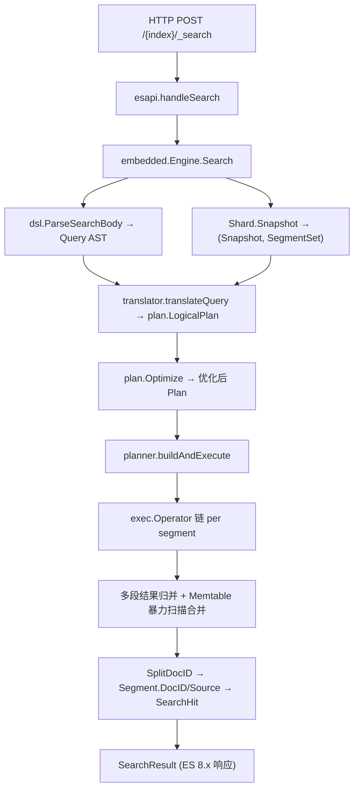
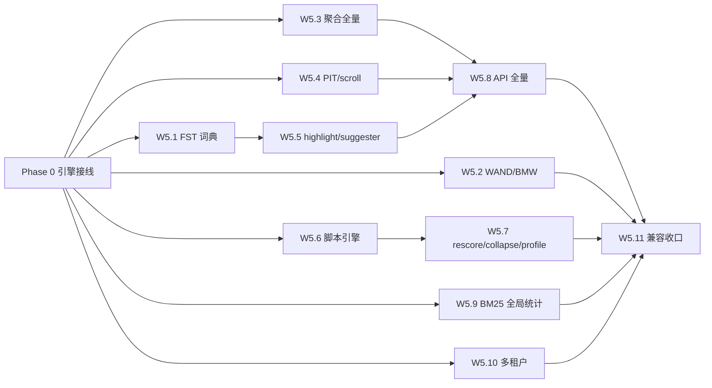

# Proposal: M0 引擎接线 + M1 ES 兼容 GA 全量

## 1. 背景与动机 (Background & Motivation)

### 1.1 当前问题

UniSearch 是一个自研向量+全文搜索引擎，对标 Elasticsearch 兼容 API，分 M0-M3 四个里程碑。M0 嵌入式 MVP 的各引擎组件已**组件级实现并通过全部 R1-R18 验收测试**（`go build`/`go test`/`go vet` 全绿），包括：

- **存储引擎** `internal/storage/`：段格式 v1、MemTable、WAL、Flush、size-tiered 合并、Shard 聚合根
- **索引引擎** `internal/index/`：HNSW（CSR+SQ8+Cross-Link）、倒排（排序数组词典+roaring posting+BM25）、标量（BKD/Bitmap/Bloom）、7 个分析器
- **查询引擎** `internal/engine/`：DSL 子集解析、Plan 优化器（R1-R4/R6）、Volcano 向量化执行、RRF/weighted 融合
- **ES 兼容 REST API** `internal/server/esapi/`：40+ 路由，ES 8.x 响应形状

但存在两个关键缺口：

1. **系统级集成缺口（最关键）**：`internal/embedded/engine.go` 是极简内存引擎（`map` + JSONL，`_search` 只做子串匹配），真正的引擎栈（storage.Shard + HNSW + 倒排 + Volcano 执行器 + 优化器 + 融合）**未接线到 HTTP 服务层**。该文件注释明确写"完整引擎接线要到 M1"。

2. **收官交付物缺口**：Docker 容器化、RAG demo、1 亿文档基准报告、CI 配置、Go 原生 fuzz 测试缺失（可后补，不阻塞 M1 启动）。

### 1.2 用户期望

- 先补齐系统级集成（引擎栈接线到 HTTP 服务），让 `_search` 走真正的 BM25 + HNSW 混合检索
- 验收后一次性完成 M1 ES 兼容 GA 全部 W5.1-W5.11 任务
- M1 出口门禁：elasticsearch-py/go-elasticsearch 测试套件通过率 ≥90% + 兼容矩阵报告（✅ 占比 ≥80%）

## 2. 目标 (Objective)

1. **Phase 0 — M0 引擎接线**：将 storage.Shard + index（HNSW/倒排/标量）+ engine（DSL/Plan/Exec/Fusion）接线到 HTTP 服务层，使 `_search` 走真实引擎栈而非子串匹配
2. **Phase 1-11 — M1 ES 兼容 GA**：完成 W5.1-W5.11 全部 11 个任务，达成 elasticsearch-py 测试套件通过率 ≥90%
3. **设计文档一致性**：所有实现与 `docs/go-design/` 详细设计文档的接口签名无偏离

## 3. 方案设计 (Approach)

### 3.1 设计原则

- **接口先行，渐进替换**：M0 已定义 `TermDict`、`Engine`、`LoadedIndex` 等接口，M1 在接口契约不变的前提下替换实现（如 FST 替换数组词典）
- **Phase 0 优先，M1 串行依赖**：引擎接线是 M1 兼容层的地基，必须先完成验收
- **矩阵分级，金标准门禁**：ES DSL 兼容长尾深不见底（风险 R1），采用矩阵分级 + ≥90%（非 100%）门禁 + 差异清单发布
- **自研为主，CGO_ENABLED=0**：FST/HLL/t-digest 均自研，保持单一静态二进制约束

### 3.2 核心方案

#### Phase 0: M0 引擎接线

当前 `esapi.Engine` 接口有 17 个方法，`embedded.Engine` 全部实现但 Write/Get/Delete/Search/Count/Refresh 六个核心方法走极简内存引擎。接线方案是将这些方法改为调用真实引擎栈：



**接线后 _search 完整调用链路**：

```
HTTP POST /{index}/_search
  → esapi.handleSearch → s.engine.Search(ctx, indices, body)
  → embedded.Engine.Search:
    1. dsl.ParseSearchBody(body) → (Query, from, size)
    2. manager.getIndex(indexName) → *indexState
    3. idx.shard.Snapshot() → (snap, *SegmentSet)
    4. translator.translateQuery(query, idx, snap, segSet, from, size) → plan.LogicalPlan
    5. plan.Optimize(logicalPlan, sel, k) → (optimizedPlan, trace)
    6. planner.buildAndExecute(ctx, optimizedPlan, idx, snap, segSet, from, size)
       - 遍历 SegmentSet.Items()，为每个 segment 构造 exec.Operator 链
       - 多 segment 合并：逐段 Pull，收集结果内存归并排序
       - Memtable 暴力扫描：Shard.Iterate + 谓词过滤 + 评分
       - 结果组装：SplitDocID → Segment.DocID/Source → SearchHit
  → reshapeHits → writeJSON (ES 8.x 响应骨架)
```

**需处理的接缝问题**：

| 接缝 | 问题 | 解决方案 |
|------|------|---------|
| meta ↔ shard | meta 用字段名，Shard 用 FieldID，无桥接 | indexState 维护 fieldIDs/fieldDefs 映射，持久化到 IndexMeta.FieldIDs |
| shard ↔ 索引 | FlushWorker 只构建 HNSW，不构建倒排/标量 | 扩展 flush.go，新增 buildInvertedIndexes/buildScalarIndexes |
| 查询 ↔ 执行 | DSL→Plan、Plan→Exec 翻译函数不存在 | 新建 translator.go + planner.go |
| 多 segment | exec 算子只操作单 segment | planner 中实现多段扇出 + 内存归并 |
| memtable 搜索 | 未 flush 数据无索引 | planner 中对 memtable 走暴力扫描路径 |
| _source 取回 | exec 产出 GlobalDocID，需解析回 _id/_source | 结果组装阶段 SplitDocID → Segment.DocID/Source |
| 索引注册 | init() 注册需包被导入 | embedded/engine.go 添加空白导入 |

#### Phase 1-11: M1 ES 兼容 GA

W5.1-W5.11 任务依赖关系与执行顺序：



**关键路径**：Phase 0 → W5.1 → W5.5 → W5.8 → W5.11
**最大并行宽度**：3-4 个任务

### 3.3 技术选型

| 决策点 | 选择 | 理由 |
|--------|------|------|
| FST 实现 | 自研（不依赖第三方） | 设计文档 02 §3.1 指定自研；CGO_ENABLED=0 约束 |
| HLL / t-digest | 自研（可参考 dgryski/axiomhq 实现） | 保持纯 Go + 代码风格一致 |
| 金标准测试 | 翻译 elasticsearch-py 用例为 Go 测试 | 纯 Go 单语言，CI 简单；httptest 驱动嵌入式引擎 |
| go-elasticsearch | 引入 v8 作为测试依赖 | 验证客户端兼容性 |
| 多租户隔离（嵌入式模式） | 查询并发 semaphore + 写入令牌桶（简化 cgroup） | 嵌入式单机无需 cgroup v2 |

## 4. 变更范围 (Impact)

### 4.1 Phase 0 新增文件

| 文件路径 | 说明 |
|----------|------|
| `internal/embedded/manager.go` | IndexManager：索引生命周期管理（map[string]*indexState），FieldID 分配与持久化 |
| `internal/embedded/docparse.go` | JSON→memtable.Row 文档解析器，实现 ApplyInsert 回调 |
| `internal/embedded/translator.go` | DSL AST→plan.LogicalPlan 翻译器，按查询类型分派 |
| `internal/embedded/planner.go` | Plan→Exec 管道构建器 + 多段合并 + memtable 暴力扫描 + 结果组装 |
| `internal/embedded/textcol.go` | 文本/标量列提供器，包装 memtable.ColumnBuilder 供 flush 构建索引 |
| `internal/embedded/engine_test.go` | 接线集成测试（Write/Get/Search/Delete/Bulk/Refresh/Restart） |

### 4.2 Phase 0 修改文件

| 文件路径 | 修改内容 |
|----------|----------|
| `internal/embedded/engine.go` | 完全重写 Engine 结构体和所有方法（核心目标） |
| `internal/storage/flush.go` | 扩展 flushTable：新增 buildInvertedIndexes/buildScalarIndexes + 加载倒排/标量索引到 SegmentEntry.Indexes |
| `internal/meta/model.go` | IndexMeta 新增 FieldIDs map[string]types.FieldID 字段，持久化字段名→FieldID 映射 |
| `test/e2e/embedded_test.go` | E2E 测试适配真实引擎栈（R18 从子串匹配改为 BM25/ANN 评分） |

### 4.3 M1 新增包

| 包路径 | 任务 | 说明 |
|--------|------|------|
| `internal/engine/agg/` | W5.3 | 向量化分组聚合 + HLL++ + t-digest + PartialState + pipeline |
| `internal/engine/highlight/` | W5.5 | unified highlighter（基于 posting positions） |
| `internal/engine/suggest/` | W5.5 | term/phrase suggester（编辑距离）+ completion（FST 前缀） |
| `internal/engine/script/` | W5.6 | painless 子集 AST 直译 + 向量函数 + 步数预算 |
| `internal/engine/profile/` | W5.7 | profile tracer + render（对齐 ES profile 结构） |
| `internal/engine/stats/` | W5.9 | BM25 全局统计表 + 段 footer term_stats 上报 |
| `internal/tenant/` | W5.10 | 资源组 + 四维配额 + 查询并发 semaphore + 写入令牌桶 + 429 背压 |
| `internal/index/inverted/fst.go` | W5.1 | 自研 FST 词典 |
| `internal/index/inverted/fuzzy.go` | W5.1 | Levenshtein 自动机（状态数上限 32） |
| `internal/index/inverted/wand.go` | W5.2 | WAND/Block-Max WAND 词项剪枝 |
| `internal/server/esapi/pit.go` | W5.4 | PIT 生命周期管理（TTL + LRU） |
| `internal/server/esapi/scroll.go` | W5.4 | scroll 转译 PIT + search_after |
| `internal/server/esapi/msearch.go` 等 | W5.8 | _msearch/_field_caps/_terms_enum/_explain/by_query/_reindex/template/ILM |
| `test/golden/` | W5.11 | elasticsearch-py 用例翻译为 Go 测试 |
| `test/compat/` | W5.11 | 兼容矩阵报告生成器 + 差异清单 |
| `test/integration/` | W5.11 | TestServer + TestClient 测试基础设施 |

### 4.4 M1 修改关键文件

| 文件路径 | 修改内容 |
|----------|----------|
| `internal/index/inverted/dict.go` | W5.1：TermDict 从排序数组→FST 实现（接口不变） |
| `internal/index/inverted/index.go` | W5.2：SearchTerms 改用 WAND；W5.9：使用全局统计 |
| `internal/engine/exec/operators.go` | W5.2/W5.3/W5.7：BM25ScoreOp 集成段上界剪枝、新增 AggregateOp/RescoreOp/CollapseOp |
| `internal/engine/plan/logical.go` + `optimizer.go` | W5.3：新增 Aggregate 节点 + 优化规则 |
| `internal/engine/dsl/ast.go` + `parser.go` | W5.6：新增 ScriptScore/Script query |
| `internal/server/esapi/router.go` | W5.4/W5.8：大量新路由 |
| `internal/server/esapi/engine.go` | W5.8：Engine 接口新增方法 |
| `internal/server/esapi/handlers.go` | W5.7/W5.8：profile 响应 + 新 API 处理器 |
| `internal/embedded/engine.go` + `translator.go` + `planner.go` | W5.3-W5.10：渐进集成所有 M1 能力 |
| `internal/storage/shard.go` | W5.4：快照 pin 机制 |
| `internal/storage/flush.go` | W5.9：flush 时上报 term_stats |
| `internal/config/config.go` | W5.10：多租户配置 |

### 4.5 不涉及

- **M0 收官交付物**：Docker 容器化、RAG demo 应用、1 亿文档基准报告（B1/B2/B6/B9）、CI 配置、Go 原生 fuzz 测试 — 可后补，不阻塞 M1
- **M2 分布式**：Raft 元数据集群、对象存储 WAL、存算分离、在线分裂 — M2 范围
- **M3 生态**：GPU CAGRA、内置 rerank、geo_shape、percolate 完整化、插件 SDK — M3 范围
- **avo 汇编优化**：M0 预留接口，纯 Go 基线已满足 M0/M1 性能需求
- **gRPC 协议**：M2 范围，M1 仅 REST API

## 5. 接口定义 (Interface Definition)

### 5.1 Phase 0 核心接口

**esapi.Engine 接口**（已存在，17 个方法，接线后实现变更）：
```go
type Engine interface {
    Write(ctx, index string, doc esapi.Doc, refresh bool) (DocResult, error)
    Bulk(ctx, index string, items []BulkItem, refresh bool) (BulkResult, error)
    Get(ctx, index, id string) (GetResult, error)
    MGet(ctx, index string, ids []string) (MGetResult, error)
    Delete(ctx, index, id string) (DocResult, error)
    Search(ctx, indices []string, body []byte) (*SearchResult, error)
    Count(ctx, indices []string, body []byte) (CountResult, error)
    PutMapping(ctx, index string, mapping json.RawMessage) error
    GetMapping(ctx, index string) (json.RawMessage, error)
    PutSettings(ctx, index string, settings json.RawMessage) error
    GetSettings(ctx, index string) (json.RawMessage, error)
    PutAlias(ctx, index string, body json.RawMessage) error
    GetAliases(ctx, index string) (AliasResult, error)
    Analyze(ctx, index string, body json.RawMessage) (AnalyzeResult, error)
    Refresh(ctx, index string) error
    Indices(ctx) (IndicesResult, error)
    Health() (HealthResult, error)
}
```

**storage.Shard 写入/读取 API**（已存在，接线后被 Engine 调用）：
```go
func OpenShard(ctx, cfg ShardConfig) (*Shard, error)
func (s *Shard) Write(ctx, ops []WriteOp) (types.SeqNo, error)
func (s *Shard) Snapshot() (types.Snapshot, *SegmentSet)
func (s *Shard) LookupID(ctx, id string, snap types.Snapshot) (LookupResult, bool)
func (s *Shard) Iterate(snap types.Snapshot, fn func(row RowView) bool)
func (s *Shard) FlushAll(ctx) error
```

### 5.2 M1 新增关键接口

**W5.1 TermDict（接口不变，实现替换）**：
```go
type TermDict interface {
    Get(term []byte) (TermID, bool)
    Fingerprint(term []byte) uint64
    Iterate(prefix []byte) TermIterator
}
```

**W5.3 聚合 PartialState 协议**：
```go
type PartialState interface {
    Merge(other PartialState) PartialState
    Finalize() (json.RawMessage, error)
}
```

**W5.4 PIT 生命周期**：
```go
type PITManager interface {
    Create(index string, ttl time.Duration) (pitID string, err error)
    Search(pitID string) (snap types.Snapshot, err error)
    Delete(pitID string) error
}
```

**W5.6 脚本引擎**：
```go
type Evaluator interface {
    Eval(ctx *ScriptCtx) (any, error)
}
```

## 6. 稳定性架构 (Stability Architecture)

### 6.1 限流与熔断

- **多租户配额（W5.10）**：四维配额 — 存储字节 / 向量条数 / 查询 QPS / 写入 TPS。超额返回 `429` + 租户标识错误体
- **写入 TPS 令牌桶**：per-tenant 令牌桶控制写入速率
- **查询并发 semaphore**：per-tenant 并发预算，防止单租户耗尽资源
- **_reindex 限速（W5.8）**：`requests_per_second` 令牌桶 + 批量大小 1000 docs/批

### 6.2 资源隔离与限制

- **嵌入式模式**：单进程，全部资源可用，多租户通过查询并发 semaphore + 写入令牌桶隔离（简化 cgroup v2）
- **PIT 资源限制（W5.4）**：TTL 5 分钟，LRU 上限 10000 个，段延迟删除机制支撑视图稳定
- **脚本步数预算（W5.6）**：painless 求值步数上限 10 万步，超限中断报错

### 6.3 灾难恢复

- **WAL 崩溃恢复（M0 已实现）**：kill -9 后 WAL 回放零丢失，group commit + CRC32c + 256MB 滚动
- **重启恢复**：Close 引擎 → 重新 New(dataDir) → WAL replay + segment 恢复 + meta 重建 fieldIDs/fieldDefs
- **MVCC 快照隔离**：查询走 Snapshot，flush/merge 期间查询零错误不重不漏

## 7. 可测性设计 (Testability Design)

### 7.1 本地手动验证

- Step 1: `make build` — 验证 `go build ./...` 成功（CGO_ENABLED=0）
- Step 2: `make test` — 验证 `go test ./...` 全绿
- Step 3: `./unisearch --embedded --data-dir /tmp/unisearch-test --listen :9200` — 启动嵌入式引擎
- Step 4: `curl -X PUT localhost:9200/test-index` — 创建索引
- Step 5: `curl -X POST localhost:9200/test-index/_bulk -H 'Content-Type: application/x-ndjson' -d '{"index":{"_id":"1"}}\n{"title":"hello world","vec":[0.1,0.2,...]}\n'` — 批量写入
- Step 6: `curl -X POST localhost:9200/test-index/_search -d '{"query":{"match":{"title":"hello"}}}'` — 验证 BM25 评分排序（非子串匹配）
- Step 7: `curl -X POST localhost:9200/test-index/_search -d '{"query":{"knn":{"vec":{"vector":[0.1,0.2,...],"k":10}}}}'` — 验证 ANN 召回
- Step 8: Ctrl+C → 重启 → `curl localhost:9200/test-index/_search` — 验证 WAL+segment 恢复

### 7.2 自动化测试策略

**Phase 0 测试**：
- **Unit Tests**: `embedded/engine_test.go`（Write/Get/Search match/knn/term/range/bool/hybrid/delete/bulk/refresh/restart）、`translator_test.go`、`planner_test.go`、`docparse_test.go`
- **E2E Tests**: `test/e2e/embedded_test.go`（R18 适配真实引擎栈）

**M1 测试**：
- **Unit Tests**: 各新包单测（agg/highlight/suggest/script/profile/stats/tenant/fst/wand）
- **Integration Tests**: `test/integration/`（TestServer + TestClient 驱动嵌入式引擎）
- **Golden Tests**: `test/golden/`（elasticsearch-py 用例翻译为 Go 测试，按 API 分组，断言 HTTP 状态码 + JSON 结构）
- **Client Compat**: `test/goes/`（go-elasticsearch v8 客户端调用所有已实现端点）
- **Compat Matrix**: `test/compat/`（通过率自动生成兼容矩阵报告 + 差异清单）

## 8. 风险与缓解 (Risks & Mitigation)

| 风险 | 影响 | 缓解措施 |
|------|------|----------|
| FST 自研超预期（W5.1, R6） | M1 延期 | 接口先行（M0 已定义 TermDict），FST 可独立替换，其余任务先用数组词典继续 |
| 金标准通过率冲刺困难（W5.11, R1） | GA 延期 | 矩阵分级 + ≥90%（非 100%）门禁 + 差异清单发布 |
| 聚合类型繁多（W5.3） | W5.3 延期 | 先实现核心 6 类（sum/avg/min/max/count/cardinality），其余渐进；pipeline 依赖 PartialState 协议先行 |
| 引擎接线接缝复杂（Phase 0） | Phase 0 延期 | 按 11 步依赖排序逐步实施，每步可独立验证 |
| 倒排全自研质量（R10） | BM25/fuzz 行为偏离 | Lucene 行为金标样本对拍（M0 已实现 <1e-9 数值对齐），持续模糊测试 |

## 9. 验收标准 (Acceptance Criteria)

### Phase 0 验收
- [ ] `go build ./...` / `go test ./...` / `go vet ./...` 全绿
- [ ] 嵌入式模式 `_search` 走真实引擎栈（BM25 + HNSW + Fusion），非子串匹配
- [ ] 写入→flush→搜索→删除→重启恢复全链路通过
- [ ] HTTP API 响应形状不变（ES 8.x 兼容）

### M1 出口验收
- [ ] **elasticsearch-py/go-elasticsearch 测试套件通过率 ≥90%**
- [ ] 兼容矩阵报告（✅ 占比 ≥80%）
- [ ] W5.1-W5.11 全部 DoD 勾选
- [ ] `go vet ./...` 零报告
- [ ] 所有新包有单测
- [ ] 实现与 `docs/go-design/` 接口签名无偏离

### 设计文档联动
- [ ] [00 §7] 痛点对策映射表逐条落地证据（基准/金标准报告）
- [ ] 设计文档小节标注的 [M1] 能力全部实现
