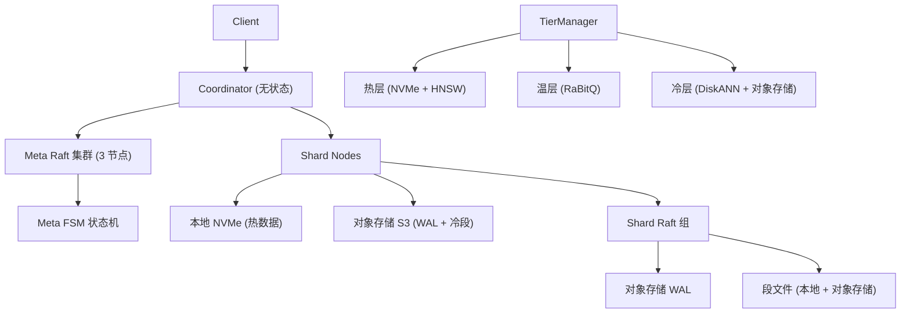
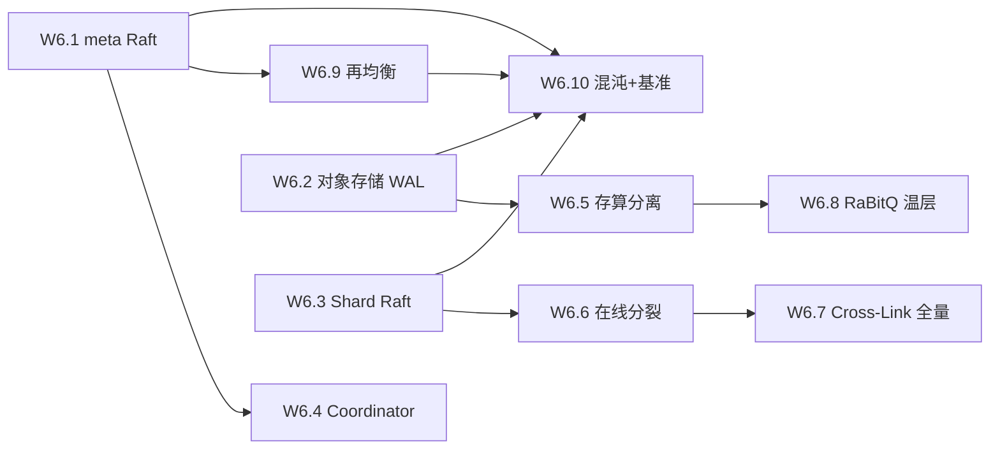

# Proposal: M2 云原生 GA 全量 W6.1-W6.10

## 1. 背景与动机 (Background & Motivation)

### 1.1 当前问题

UniSearch M0 嵌入式 MVP 和 M1 ES 兼容 GA 已完成核心代码实现：
- M0：单机存储引擎 + HNSW-SQ8 + 倒排 BM25 + DSL 子集 + 基础 REST API + 引擎接线（14 项全部完成）
- M1：FST 词典 + WAND/BMW + 聚合全量 + PIT/scroll + highlight/suggester + 脚本引擎 + profile + API 全量 + BM25 全局统计 + 多租户 + 兼容收口（11 项全部完成，9 个集成 Gap 全部关闭，golden 27/27 = 100%）

当前系统是单机嵌入式模式（`--embedded`），数据全部落本地盘。M2 需要将系统升级为云原生分布式架构，支持：
- Raft 元数据集群（3 节点选举/恢复）
- 对象存储 WAL（存算分离）
- 分片 Raft 组（kill -9 RTO <30s）
- Coordinator 层（ingest 攒批/背压 + query MPP）
- 在线分裂（分裂期双杀零感知）
- 冷热分层（DiskANN 冷层）
- Cross-Link Merge 全量
- RaBitQ 温层量化
- 混沌演练 + 10 亿向量基准

### 1.2 用户期望

- 单二进制多角色部署：`unisearch --cloud --role meta|coordinator|shard`
- hashicorp/raft 元数据集群，3 节点选举/恢复
- S3 兼容对象存储（MinIO 本地测试）
- protobuf + gRPC 节点通信
- C1-C6 全量混沌测试
- 10 亿向量集群基准 + 混沌演练报告

## 2. 目标 (Objective)

1. **W6.1-W6.10 全量实现**：完成 development-plan.md §4 的全部 10 个任务
2. **单二进制多角色**：同一二进制支持 `--cloud --role meta|coordinator|shard`
3. **三线并行**：meta Raft / 对象存储 WAL / 在线分裂可并行推进
4. **出口门禁**：混沌报告全绿 + 10 亿基准 + 存算分离成本报告

## 3. 方案设计 (Approach)

### 3.1 设计原则

- **单二进制多角色**（设计 00 §5.2）：同一二进制，`--cloud --role` 切换角色
- **三线并行**（development-plan.md §1）：meta Raft / WAL / 分裂三线独立推进
- **接口先行**：先定义 gRPC proto + Raft FSM 接口，再实现
- **嵌入式兼容**：`--embedded` 模式保持不变，`--cloud` 模式新增

### 3.2 核心架构



### 3.3 任务依赖与执行顺序



**关键路径**：W6.1 → W6.4 → W6.9 → W6.10
**三线并行**：W6.1 ∥ W6.2 ∥ W6.3（第 1-6 周并行）

### 3.4 技术选型

| 决策点 | 选择 | 理由 |
|--------|------|------|
| Raft 实现 | hashicorp/raft | 设计 05 §1 指定，Go 生态最成熟 |
| 对象存储 | S3 兼容接口（MinIO 测试） | 设计 05 §2 指定，MinIO 本地开发 |
| 部署模型 | 单二进制 `--cloud --role` | 设计 00 §5.2 指定 |
| 节点通信 | protobuf + gRPC | 设计 05 §7 指定 |
| 混沌测试 | C1-C6 全量 | 设计 05 §9 指定 |

## 4. 变更范围 (Impact)

### 4.1 新增模块

| 模块路径 | 任务 | 说明 |
|----------|------|------|
| `internal/raft/` | W6.1 | hashicorp/raft 封装 + FSM + 快照 + Watch |
| `internal/objstore/` | W6.2 | S3 客户端封装 + LogStore 落 S3 |
| `internal/coordinator/` | W6.4 | Query/Ingest 协调器（无状态） |
| `internal/storage/tiering/` | W6.5 | TierManager + 冷热分层 + DiskANN |
| `api/proto/` | W6.1/W6.4 | gRPC 协议定义（shard.proto/meta.proto） |
| `test/chaos/` | W6.10 | 混沌编排 C1-C6 |

### 4.2 修改现有模块

| 模块路径 | 修改内容 |
|----------|----------|
| `internal/meta/` | 从单机 JSON+fsync 升级为 Raft FSM（接口不变） |
| `internal/storage/` | WAL 支持对象存储双写；段支持对象存储加载 |
| `internal/tenant/` | 扩展为 dedicated/cold 模式 |
| `cmd/unisearch/` | 新增 `--cloud --role` 模式 |
| `internal/config/` | 新增云原生配置（集群地址、S3 配置等） |

### 4.3 新引入依赖

| 依赖 | 用途 | 任务 |
|------|------|------|
| `github.com/hashicorp/raft` | Raft 共识算法 | W6.1 |
| `github.com/hashicorp/raft-boltdb` | Raft 日志持久化 | W6.1 |
| `github.com/minio/minio-go/v7` | S3 兼容对象存储客户端 | W6.2 |
| `google.golang.org/grpc` | gRPC 通信 | W6.1/W6.4 |
| `google.golang.org/protobuf` | protobuf 编解码 | W6.1/W6.4 |

### 4.4 不涉及

- **嵌入式模式**：`--embedded` 保持不变，M0/M1 功能不受影响
- **M3 生态**：GPU CAGRA、内置 rerank、geo_shape、percolate、插件 SDK — M3 范围

## 5. 接口定义 (Interface Definition)

### 5.1 云原生进程模型

```go
// cmd/unisearch/server.go — 新增 cloud 模式
func runCloud(cfg *config.Config) error {
    switch cfg.Cloud.Role {
    case "meta":
        return raft.RunMetaNode(cfg)
    case "coordinator":
        return coordinator.RunCoordinator(cfg)
    case "shard":
        return shard.RunShardNode(cfg)
    default:
        return fmt.Errorf("unknown cloud role: %s", cfg.Cloud.Role)
    }
}
```

### 5.2 Raft FSM 接口

```go
// internal/raft/fsm.go
type MetaFSM interface {
    Apply(cmd []byte) any      // FSM 命令应用
    Snapshot() (io.ReadCloser, error)  // 状态快照
    Restore(rc io.ReadCloser) error    // 状态恢复
}
```

### 5.3 gRPC 协议

```protobuf
// api/proto/shard.proto
service ShardService {
    rpc Search(SearchRequest) returns (SearchResponse);
    rpc Write(WriteRequest) returns (WriteResponse);
    rpc TransferSegment(SegmentTransfer) returns (TransferAck);
}

// api/proto/meta.proto
service MetaService {
    rpc GetIndexMeta(IndexRequest) returns (IndexMetaResponse);
    rpc AllocateShard(AllocateRequest) returns (AllocateResponse);
    rpc ReportHeartbeat(Heartbeat) returns (HeartbeatAck);
}
```

## 6. 稳定性架构 (Stability Architecture)

### 6.1 限流与熔断

- **Coordinator 背压**：ingest 攒批 + 令牌桶限速（设计 05 §6）
- **Shard 写入限流**：WAL 追赶协议 + 慢 IO 降级（设计 05 §2）
- **查询超时**：Coordinator 级别的查询超时 + 部分分片超时不阻塞

### 6.2 资源隔离与限制

- **存算分离**：段文件在对象存储，本地 NVMe 做缓存（设计 01 §9）
- **冷热分层**：热层 HNSW (NVMe) / 温层 RaBitQ / 冷层 DiskANN (对象存储)
- **多租户**：dedicated 独占 / shared-shard 混部 / cold 暂停

### 6.3 灾难恢复

- **kill -9 恢复**：Shard Raft 组故障接管，RTO <30s（W6.3 DoD）
- **网络分区**：Raft quorum 自动处理，少数派节点只读降级
- **在线分裂**：分裂期间双杀零感知（W6.6 DoD）

## 7. 可测性设计 (Testability Design)

### 7.1 本地手动验证

- Step 1: `make build` — 编译单二进制
- Step 2: 启动 3 节点 MinIO + 3 节点 meta 集群
- Step 3: `./unisearch --cloud --role meta --raft-addr :8080 --data-dir /tmp/meta1`
- Step 4: `./unisearch --cloud --role shard --meta-addr localhost:8080`
- Step 5: `./unisearch --cloud --role coordinator --meta-addr localhost:8080 --listen :9200`
- Step 6: `curl localhost:9200/_cluster/health` — 验证集群状态

### 7.2 自动化测试策略

- **Unit Tests**: raft FSM、objstore 客户端、coordinator 路由、tiering 策略
- **Integration Tests**: 3 节点 meta 集群选举/恢复、shard 故障接管
- **Chaos Tests**: C1-C6 混沌场景（kill -9 / 网络分区 / 慢 IO / 分裂双杀 / 分裂重试 / 脑裂）
- **Benchmark**: 10 亿向量基准（B2/B5/B9 规模版）

## 8. 风险与缓解 (Risks & Mitigation)

| 风险 | 缓解措施 |
|------|----------|
| hashicorp/raft 集成复杂 | 先实现 FSM 接口，再用 hashicorp/raft 驱动；M0 meta 单机形态接口不变 |
| 对象存储 WAL 延迟 | NVMe 双写热路径 + S3 异步追赶（设计 05 §2） |
| 在线分裂期间数据一致性 | Gen 双版本 + 位图继承 + crosslinks 重定向（设计 05 §3） |
| 10 亿向量基准资源 | 先 1 亿规模验证，再扩展到 10 亿 |
| gRPC 引入增加编译复杂度 | proto 定义先行，gRPC 服务逐步迁移 |

## 9. 验收标准 (Acceptance Criteria)

### M2 出口评审

- [ ] **混沌报告全绿**：C1-C6 全部通过
- [ ] **10 亿基准**：B2/B5/B9 规模版归档
- [ ] **存算分离成本报告**：对象存储 vs 全 NVMe 成本对比
- [ ] `go build ./...` / `go test ./...` / `go vet ./...` 全绿
- [ ] 嵌入式模式 `--embedded` 不受影响

### 各任务 DoD

- [ ] W6.1: 3 节点选举/恢复注入测试通过
- [ ] W6.2: C3 慢 IO 注入 P99 退化 <2×
- [ ] W6.3: C1 kill -9 RTO <30s
- [ ] W6.4: 分片预聚合归并正确性对拍单机
- [ ] W6.5: 冷段查询 + 召回补偿验证
- [ ] W6.6: C5 分裂期双杀；查询零感知
- [ ] W6.7: B10 召回 ≥ 基线-2% + 合并耗时对比报告
- [ ] W6.8: 召回 ≥95% + 内存 1/32 验证
- [ ] W6.9: 迁移期间查询零错误
- [ ] W6.10: 演练报告 + 10 亿向量基准归档
