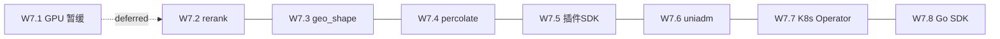

# Proposal: M3 生态与进阶 W7.2-W7.8（W7.1 GPU 暂缓）

## 1. 背景与动机 (Background & Motivation)

### 1.1 当前问题

UniSearch M0 嵌入式 MVP、M1 ES 兼容 GA、M2 云原生 GA 的核心引擎和分布式架构已完成。M3 生态与进阶是项目路线图的最后一个里程碑，目标是让 UniSearch 从"可用"升级为"可迁移、可扩展、可运营"：

- **可迁移**：uniadm es-compat 工具帮助 ES 存量用户评估和迁移
- **可扩展**：插件 SDK 支持第三方扩展；geo_shape/percolate 补全 ES 兼容矩阵
- **可运营**：K8s Operator 自动化运维；Go/Python SDK 对外 API
- **可增强**：内置 rerank 模型提升检索质量

M3 出口评审标准：**首个 ES 存量用户整体迁移案例**（uniadm 报告 → 迁移 → 金标准回归通过）。

### 1.2 用户期望

- W7.1 GPU CAGRA **暂缓**（CPU HNSW 已满足当前需求）
- W7.2 内置 rerank 使用**本地 ONNX 推理**（内置小型模型，延迟 <50ms）
- W7.8 **Go SDK 优先**，Python SDK 后续追加
- M3 各项独立可并行（development-plan.md §1 指定）

## 2. 目标 (Objective)

1. **W7.2-W7.8 全量实现**：完成 development-plan.md §5 的 7 个任务
2. **M3 出口评审**：首个 ES 存量用户整体迁移案例（uniadm 报告 → 迁移 → 金标准回归通过）

## 3. 方案设计 (Approach)

### 3.1 设计原则

- **各项独立可并行**（development-plan.md §1）：W7.2-W7.8 互不依赖
- **W7.1 GPU 暂缓**：标记为 deferred，代码不实现，后续按需启动
- **ONNX 本地推理**：内置小型 rerank 模型，不依赖外部服务
- **Go SDK 优先**：复用现有 HTTP/gRPC 客户端，Python SDK 后续

### 3.2 任务依赖与执行顺序



**全部并行**：W7.2-W7.8 无内部依赖，可同时推进。

### 3.3 技术选型

| 决策点 | 选择 | 理由 |
|--------|------|------|
| W7.1 GPU CAGRA | 暂缓 | CPU HNSW 已满足；sidecar 进程复杂度高 |
| W7.2 rerank | 本地 ONNX 推理 | 内置小型模型（MiniLM），延迟 <50ms，不依赖外部服务 |
| W7.8 SDK | Go 优先 | 复用 HTTP/gRPC 客户端，Python 后续追加 |

## 4. 变更范围 (Impact)

### 4.1 新增模块

| 模块路径 | 任务 | 说明 |
|----------|------|------|
| `internal/engine/rerank/` | W7.2 | ONNX 本地推理 + 模型加载 + 打分 |
| `internal/engine/percolate/` | W7.4 | 查询即文档存储与匹配引擎 |
| `internal/plugin/` | W7.5 | 插件 SDK（进程内注册 + sidecar 协议） |
| `cmd/uniadm/escompat/` | W7.6 | ES 存量扫描评估工具 |
| `deploy/k8s/operator/` | W7.7 | K8s Operator CRD + controller |
| `pkg/unisdk/` | W7.8 | Go SDK（HTTP/gRPC 客户端） |
| `pkg/unisdkpy/` | W7.8 | Python SDK（后续追加） |

### 4.2 修改现有模块

| 模块路径 | 修改内容 |
|----------|----------|
| `internal/engine/fusion/fusion.go` | rerank 分支扩展（当前返回 ErrUnsupportedMethod） |
| `internal/index/scalar/` | BKD 面/线编码扩展（geo_shape） |
| `internal/index/registry.go` | 插件 RemoteIndex 接口 |
| `cmd/uniadm/main.go` | es-compat 子命令骨架 |
| `internal/engine/dsl/parser.go` | 解除 percolate/geo_shape unsupported 限制 |

### 4.3 新引入依赖

| 依赖 | 用途 | 任务 |
|------|------|------|
| `github.com/yalue/onnxruntime_go` | ONNX Runtime Go 绑定 | W7.2 |
| `k8s.io/client-go` | K8s Operator 客户端 | W7.7 |
| `k8s.io/apimachinery` | K8s CRD 类型 | W7.7 |

### 4.4 不涉及

- **W7.1 GPU CAGRA**：暂缓，不实现 sidecar 进程，不引入 CUDA/ GPU 依赖
- **嵌入式/M1/M2 核心引擎**：不修改存储/索引/查询引擎核心逻辑

## 5. 接口定义 (Interface Definition)

### 5.1 Rerank 接口（W7.2）

```go
// internal/engine/rerank/reranker.go
type Reranker interface {
    Rerank(query string, docs []RerankDoc) ([]RerankResult, error)
}
type RerankDoc struct {
    ID     string
    Title  string
    Content string
}
type RerankResult struct {
    ID    string
    Score float64
}
```

### 5.2 插件 SDK 接口（W7.5）

```go
// internal/plugin/registry.go
type RemoteIndex interface {
    Build(ctx, provider, output) error
    Load(input) (LoadedIndex, error)
    Search(ctx, query, budget) (*SearchResult, error)
}
```

### 5.3 Go SDK 接口（W7.8）

```go
// pkg/unisdk/client.go
type Client struct { ... }
func NewClient(addr string) *Client
func (c *Client) Index(ctx, index, id string, doc any) (*IndexResult, error)
func (c *Client) Search(ctx, index string, body []byte) (*SearchResult, error)
func (c *Client) Bulk(ctx, body []byte) (*BulkResult, error)
```

## 6. 验收标准 (Acceptance Criteria)

### M3 出口评审

- [ ] **首个 ES 存量用户整体迁移案例**（uniadm 报告 → 迁移 → 金标准回归通过）
- [ ] `go build ./...` / `go test ./...` / `go vet ./...` 全绿
- [ ] 嵌入式/云原生模式不受影响

### 各任务 DoD

- [ ] W7.2: rerank 延迟 <50ms（小模型）
- [ ] W7.3: geo_shape 查询族过金标准
- [ ] W7.4: percolate 金标准
- [ ] W7.5: 第三方示例插件
- [ ] W7.6: 对 3 个真实 ES 集群输出报告
- [ ] W7.7: e2e 自动化用例
- [ ] W7.8: SDK 文档 + 版本化承诺
