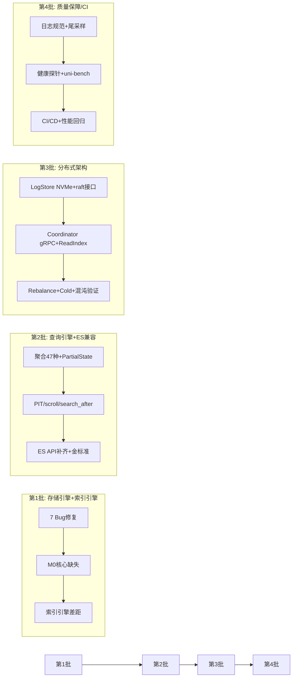

# Proposal: 深度审计差距修复 — 7 Bug + 67 项差距全量补齐

## 1. 背景与动机 (Background & Motivation)

### 1.1 当前问题

对 `docs/go-design/` 7 篇设计文档与 193 个 Go 源文件进行逐文件、逐函数级深度审查后，发现：

- **7 个确认 Bug**：实际代码错误（非设计差距），影响功能正确性
- **67 项差距**：设计要求但未实现/仅 stub/实现质量不达标的功能点

差距按里程碑分布：

| 优先级 | 里程碑 | 项数 | 典型问题 |
|--------|--------|------|----------|
| P0 | M0 缺失 | 15 | memtable搜索TODO、合并后索引未重建、幂等写入缺失、SIMD汇编核 |
| P1 | M1 缺失 | 28 | 聚合类型不足(8+1+0 vs 47)、PIT快照占位、scroll空页、日志规范缺失 |
| P2 | M2 框架 | 14 | LogStore NVMe stub、Coordinator无gRPC client、Raft缺ReadIndex |
| P3 | 基准/CI | 10 | uni-bench完全缺失、无GitHub Workflow、Dockerfile非distroless |

前序 `2026-10-20-gap-fill` 任务已处理 9 个第一轮缺口，本轮在其基础上做深度补充，修复实现质量问题并补齐全部剩余差距。

### 1.2 用户期望

将 7 个 Bug 和 67 项差距全部修复到设计要求标准，使代码实现与设计文档完全对齐。按模块分 4 批交付，每批可独立验证和发布。

## 2. 目标 (Objective)

1. **修复全部 7 个确认 Bug**：CmdUnregisterNode 错误、uploadCh 丢段、highlight 位置错误、别名 Remove 未处理、花括号展开误拆、cancel 泄漏、Makefile fuzz 名称不匹配
2. **补齐 67 项差距到设计标准**：M0 功能完整 → M1 ES 兼容达标 → M2 分布式生产可用 → 质量保障/CI 建成
3. **全量实现 47 种聚合类型**：17 metric + 18 bucket + 12 pipeline，含 PartialState 跨段合并协议

## 3. 方案设计 (Approach)

### 3.1 设计原则

- **按模块分批、批次内独立交付**：每批可独立编译、测试、验证，不依赖后续批次
- **Bug 优先**：7 个 Bug 在第 1 批中首先修复，消除已知错误
- **最小侵入 + 必要重构**：新增模块优先；对架构级差距（聚合框架、memtable 搜索、LogStore 接口）做必要重构
- **测试先行**：每批配套单元测试 + 集成测试，第 3 批含混沌测试验证

### 3.2 批次总览



### 3.3 第 1 批：存储引擎 + 索引引擎（~25 项）

#### 3.3.1 Bug 修复（7 项）

| # | Bug | 修复方案 | 文件 |
|---|-----|---------|------|
| B1 | CmdUnregisterNode 复用 applyDeleteIndex | 新增 `applyUnregisterNode`，从 Members 列表移除指定 NodeID | `internal/raft/fsm.go`, `types.go` |
| B2 | uploadCh 满静默丢日志段 | 改为阻塞发送 + 超时返回 error，增加重试队列 | `internal/objstore/logstore.go` |
| B3 | highlight 放置在响应顶层 | 移入每个 hit 对象内部，与 ES 8.x 格式对齐 | `internal/server/esapi/handlers.go` |
| B4 | 别名 Remove 动作未处理 | 新增 `Engine.RemoveAlias` 方法，在 `_aliases` 循环中处理 `a.Remove` | `internal/server/esapi/handlers.go`, `engine.go` |
| B5 | 花括号展开误拆 | 新增 `expandBraces` 函数，在 `parseIndices` 中先做花括号展开再逗号分隔 | `internal/server/esapi/router.go` |
| B6 | ctxFromReq 丢弃 cancel | 改为 `defer cancel()` 或返回 cancel 供 handler 调用 | `internal/server/esapi/handlers.go` |
| B7 | Makefile fuzz target 名称不匹配 | 修正为 `-fuzz=FuzzParseQuery` | `Makefile` |

#### 3.3.2 存储引擎 P0 缺失（8 项）

| # | 差距 | 方案 |
|---|------|------|
| 1 | 幂等写入 client_id+sequence | `MemTable` 新增 `dedupWindow` LRU map（容量 100 万），`Write` 接口接受 `client_id+sequence`，命中窗口跳过写入 |
| 6 | 合并后未重建倒排/BKD 索引 | `MergeSegments` 中增加 `buildInvertedIndexes` + `buildScalarIndexes` 调用，复用 flush 路径索引构建 |
| 7 | 多 shard 全局 flush 并发限制 | 新增 `FlushLimiter`（`semaphore.NewWeighted(min(4, runtime.NumCPU()/2))`），FlushWorker 获取许可后执行 |
| 8 | track_total_hits/terminate_after | DSL parser 解析这两个字段，`buildAndExecute` 中实现行数阈值提前终止 |
| 9 | checksum 不覆盖子目录 | `checksumManifest` 递归遍历子目录，覆盖 `vec.idx/`、`inv.idx/`、`scalar.idx/` |
| 10 | _bulk 超时 30s 应为 60s | `ctxFromReq` 对 `_bulk` 路径使用 60s 超时 |
| 11 | ?timeout 参数覆盖 | 解析 `?timeout` query 参数，覆盖默认超时值 |
| 12 | refresh=false 不等 fsync | WAL `Append` 增加 `async` 模式，`refresh=false` 时异步提交不等 fsync |

#### 3.3.3 索引引擎差距（10 项）

| # | 差距 | 方案 |
|---|------|------|
| 4 | AVX2/NEON SIMD 汇编核 | 新增 `internal/simd/dist_amd64.s`（avo 生成 AVX2+FMA）+ `dist_arm64.s`（NEON），`simd_asm` build tag 切换 |
| 14 | Iterative 过滤策略 | 10-30% 选择率区间实现 WAND 剪枝与图遍历交替：WAND 产出候选位图 → 图遍历仅入候选 → 不足 k 回退 post-filter |
| 15 | Cross-Link 查询单堆跳段 | `MultiSegmentSearcher` 改为统一候选堆：BFS 经 crosslink 跳段时对端节点入堆，非 route+fan-out |
| 16 | RaBitQ 集成图搜索 | `Graph.searchQuantized` 增加 RaBitQ 路径：Hamming 粗筛 → float32 精排，`quant.state` 序列化/反序列化 |
| 17 | 稀疏向量索引/查询 | 倒排复用：term = `field\x00dim`，posting tf 槽存 `weight×2^8`；新增 `SparseVectorQuery` AST + translator；Fusion 联合 |
| 18 | FST Fingerprint | 新增 `FST.Fingerprint()` min-hash 方法，用于跨段词典比较 |
| 19 | 分析器词典热加载 | gse 词典 mtime 轮询（5s）+ SIGHUP 立即重载，analyzer 实例 per-index 缓存 |
| 20 | Bloom 块级 | 改为每 Block 一个 bloom（1024 条目，fpp 1%），块级预过滤 |
| 21 | max_inner_product 独立类型 | 新增 `MetricMIPS`，构建期不做归一化，查询期直接 ANN |
| 22 | 段格式模糊测试 | 新增 `FuzzSegmentFormat`：随机 footer 破坏 → 明确报错验证 |

### 3.4 第 2 批：查询引擎 + ES 兼容（~28 项）

#### 3.4.1 聚合引擎全量扩展（核心工作量）

**47 种聚合类型实现**：

| 类别 | 设计要求 | 已实现 | 待实现 |
|------|---------|--------|--------|
| Metric | 17 种 | 8（sum/count/min/max/avg/stats/value_count/cardinality） | 9（extended_stats/percentiles/percentile_ranks/top_hits/weighted_avg/median_absolute_deviation/geo_centroid/geo_bounds/boxplot/string_stats） |
| Bucket | 18 种 | 1（terms） | 17（range/date_range/filter/filters/missing/nested/histogram/date_histogram/auto_date_histogram/significant_terms/sampler/global/composite/multi_terms/rare_terms/ip_range/geo_distance） |
| Pipeline | 12 种 | 0 | 12（bucket_sort/bucket_selector/bucket_script/derivative/cumulative_sum/moving_avg/avg_bucket/max_bucket/sum_bucket/stats_bucket/serial_diff/normalize） |

**实现方案**：
- 新增 `internal/engine/agg/bucket/` 子包：每种 bucket 聚合独立文件
- 新增 `internal/engine/agg/pipeline/` 子包：pipeline 聚合基于父桶结果二次计算
- `GroupAggregator` 重构为可插拔 bucket 收集器
- `HashAggregate` 算子化：实现为 `exec.Operator`，支持列批流式聚合

**PartialState 协议**：
- 新增 `internal/engine/agg/partial.go`：`PartialState` protobuf 结构（HLLSketch/TDigestSketch/TopState/SumState oneof）
- 段级 partial 聚合 → 序列化 → 协调器 FinalAgg 合并
- terms 桶合并（同 key 加和）、HLL 寄存器 max、t-digest centroid 归并

#### 3.4.2 深分页链路（5 项）

| # | 差距 | 方案 |
|---|------|------|
| 18 | PIT 快照占位 NewSnapshot(0) | `PITManager.Create` 从 `Shard.Snapshot()` 获取真实 ReadUpTo 水位 |
| 19 | scroll 返回空页 | `handleScroll` 实际执行 search_after 推进：解析 cursor → 下一批搜索 → 返回真实结果 |
| 20 | search_after 无游标比较 | `buildAndExecute` 增加 search_after 模式：sortValues 逐 key 二进制比较，过滤已返回文档 |
| 23 | relative_score 融合 | 新增 `RelativeScoreFusion`：以 BM25F 为基线，向量分映射到 BM25 分布同尺度 |
| 24 | rerank 外部 HTTP | `Reranker` 新增 `HTTPReranker`：POST 外部 `rerank_url`，超时 2s 降级 rrf |

#### 3.4.3 ES 兼容补齐（15 项）

| # | 差距 | 方案 |
|---|------|------|
| 25 | _update_by_query stub | 实现滚动搜索 + 批量更新（painless 子集执行） |
| 26 | _terms_enum stub | 位图索引/词典前缀遍历实现 |
| 27 | _index_template/_ilm 持久化 | 新增 `TemplateStore` + `ILMStore`，meta.Store 持久化 |
| 28 | _cat/shards,nodes,allocation | 新增 3 个 cat handler，从路由表 + 心跳数据消费 |
| 29 | _update/{id} 等未注册路由 | 注册 5 条缺失路由 + 对应 handler |
| 30 | deprecation Warning header | 新增 `setDeprecationWarning` 工具函数，在 doc_values:false/norms/scroll 场景设置 `299` header |
| 31 | 通配索引展开 | `parseIndices` 增加 glob 匹配：从 meta.Store.List() 获取索引名做 pattern 匹配 |
| 32 | if_primary_term 解析 | handler 解析 `if_primary_term` 参数，M0 恒 1 校验 |
| 33 | _bulk 单条 100MB 限制 | NDJSON Scanner 增加 per-line 大小检查 |
| 34 | _search 缺 suggest/profile/inner_hits | 响应组装补齐 suggest/profile 字段；inner_hits 从 collapse 结果提取 |
| 35 | _explain 计划分解 | 执行单文档查询计划 + 打分分解，输出 ES explain 结构 |
| 36 | 兼容金标准改用 ES 官方 yaml | 引入 rest-api-spec yaml 解析器，按矩阵筛选用例执行 |
| 37 | CompatMatrix 硬编码 | 改为从实际测试结果动态生成 |
| 38 | _field_caps 结构偏差 | 二级 key 改为类型名而非索引名 |
| 39 | 指标缺标签维度 | 补全 shard/phase/tier 标签到 6 个缺失指标 |

### 3.5 第 3 批：分布式架构（~14 项）

| # | 差距 | 方案 |
|---|------|------|
| 44 | LogStore NVMe 写入 stub | 实现 `os.WriteFile` + `fsync` 本地双写，Raft quorum 基于 NVMe fsync |
| 45 | LogStore 未实现 raft 接口 | 实现 `hashicorp/raft.LogStore` + `StableStore` 接口，替换 BoltDB |
| 46 | Coordinator 无真实 gRPC client | 新增 `GRPCShardClient`：`grpc.NewClient` 连接 shard 节点，实现 `ShardClient` 接口 |
| 47 | ShardService PullWAL/Snapshot | 实现 `PullWAL`（流式 WAL 段推送）+ `Snapshot`（段文件元数据返回） |
| 48 | MetaServer no-op | 实现 `Apply`（委托 RaftCluster.Apply）+ `Watch`（路由表变更事件流）+ `Heartbeat`（更新 Members） |
| 49 | Raft 读未用 ReadIndex | `RaftCluster.GetIndex` 改为 `raft.ReadIndex()` 实现线性一致读 |
| 50 | Rebalance 无数据迁移 | `RebalanceCoordinator` 增加 hook 机制（类似 SplitCoordinator），实现三阶段：快照拉取→增量同步→路由切换 |
| 51 | Cold 模式无 mmap 操作 | `ColdManager.Pause` 调用 `SegmentReader.Close()`（mmap unmap），`Wakeup` 重新打开段 |
| 52 | 混沌 RunScenario 模拟 | 实现真实 Docker + toxiproxy 编排：`exec` 启动容器、注入故障、采集指标、判定 RTO<30s |
| 53 | Proto Search 非流式 | shard.proto 新增 `SearchStream(SubPlan) returns (stream LocalResult)` RPC |
| 54 | Cross-Link Merge 桩代码 | 实现 `ExecuteMerge` 实际逻辑：列数据合并 + posting 归并 + HNSW 增量插入 + crosslink 重建 |
| 55 | IngestCoordinator 背压/幂等 | 新增 per-shard 队列水位背压（64MB 上限→429）+ client_id+sequence 去重窗口 |
| 56 | tenant/objstore 无测试 | 新增 `tenant_test.go` + `objstore_test.go`，覆盖配额/信号量/S3 客户端 |
| 57 | FSM 命令缺 AddReplica | 新增 `CmdAddReplica`，在已有分片上增加副本节点 |

### 3.6 第 4 批：质量保障 / CI（~10 项）

| # | 差距 | 方案 |
|---|------|------|
| 40 | 日志 6/8 字段缺失 | `slog` handler 增加 tenant/index/shard_id/segment_id/trace_id/span_id 字段提取 |
| 41 | 慢查询日志 | 新增 `SlowQueryLogger`：查询 >1s 时输出 took_ms/shards_scanned/rows_read/plan_summary |
| 42 | 错误日志无 trace_id | panic recovery + writeError 中注入 trace_id 关联 |
| 43 | 尾采样未实现 | 新增 `TailSampler`：错误全采 + 慢查询>1s 全采 + 其余 1%，替换 AlwaysSample |
| 44 | 健康探针硬编码 | `Health()` 根据分片副本状态计算 green/yellow/red + wait_for_status/timeout 参数支持 |
| 45 | uni-bench B1-B10 | 新增 `test/bench/` 包，10 个基准用例 + `make bench` target |
| 46 | 无 .github/workflows | 新增 `ci.yml`：lint + test -race + build + 金标准增量 + 性能回归微缩版 |
| 47 | Dockerfile 非 distroless | 改为 `gcr.io/distroless/static-debian12` 多阶段构建 |
| 48 | 性能回归 CI | 新增 `test/bench/regression_test.go`：B1/B2/B6 微缩版 + ±10% 阈值告警 |
| 49 | Makefile fuzz target 补齐 | 新增段格式 + query_string 两个 fuzz target，修正 Makefile 名称 |

### 3.7 技术选型

| 组件 | 选型 | 理由 |
|------|------|------|
| SIMD 汇编 | `github.com/mmcloughlin/avo` | 设计 00§3.2 指定，Go 写汇编生成器 |
| 聚合框架 | 自研分层 `agg/bucket/` + `agg/pipeline/` | 设计 03§6 要求全量 47 种 |
| ES 金标准 | `rest-api-spec` yaml 解析 | 设计 04§9 要求官方 spec |
| 混沌编排 | Docker + toxiproxy CLI | 设计 05§9 场景 C1-C6 |
| 基准套件 | 自研 `test/bench/` | 设计 06§5.2 B1-B10 |
| CI 平台 | GitHub Actions | 设计 06§6 要求自动化 pipeline |

## 4. 变更范围 (Impact)

### 4.1 新增文件

| 文件路径 | 说明 | 批次 |
|----------|------|------|
| `internal/simd/dist_amd64.s` | AVX2+FMA 汇编核 | 1 |
| `internal/simd/dist_arm64.s` | NEON 汇编核 | 1 |
| `internal/simd/dist_asm.go` | avo 生成器 | 1 |
| `internal/engine/dsl/ast_sparse.go` | SparseVectorQuery AST | 1 |
| `internal/engine/agg/bucket/*.go` | 17 种 bucket 聚合 | 2 |
| `internal/engine/agg/pipeline/*.go` | 12 种 pipeline 聚合 | 2 |
| `internal/engine/agg/partial.go` | PartialState 协议 | 2 |
| `internal/engine/fusion/relative_score.go` | relative_score 融合 | 2 |
| `internal/engine/rerank/http_reranker.go` | 外部 HTTP reranker | 2 |
| `internal/server/esapi/template_store.go` | 索引模板持久化 | 2 |
| `internal/server/esapi/ilm_store.go` | ILM 策略持久化 | 2 |
| `test/golden/es_spec/*.yaml` | ES 官方 rest-api-spec 子集 | 2 |
| `internal/objstore/raft_logstore.go` | raft LogStore/StableStore 实现 | 3 |
| `internal/coordinator/grpc_client.go` | gRPC shard client | 3 |
| `test/chaos/orchestrator.go` | 混沌编排引擎 | 3 |
| `test/bench/bench_test.go` | uni-bench B1-B10 | 4 |
| `test/bench/regression_test.go` | 性能回归测试 | 4 |
| `.github/workflows/ci.yml` | GitHub Actions CI | 4 |

### 4.2 修改文件

| 文件路径 | 修改内容 | 批次 |
|----------|----------|------|
| `internal/raft/fsm.go` | 修复 B1 + 新增 applyUnregisterNode | 1 |
| `internal/objstore/logstore.go` | 修复 B2 + 实现 NVMe 写入 | 1/3 |
| `internal/server/esapi/handlers.go` | 修复 B3/B4/B6 + 补齐缺失 handler | 1/2 |
| `internal/server/esapi/router.go` | 修复 B5 + 补齐路由注册 | 1/2 |
| `Makefile` | 修复 B7 + 新增 bench/fuzz target | 1/4 |
| `internal/storage/memtable/memtable.go` | 幂等写入去重窗口 | 1 |
| `internal/storage/merge.go` | 合并后索引重建 | 1 |
| `internal/storage/flush.go` | 全局 flush 并发限制 | 1 |
| `internal/storage/segment/builder.go` | checksum 递归子目录 | 1 |
| `internal/storage/wal/local.go` | async 模式（refresh=false） | 1 |
| `internal/index/hnsw/filter.go` | Iterative 过滤策略 | 1 |
| `internal/index/hnsw/multi_search.go` | 单堆跨段跳段 | 1 |
| `internal/index/hnsw/quant.go` | RaBitQ 集成 | 1 |
| `internal/index/inverted/fst.go` | Fingerprint 方法 | 1 |
| `internal/index/analyzer/factory.go` | 词典热加载 + per-index 缓存 | 1 |
| `internal/index/scalar/bloom.go` | 块级 bloom | 1 |
| `internal/engine/agg/aggregator.go` | 新增 9 种 metric 聚合 | 2 |
| `internal/engine/exec/operators.go` | HashAggregate 算子化 | 2 |
| `internal/engine/dsl/parser.go` | track_total_hits/terminate_after 解析 | 2 |
| `internal/server/esapi/pit_handlers.go` | PIT 真实快照 + scroll 推进 | 2 |
| `internal/embedded/planner.go` | search_after 游标 + memtable 搜索 | 2 |
| `internal/observability/tracing.go` | 尾采样 | 4 |
| `internal/observability/metrics.go` | 补全标签维度 | 2 |
| `internal/raft/raft_cluster.go` | ReadIndex 线性一致读 | 3 |
| `internal/coordinator/coordinator.go` | gRPC client + 背压 | 3 |
| `internal/tenant/rebalance.go` | 三阶段数据迁移 hook | 3 |
| `internal/tenant/tenant.go` | Cold mmap 操作 | 3 |
| `internal/server/grpc/server.go` | PullWAL/Snapshot/MetaService 实现 | 3 |
| `api/proto/shard.proto` | SearchStream RPC | 3 |
| `cmd/unisearch/server.go` | _bulk 60s 超时 | 1 |
| `Dockerfile` | distroless 多阶段 | 4 |

### 4.3 不涉及

- GPU CAGRA 加速（M3 W7.1，已暂缓）
- 前序 `gap-fill` 任务中已完全实现的 9 项（本轮仅修复其实现质量问题，如指标缺标签、追踪缺尾采样）
- 全新功能设计（本轮是对已有设计的差距修复，不引入设计文档外的新功能）

## 5. 接口定义 (Interface Definition)

### 5.1 幂等写入接口

```
_bulk action line 扩展:
{"index": {"_index": "logs", "_id": "1", "client_id": "app-1", "sequence": 42}}
```

`Shard.Write(ctx, batch WriteBatch)` 中 `WriteBatch` 新增 `ClientID` + `Sequence` 可选字段。

### 5.2 PartialState 协议

```protobuf
message PartialState {
  uint32 agg_id = 1;
  oneof state {
    HLLSketch hll = 2;
    TDigestSketch tdigest = 3;
    TopState top = 4;
    SumState sum = 5;
  }
}
```

### 5.3 聚合算子接口

```go
type BucketCollector interface {
    Collect(key []byte, value any) error
    Result() (*BucketResult, error)
    Merge(other BucketCollector) error
}
```

### 5.4 SearchStream gRPC

```protobuf
rpc SearchStream(SubPlan) returns (stream LocalResult);
```

## 6. 稳定性架构 (Stability Architecture)

### 6.1 限流与熔断

- **幂等去重窗口**：LRU 容量 100 万项，超限淘汰最旧记录
- **LogStore 上传**：channel 容量 256，满时阻塞等待（非丢弃），超时 5s 返回 error
- **rerank 外部 HTTP**：超时 2s 降级为 rrf 融合

### 6.2 资源隔离与限制

- **Flush 全局并发**：`semaphore.NewWeighted(min(4, CPU/2))` 限制同时 flush 的 shard 数
- **memtable 搜索**：复用 `sync.Pool` 池化中间态，查询路径零 >32KB 堆分配

### 6.3 灾难恢复

- **LogStore NVMe 双写**：leader 基于 NVMe fsync 判定 quorum，对象存储异步归档
- **Raft ReadIndex**：读请求走 `raft.ReadIndex()` 保证线性一致
- **Cold 唤醒**：`SegmentReader` 重新 mmap 打开，秒级恢复

## 7. 可测性设计 (Testability Design)

### 7.1 本地手动验证

- **第 1 批**：`go test -race ./internal/storage/... ./internal/index/...` 全绿 + `make fuzz` 4 target 运行
- **第 2 批**：`go test ./internal/engine/agg/...` 47 种聚合往返 + `test/golden/` ES 官方 yaml 通过
- **第 3 批**：`test/chaos/` C1 leader kill 验证 RTO<30s + `docker-compose up` 3 节点集群
- **第 4 批**：`make bench` B1-B10 运行 + `make ci` GitHub Actions 本地模拟

### 7.2 自动化测试策略

| 批次 | 测试类型 | 覆盖范围 |
|------|---------|---------|
| 1 | Unit + Fuzz | 编码往返、SIMD 对齐、幂等去重、WAL 异步、段格式 fuzz |
| 1 | Integration | 合并后索引可搜索、Cross-Link 单堆跳段、RaBitQ 召回率 |
| 2 | Unit + Golden | 47 种聚合数值正确性、PIT/scroll/search_after 端到端、ES yaml spec |
| 3 | Integration + Chaos | 3 节点 Raft 故障转移、在线分裂端到端、Rebalance 数据迁移、RTO<30s |
| 4 | Benchmark + CI | B1-B10 性能指标、性能回归 ±10% 阈值、distroless 镜像构建 |

## 8. 风险与缓解 (Risks & Mitigation)

| 风险 | 缓解措施 |
|------|----------|
| 47 种聚合全量实现工作量大 | 分 metric→bucket→pipeline 三阶段交付，每阶段独立可测 |
| SIMD 汇编核跨平台正确性 | 单测强制对齐 Pure Go 参考实现（随机数据 + 边界 0/1/15/16/17） |
| memtable 搜索实现可能引入并发问题 | 复用 MemTable RWMutex，读路径与写入路径隔离 |
| LogStore raft 接口替换 BoltDB 可能影响 Raft 稳定性 | 保留 BoltDB 作为 fallback，通过 build flag 或配置切换 |
| 混沌测试需要 Docker 环境 | CI 中使用 GitHub Actions docker-compose service |
| 67 项差距交付周期长 | 4 批并行设计、串行交付，每批可独立 merge |

## 9. 验收标准 (Acceptance Criteria)

- [ ] **Bug 修复**: 7 个确认 Bug 全部修复，有对应回归测试
- [ ] **第 1 批**: 存储引擎 + 索引引擎差距修复，`go test -race ./internal/storage/... ./internal/index/...` 全绿
- [ ] **第 2 批**: 47 种聚合全部实现 + ES 官方 yaml 金标准通过率 ≥90% + PIT/scroll/search_after 端到端可用
- [ ] **第 3 批**: 分布式 14 项全部生产可用 + 混沌 C1 leader kill RTO<30s + Raft ReadIndex 线性一致
- [ ] **第 4 批**: uni-bench B1-B10 全部可运行 + GitHub Actions CI 全绿 + distroless 镜像 + 性能回归 ±10% 看护
- [ ] **全局**: `go build ./... && go test -race ./... && go vet ./...` 全绿
- [ ] **审计覆盖**: 117 功能点中完全实现占比 ≥95%（从当前 90% 提升）
