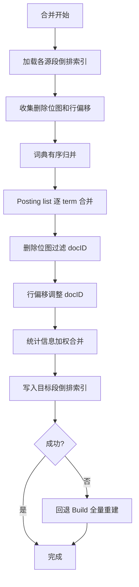
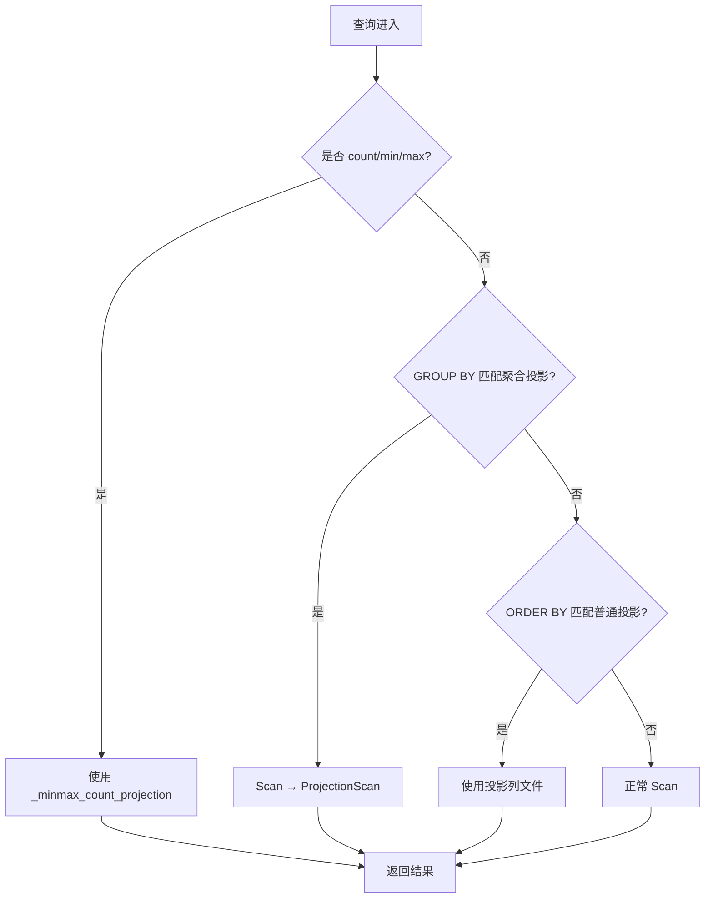

# Proposal: 引入 ClickHouse 优秀功能到 UniSearch

## 1. 背景与动机 (Background & Motivation)

### 1.1 当前问题

UniSearch 是一个融合全文检索与向量搜索的数据库，提供 ES 8.x 兼容的 REST API。经过对 ClickHouse 源码的代码级深度探索，识别出 6 个 ClickHouse 的核心创新功能可以显著提升 UniSearch 的存储效率、查询性能和数据管理能力：

1. **合并开销大**：当前倒排索引在段合并时全量重建（`buildMergeInvertedIndexes` 重新分词），而非直接合并 posting list，I/O 和 CPU 开销与数据量成正比
2. **编码能力有限**：`Encoding` 是单枚举值，编码选择矩阵固定（6 种编码），无法组合使用（如 Delta+ZSTD 串联），缺少 DoubleDelta/T64/ALP 等高效编码
3. **聚合性能瓶颈**：`GroupAggregator` 使用 `map[string]*groupBucket`，所有键统一转 string，数值型分组键产生大量转换开销，无类型特化哈希表
4. **无数据生命周期管理**：ILM policy handler 仅存储策略，不执行 TTL 操作；缺少数据自动过期、聚合降采样、重压缩等能力
5. **写入吞吐受限**：`IngestCoordinator` 按 shard 维度简单攒批，无按 table/format/identity 分组，高并发小写入场景吞吐不足
6. **无查询预计算**：每次聚合查询全量扫描，缺少投影/预计算机制加速重复性 GROUP BY 查询

### 1.2 用户期望

- 合并速度显著提升（倒排索引合并而非重建）
- 存储压缩率提升 20-40%（可组合编解码器 + 新编码类型）
- 聚合查询性能提升 2-5x（哈希表特化）
- 数据自动生命周期管理（TTL 四模式）
- 高并发写入吞吐提升（异步 INSERT 批量合并）
- 重复性聚合查询加速 10-100x（投影预计算）
- **保持 ES 8.x REST API 100% 兼容**

## 2. 目标 (Objective)

1. **引入 6 项 ClickHouse 核心功能**，覆盖存储编码、索引合并、聚合引擎、数据生命周期、写入摄入、查询优化全链路
2. **按依赖关系分 4 阶段实施**（预计 9-12 周），每阶段可独立交付和验证
3. **保持 ES API 完全兼容**，新功能通过内部优化或扩展字段实现，不破坏现有 API 行为

## 3. 方案设计 (Approach)

### 3.1 设计原则

- **向后兼容优先**：不改 `FormatVersion`，复合编码信息存储在块 payload 前缀中，单编码段新旧版本均可读
- **渐进式引入**：每阶段独立交付，不依赖后续阶段的功能即可运行和验证
- **内部优化透明**：F1（倒排合并）、F2（编解码器）、F3（哈希表）为纯内部优化，用户无感知；F4/F5/F6 通过 ES 扩展字段暴露
- **回退安全**：每个功能均有回退路径——F1 合并失败回退 Build 全量重建，F3 小数据量回退 Go map，F5 超大数据回退同步写入

### 3.2 功能清单与依赖关系

```
阶段 1 (P1): 基础设施
  ├── F1: 倒排索引可合并 ──────────→ 合并路径共享 (merge.go)
  └── F2: 可组合编解码器 ──→ F4 TTL RECOMPRESS 模式

阶段 2 (P2): 引擎优化
  └── F3: 聚合哈希表特化 ──→ F6 聚合投影预计算

阶段 3 (P3): 生命周期与摄入
  ├── F4: TTL 生命周期管理 ─→ 共享 merge.go (依赖 F2 RECOMPRESS)
  └── F5: 异步 INSERT 批量合并 (独立)

阶段 4 (P4): 投影与优化器
  └── F6: 投影/预计算 ───→ 依赖 F3 哈希表 + optimizer R8
```

### 3.3 各功能详细设计

#### F1: 倒排索引可合并

**现状**：`internal/storage/merge_indexes.go` 的 `buildMergeInvertedIndexes` 通过 `mergeTextColumnProvider` 重新读取文本并重新分词构建索引（全量重建）。`inverted.Index.Merge()` 已存在但未被合并路径调用，且不处理删除位图。

**方案**：将合并路径从"重新分词全量重建"改为"posting list 直接合并 + 删除过滤"。

**核心流程**：


**关键接口变更**：
- `PostingList` 新增 `FilterAndOffset(deleteBitmap *roaring.Bitmap, offset uint32) *PostingList`
- `invertedStore` 新增 `MergeWithOptions(ctx, sources []MergeSource, w IndexOutput) error`，其中 `MergeSource` 包含 `LoadedIndex`、`deleteBitmap`、`rowOffset`
- 词典合并改用有序归并（各源段词典已排序）替代 map 去重+排序

#### F2: 可组合编解码器

**现状**：`Encoding` 是单枚举值（1-6），`chooseEncoding` 是类型 x 基数矩阵，每块选择单一编码。zstd 压缩是编码的一部分（如 `EncodingDeltaZstd`），非可组合的外层。

**方案**：引入 `BlockCodec` 接口和 `CodecChain`，支持多编码串联，新增 DoubleDelta/T64/ALP 编码。

**编解码器接口**：
```go
// BlockCodec 是单个编解码器的接口
type BlockCodec interface {
    Encode(ft meta.FieldType, data *BlockData) ([]byte, error)
    Decode(ft meta.FieldType, payload []byte, nrows int) (*BlockData, error)
    ID() uint8
}

// CodecChain 是多编解码器串联
type CodecChain struct {
    codecs []BlockCodec
}
// Encode 按正序应用：Delta → ZSTD
// Decode 按逆序应用：ZSTD → Delta
```

**编解码器 ID 分配**：
| ID | 编解码器 | 适用场景 |
|----|---------|---------|
| 1 | Delta | 单调递增/递减整数 |
| 2 | DoubleDelta | 等步长整数序列（新增） |
| 3 | Gorilla | 浮点数序列 |
| 4 | T64 | 64 位整数转置编码（新增） |
| 5 | ALP | 浮点数自适应无损编码（新增） |
| 7 | ZSTD | 通用压缩 |
| 9 | Dict | 低基数字典编码 |
| 10 | RLE | 布尔值游程编码 |

**向后兼容策略**：不改 `FormatVersion`。当 `BlockIndex.Encoding == EncodingComposite(7)` 时，payload 前缀包含编解码器链描述（u8 链长度 + 各编解码器 ID）。旧版本读取器遇到 `EncodingComposite` 返回 "unsupported encoding" 错误（需新版本读取），单编码段（1-6）新旧版本均可读。

**新增编码详情**：
- **DoubleDelta**：计算 `a[i] - 2*a[i-1] + a[i-2]`，zigzag + bitpack，适用于等步长时间戳
- **T64**：64 位整数按字节转置为 8 列，每列独立 bitpack，适用于高位不变的 64 位整数
- **ALP**：浮点数乘以最佳因子转为 int64 后 bitpack，适用于 Gorilla 效率不佳的 double 列

#### F3: 聚合哈希表特化

**现状**：`GroupAggregator`（`aggregator.go:274`）使用 `map[string]*groupBucket`，所有键统一转 string。`PartialCollector`（`partial.go:36`）使用 `map[uint32]Aggregator`，无类型感知。

**方案**：为不同键类型生成专用哈希表，引入两级哈希表支持大数据量并行合并。

**哈希表类型与选择规则**：
| 键类型 | 哈希表实现 | 特点 |
|--------|-----------|------|
| long/date/ip | `FixedHashTableU64` | 开放寻址，无哈希计算，直接索引 |
| boolean | `FixedHashTableU32` | 仅 2 值，极紧凑 |
| keyword/text | `StringHashTable` | FNV-1a 哈希，短键内联 |
| 多列组合 | `CompositeKeyTable` | 拼接为 128/256 位 |
| 无聚合函数 | `VoidHashTable` | DISTINCT 优化，仅跟踪存在性 |
| 组数 > 100K | `TwoLevelHashTable` | 包装上述哈希表，256 桶并行合并 |

**自适应切换**：小数据量（< 1000 组）使用 Go 原生 map（内存分配优化好），大数据量切换特化哈希表。

#### F4: TTL 生命周期管理

**现状**：ILM policy handler 仅存储策略定义，不执行 TTL 操作。合并调度器基于 size-tiered 策略，无 TTL 感知。

**方案**：TTL 表达式定义在索引映射中，后台合并线程通过 TTL 合并选择器优先处理过期段。

**四种 TTL 模式**：
| 模式 | 行为 | 实现要点 |
|------|------|---------|
| DELETE | 删除过期行 | `copyMergeRows` 增加时间戳过滤条件 |
| MOVE | 移动到其他磁盘/卷 | 合并后段写入目标路径（冷热分层集成） |
| GROUP_BY | 过期行按组聚合 | 合并时对过期行执行 GROUP BY，用聚合结果替代明细行 |
| RECOMPRESS | 重新压缩 | 合并后对指定列用目标编解码器重新编码（依赖 F2） |

**TTL 合并选择器**：`TTLMergeSelector` 遍历段 zone map 检查时间列 max 值，过期段优先于 size-tiered 候选。TTL 合并使用独立并发槽，不阻塞正常合并。

#### F5: 异步 INSERT 批量合并

**现状**：`IngestCoordinator` 按 shard 维度攒批（64MB/2ms），同步等待，无按 table/format/identity 分组。

**方案**：引入异步 INSERT 队列，按 (index, format, settings, user identity) 分组攒批。

**分组键**：
```go
type AsyncInsertGroupKey struct {
    Index       string   // 索引名
    Format      string   // 数据格式 (json/ndjson)
    SettingsHash uint64  // 设置哈希
    UserIdentity string  // 用户标识（安全隔离）
}
```

**配置参数**：
- `AsyncInsertMaxDataSize`: 1MB（单批次最大数据量）
- `AsyncInsertMaxWaitMs`: 50ms（最大等待时间）
- `WaitForAsyncInsert`: true（默认等待完成）

**超大数据回退**：当单次写入超过 `AsyncInsertMaxDataSize` 的 N 倍时，回退同步写入。

#### F6: 投影/预计算

**现状**：无投影概念。`optimizer.go` R3（投影裁剪）是 noop。`SegmentFooter` 存储 `ColumnStats`（min/max/nullCount/cardinality）。

**方案**：全量实现三种投影，查询优化器自动选择最优投影。

**三种投影类型**：
| 类型 | 描述 | 存储方式 | 加速场景 |
|------|------|---------|---------|
| `_minmax_count_projection` | 自动创建，从 ColumnStats 生成 | Footer 元数据 | count/min/max 查询 |
| 聚合投影 | 预计算 GROUP BY 聚合状态 | `projections/proj_{name}/agg_state.bin` | 重复性 GROUP BY 查询 |
| 普通投影 | 按不同排序键存储数据副本 | `projections/proj_{name}/col_{fid}.bin` | 特定 ORDER BY 查询 |

**优化器 R8 规则**：


**投影定义 API**（通过 `_settings` 扩展）：
```json
PUT /my-index/_settings
{
  "projections": [
    {
      "name": "daily_stats",
      "type": "aggregate",
      "group_by": ["date", "category"],
      "aggregates": [{"type": "sum", "field": "price"}, {"type": "count"}]
    },
    {
      "name": "by_category",
      "type": "normal",
      "sort_key": ["category", "date"]
    }
  ]
}
```

### 3.4 技术选型

- **编码体系**：选择 Go 原生实现所有新编码（DoubleDelta/T64/ALP），不引入 C 绑定，保持单一静态二进制
- **哈希表**：选择自研实现而非第三方库，以便与 UniSearch 的 `groupBucket` 结构深度集成
- **TTL**：选择通过现有合并调度器扩展实现，不引入独立 TTL 线程
- **异步 INSERT**：选择在 `IngestCoordinator` 层实现而非 HTTP handler 层，保持 gRPC 路径也能受益

## 4. 变更范围 (Impact)

### 4.1 新增文件

| 文件路径 | 说明 | 所属功能 |
|----------|------|---------|
| `internal/storage/segment/encoding_doubledelta.go` | DoubleDelta 编码实现 | F2 |
| `internal/storage/segment/encoding_t64.go` | T64 编码实现 | F2 |
| `internal/storage/segment/encoding_alp.go` | ALP 编码实现 | F2 |
| `internal/engine/agg/hashtable.go` | 特化哈希表接口和实现 | F3 |
| `internal/engine/agg/hashtable_factory.go` | 哈希表工厂函数 | F3 |
| `internal/storage/merge/ttl_merge.go` | TTL 合并执行器 | F4 |
| `internal/coordinator/async_insert.go` | 异步 INSERT 队列 | F5 |

### 4.2 修改文件

| 文件路径 | 修改内容 | 所属功能 |
|----------|---------|---------| 
| `internal/storage/segment/codec.go` | 新增 BlockCodec 接口/CodecChain/工厂 | F2 |
| `internal/storage/segment/encoding.go` | 新增 EncodingComposite/chooseCodec/编解码器 ID 常量 | F2 |
| `internal/storage/segment/column_writer.go` | flushBlock 使用 BlockCodec 编码 | F2 |
| `internal/storage/segment/column_reader.go` | decodeBlockAt 支持 EncodingComposite | F2 |
| `internal/index/inverted/postings.go` | 新增 FilterAndOffset 方法 | F1 |
| `internal/index/inverted/index.go` | 新增 MergeWithOptions 方法 | F1 |
| `internal/index/inverted/dict.go` | 词典有序归并 | F1 |
| `internal/storage/merge_indexes.go` | 替换 buildMergeInvertedIndexes | F1 |
| `internal/storage/merge.go` | MergeOptions/copyMergeRows 行偏移/投影重建/TTL 过滤 | F1,F4,F6 |
| `internal/engine/agg/aggregator.go` | GroupAggregator 哈希表替换 | F3 |
| `internal/engine/agg/partial.go` | 两级哈希表合并增强 | F3,F6 |
| `internal/meta/mapping.go` | TTLExpr 定义 | F4 |
| `internal/meta/model.go` | ProjectionDef/IndexSettings 扩展 | F6 |
| `internal/storage/merge_info.go` | SegmentStats 新增 MaxTimestamp | F4 |
| `internal/storage/merge/scheduler.go` | TTLMergeSelector 集成 | F4 |
| `internal/coordinator/coordinator.go` | SubmitAsync 集成 | F5 |
| `internal/storage/segment/builder.go` | ProjectionWriter | F6 |
| `internal/storage/flush.go` | 投影 flush 构建 | F6 |
| `internal/storage/segment/reader.go` | 投影加载/ProjectionReader | F6 |
| `internal/engine/plan/optimizer.go` | R8 投影选择规则 | F6 |
| `internal/engine/plan/plan.go` | ProjectionScan 逻辑计划节点 | F6 |
| `internal/engine/exec/operator.go` | ProjectionScanOp 执行算子 | F6 |
| `internal/server/esapi/handlers.go` | ?async=true/投影定义 API | F5,F6 |
| `internal/server/esapi/m1_handlers.go` | ILM/TTL 扩展 | F4 |
| `internal/observability/metrics.go` | 异步队列监控指标 | F5 |

### 4.3 不涉及

- 不修改 HNSW 向量索引的构建和搜索逻辑
- 不修改 Raft 共识和 gRPC 服务层
- 不修改多租户配额和准入控制逻辑
- 不修改 ES 兼容的 DSL 解析器（仅扩展 `_settings` 支持新字段）
- 不修改冷热分层迁移逻辑（TTL MOVE 模式调用现有 tier manager）

## 5. 接口定义 (Interface Definition)

### 5.1 外部接口（ES REST API 扩展）

#### 投影定义 API
```
PUT /{index}/_settings
Body: { "projections": [...] }

GET /{index}/_projection/{name}
Response: { "name": "...", "type": "...", "status": "active" }
```

#### TTL 配置 API（通过 ILM policy）
```
PUT /_ilm/policy/{policy_id}
Body: { "policy": { "phases": { "delete": { "actions": { "ttl": { "mode": "delete", "column": "@timestamp", "interval": "30d" }}}}}}
```

#### 异步 INSERT API
```
POST /{index}/_doc?async=true
POST /_bulk?async=true
Response: { "_async": true, "_shards": {...} }

GET /_async_insert/stats
Response: { "queue_length": 0, "flush_total": 42, "flush_errors": 0 }
```

### 5.2 内部接口

#### BlockCodec 接口
```go
type BlockCodec interface {
    Encode(ft meta.FieldType, data *BlockData) ([]byte, error)
    Decode(ft meta.FieldType, payload []byte, nrows int) (*BlockData, error)
    ID() uint8
}
```

#### AggHashTable 接口
```go
type AggHashTable interface {
    FindOrInsert(key any) (*groupBucket, bool)
    Iterate(fn func(key any, bucket *groupBucket) bool)
    Len() int
    Reset()
}
```

#### MergeOptions 结构
```go
type MergeOptions struct {
    TTLExpr    *TTLExpr        // TTL 表达式（F4）
    RowOffsets []uint32         // 各源段行偏移（F1）
    CodecConfig *CodecConfig    // 编解码器配置（F2）
    Projections []ProjectionDef // 投影定义（F6）
}
```

## 6. 稳定性架构 (Stability Architecture)

### 6.1 限流与熔断

- **异步 INSERT 限流**：`AsyncInsertMaxDataSize`(1MB) 单批次上限，超限返回 `TOO_MUCH_DATA` 由调用者同步写入；队列深度上限 10000 文档，超限返回 429
- **TTL 合并限流**：独立并发槽（max 1 个 TTL 合并并发），不与正常合并竞争资源
- **投影合并限流**：投影重建在合并后异步执行，不阻塞合并完成

### 6.2 资源隔离与限制

- **TTL 合并**：使用独立的 `MergeOptions` 配置，CPU/IO 预算与正常合并分离
- **异步 INSERT**：每分组队列独立内存预算（`AsyncInsertMaxDataSize`），不跨分组共享
- **投影存储**：投影数据计入段大小，受租户存储配额约束

### 6.3 灾难恢复

- **F1 回退**：倒排索引合并失败时，回退到 `Build` 全量重建路径，不影响合并正确性
- **F2 回退**：编码失败时，回退到默认 ZSTD 编码；解码遇到不支持的 `EncodingComposite` 时返回明确错误
- **F3 回退**：特化哈希表初始化失败时，回退到 Go 原生 map
- **F5 回退**：异步 flush 失败时，记录到错误日志和监控指标；`wait=true` 模式下错误传播给调用者
- **F6 回退**：投影不可用时，优化器回退到正常 Scan 路径

## 7. 可测性设计 (Testability Design)

### 7.1 本地手动验证

**F1 倒排索引可合并**：
1. 创建索引并写入 1000 文档，执行 `POST /my-index/_forcemerge?max_num_segments=1`
2. 对比合并前后搜索结果和 BM25 评分一致性
3. 检查合并日志确认使用 merge 路径而非 build 路径

**F2 可组合编解码器**：
1. 创建索引，写入不同类型数据（long/date/double/text）
2. 执行 `_forcemerge`，检查段文件的压缩率变化
3. 搜索验证所有字段值正确返回

**F3 聚合哈希表特化**：
1. 写入 100 万文档，执行 `terms` 聚合（按 long 字段分组）
2. 对比聚合结果正确性，检查聚合延迟

**F4 TTL 生命周期管理**：
1. 创建索引，设置 TTL delete 1 分钟
2. 写入带时间戳文档，等待过期
3. 触发 `_forcemerge?ttl=true`，验证过期数据被删除

**F5 异步 INSERT 批量合并**：
1. 并发发送 100 个 `?async=true` 单文档写入
2. 检查 `GET /_async_insert/stats` 确认批处理效果
3. 搜索验证所有文档最终可见

**F6 投影/预计算**：
1. 通过 `_settings` 定义聚合投影
2. 执行匹配的 GROUP BY 查询，通过 `_explain` 确认使用 ProjectionScan
3. 对比投影和非投影查询的性能

### 7.2 自动化测试策略

- **Unit Tests**：每个新编码的往返正确性（DoubleDelta/T64/ALP）；每种哈希表的插入/查找/迭代正确性；FilterAndOffset 的删除过滤和偏移正确性
- **Integration Tests**：合并后搜索结果一致性（F1）；新旧格式段混合读取兼容性（F2）；聚合结果跨段合并正确性（F3）；TTL 各模式端到端验证（F4）；异步 INSERT 并发安全验证（F5）；投影查询匹配和回退验证（F6）
- **Benchmark Tests**：合并时间对比（F1 全量重建 vs 合并）；编码压缩率对比（F2 新旧编码）；聚合吞吐量对比（F3 原生 map vs 特化哈希表）；异步写入吞吐对比（F5 同步 vs 异步）

## 8. 风险与缓解 (Risks & Mitigation)

| 风险 | 缓解措施 |
|------|----------|
| F1: 行偏移计算与 copyMergeRows 不一致导致 docID 错位 | 共享偏移计算逻辑；合并结果验证；失败回退 Build 路径 |
| F2: 旧版本进程无法读取 EncodingComposite 段 | 不改 FormatVersion；EncodingComposite(7) 返回明确错误；单编码段完全兼容 |
| F3: 小数据量自定义哈希表比 Go map 更慢 | 自适应切换阈值（< 1000 组用 Go map）；基准测试确定最优阈值 |
| F4: TTL 合并与正常合并并发冲突 | TTL 使用独立并发槽；GROUP_BY 模式默认禁用需显式启用 |
| F5: 异步写入数据可见性延迟和错误传播 | 默认 wait=true；异步错误记录到监控；提供 wait_for_completion 参数 |
| F6: 投影合并重建开销大 + 优化器匹配复杂 | 先实现 minmax_count（零开销），再聚合投影，最后普通投影；投影重建异步执行 |
| 全局: 6 个功能同时修改 merge.go 导致冲突 | 引入 MergeOptions 统一参数传递；分阶段实施，每阶段独立验证 |

## 9. 验收标准 (Acceptance Criteria)

- [ ] **F1**: 合并后搜索结果与全量重建一致（BM25 评分精确匹配）；合并时间减少 50%+
- [ ] **F2**: 新编码往返正确性 100%；旧格式段可正常读取；压缩率提升 20%+（典型数据集）
- [ ] **F3**: 聚合结果与原生 map 一致；GROUP BY 吞吐量提升 2x+（大数据量场景）
- [ ] **F4**: TTL DELETE 模式正确删除过期行；TTL 合并不阻塞正常合并；ES ILM API 兼容
- [ ] **F5**: 异步 INSERT 并发安全；?async=true 时 ES 客户端无感知；写入吞吐提升 3x+（高并发小写入）
- [ ] **F6**: _minmax_count 投影零开销加速 count/min/max 查询；聚合投影加速 GROUP BY 10x+；优化器正确匹配和回退
- [ ] **ES 兼容**: 现有 ES API 测试 100% 通过；新功能通过扩展字段实现，不破坏现有 API
- [ ] **可观测性**: 异步队列/TTL 合并/投影使用均有 Prometheus 指标和日志
- [ ] **go build/test/vet**: 全绿
