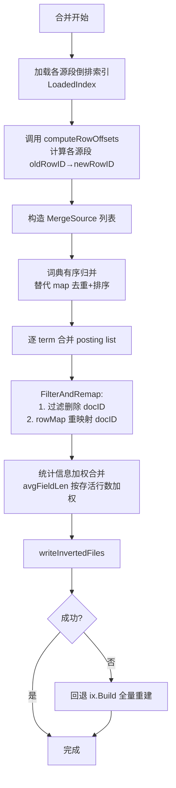
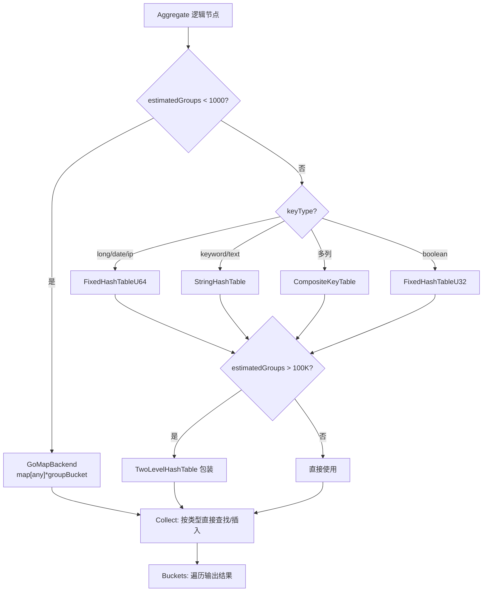
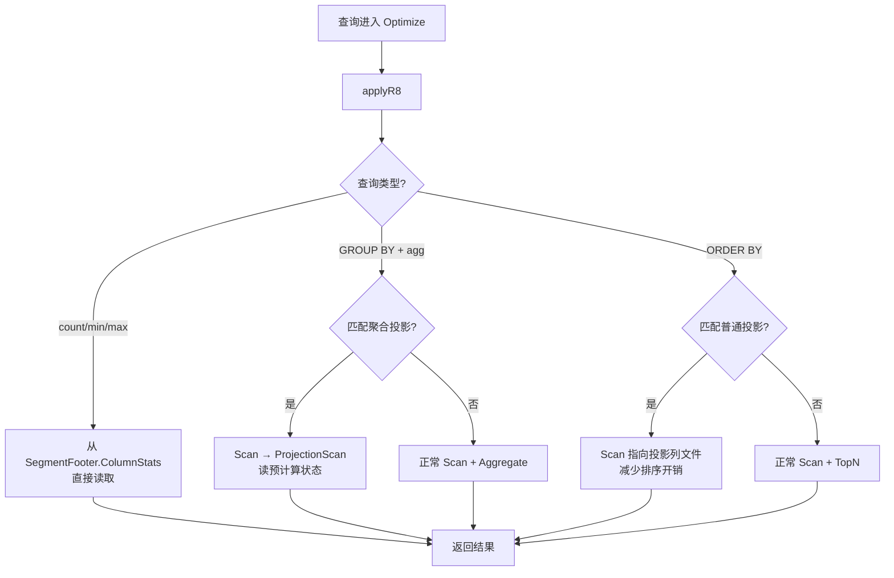

# Spec: 引入 ClickHouse 优秀功能到 UniSearch

> 本文档基于 `01_proposal.md` 和设计评审共识，定义 6 个功能的工程实现细节。

## 1. 概述

将 ClickHouse 的 6 项核心创新功能引入 UniSearch，分 4 阶段实施：
- **P1**: F1 倒排索引可合并 + F2 可组合编解码器
- **P2**: F3 聚合哈希表特化（含执行管线接入）
- **P3**: F4 TTL 生命周期管理 + F5 异步 INSERT 批量合并
- **P4**: F6 投影/预计算（全量实现）

## 2. F1: 倒排索引可合并

### 2.1 现状

- `merge_indexes.go` 的 `buildMergeInvertedIndexes` 调用 `ix.Build()` 全量重建
- `invertedStore.Merge()` 已存在但未被合并路径调用，且 `rowOff[i]` 按 `DocCount` 简单累加，不处理删除行
- `copyMergeRows` 无显式偏移追踪，靠 `builder.AppendID` 隐式递增
- `mergeTextColumnProvider.ForEachText` 有独立的 `newRowID` 追踪，与 `copyMergeRows` 通过相同遍历+跳过逻辑保持一致

### 2.2 设计决策

**行偏移对齐策略：复用 provider 偏移逻辑**

在合并 posting list 时，复用 `mergeTextColumnProvider` 的 `newRowID` 递增逻辑。具体做法：提取 `mergeTextColumnProvider` 中的行遍历逻辑为独立的 `computeRowOffsets` 函数，该函数返回各源段存活行的 oldRowID→newRowID 映射。合并 posting list 时使用此映射进行 docID 转换。

### 2.3 数据结构

```go
// MergeSource 描述一个源段的合并输入
type MergeSource struct {
    Loaded   index.LoadedIndex  // 已加载的倒排索引
    Deletes  *roaring.Bitmap     // 删除位图（可为 nil）
    // RowMap[i] = newRowID，即源段第 i 个存活行在新段中的行号
    // 长度 = 源段存活行数
    RowMap   []uint32
}

// MergeOptions 统一合并参数（F1/F4/F6 共享）
type MergeOptions struct {
    TTLExpr     *TTLExpr         // F4: TTL 表达式
    Projections []ProjectionDef  // F6: 投影定义
}
```

### 2.4 接口签名

```go
// PostingList 新增方法 (postings.go)
func (pl *PostingList) FilterAndRemap(deletes *roaring.Bitmap, rowMap []uint32) *PostingList
// 过滤已删除 docID，将剩余 docID 通过 rowMap 重映射为新 docID
// 返回新的 PostingList，保持 tf/fldLen/positions 对齐

// invertedStore 新增合并方法 (index.go)
func (st *invertedStore) MergeWithOptions(
    ctx context.Context,
    sources []MergeSource,
    w index.IndexOutput,
    field string,
    storePositions bool,
) error
// 逐 term 合并 posting list：
// 1. 词典有序归并（各源段词典已排序）
// 2. 对每个 term 的 posting list 调用 FilterAndRemap
// 3. 统计信息按存活行数加权合并
// 4. 写出文件
```

### 2.5 核心流程



### 2.6 修改清单

| 文件 | 修改内容 |
|------|---------|
| `internal/index/inverted/postings.go` | 新增 `FilterAndRemap` 方法 |
| `internal/index/inverted/index.go` | 新增 `MergeWithOptions` 方法；提取 `computeRowOffsets` |
| `internal/index/inverted/dict.go` | 词典有序归并函数 `MergeSortedDicts` |
| `internal/storage/merge_indexes.go` | 替换 `buildMergeInvertedIndexes`：从 `SegmentEntry.Indexes` 获取源索引，调用 `MergeWithOptions`；失败回退 `ix.Build` |
| `internal/storage/merge.go` | 步骤 7b 调用链变更；无需修改 `copyMergeRows`（偏移通过独立计算） |

### 2.7 错误处理

- `MergeWithOptions` 失败时，`buildMergeInvertedIndexes` 回退到 `ix.Build` 全量重建路径
- 回退时记录 WARN 日志：`"inverted index merge failed, fallback to build: {error}"`
- `FilterAndRemap` 中 docID 超出 `rowMap` 范围时返回 error（不应发生，防御性检查）

### 2.8 关键测试场景

| 场景 | 验证点 |
|------|--------|
| 无删除行合并 | 合并后 BM25 评分与 Build 一致 |
| 有删除行合并 | 已删除文档的 posting 不出现在合并结果中 |
| 跨段短语查询 | positions 正确重映射，短语搜索结果一致 |
| 空段合并 | 源段无文档时合并不 panic |
| 合并回退 | 模拟 MergeWithOptions 失败，验证回退到 Build |
| 大词典合并 | 100 万 term 词典有序归并内存峰值低于 map 去重 |

## 3. F2: 可组合编解码器

### 3.1 现状

- `Encoding` 是 `uint32` 枚举（0-6），通过 protowire varint 序列化（tag 2）
- `chooseEncoding` 是类型×基数矩阵，每块选择单一编码
- `encodeBlock`/`decodeBlock` 按 `Encoding` enum 分发到独立函数
- zstd 压缩是编码的一部分（如 `EncodingDeltaZstd` = delta + zstd），非可组合

### 3.2 设计决策

**链描述存储：块 payload 前缀**

不改 `BlockIndex` 结构和 `FormatVersion`。当 `BlockIndex.Encoding == EncodingComposite(7)` 时，payload 前缀包含编解码器链描述（u8 链长度 + 各编解码器 ID）。单编码段（1-6）新旧版本均可读。

### 3.3 数据结构

```go
// BlockCodec 是单个编解码器的接口
type BlockCodec interface {
    Encode(ft meta.FieldType, data *BlockData) ([]byte, error)
    Decode(ft meta.FieldType, payload []byte, nrows int) (*BlockData, error)
    ID() uint8
}

// CodecChain 是多编解码器串联
type CodecChain struct {
    codecs []BlockCodec
}
// Encode 按正序应用：Delta → ZSTD
// Decode 按逆序应用：ZSTD → Delta

// 编解码器 ID 常量
const (
    CodecIDDelta        uint8 = 1
    CodecIDDoubleDelta  uint8 = 2  // 新增
    CodecIDGorilla      uint8 = 3
    CodecIDT64          uint8 = 4  // 新增
    CodecIDALP          uint8 = 5  // 新增
    CodecIDZstd         uint8 = 7
    CodecIDDict         uint8 = 9
    CodecIDRLE          uint8 = 10
    CodecIDBitpack      uint8 = 11
)

// EncodingComposite 表示使用复合编解码器链
const EncodingComposite Encoding = 7

// CodecChainDesc 是 payload 前缀中的链描述
// 格式: [u8 chain_len] [u8 codec_id_1] [u8 codec_id_2] ...
type CodecChainDesc struct {
    IDs []uint8
}
```

### 3.4 接口签名

```go
// codec.go 新增
func NewCodecChain(codecs ...BlockCodec) *CodecChain
func (c *CodecChain) Encode(ft meta.FieldType, data *BlockData) ([]byte, error)
func (c *CodecChain) Decode(ft meta.FieldType, payload []byte, nrows int) (*BlockData, error)
func (c *CodecChain) IDs() []uint8

// 编解码器工厂
func NewCodecByID(id uint8, ft meta.FieldType) (BlockCodec, error)

// encoding.go 修改
func chooseCodec(ft meta.FieldType, st blockStats) BlockCodec
// 返回单个 BlockCodec 或 *CodecChain
// 当链长度为 1 时，BlockIndex.Encoding 存原始 Encoding 值（向后兼容）
// 当链长度 > 1 时，BlockIndex.Encoding = EncodingComposite

// codec.go 分发扩展
func encodeBlockComposite(codec BlockCodec, ft meta.FieldType, data *BlockData) ([]byte, error)
// 当 codec 是单编码时走原路径；当是 CodecChain 时写入链描述前缀

func decodeBlockComposite(ft meta.FieldType, enc Encoding, payload []byte, nrows int) (*BlockData, error)
// 当 enc == EncodingComposite 时读取链描述前缀，构造 CodecChain，逆序解码
```

### 3.5 新增编码详细设计

#### DoubleDelta (encoding_doubledelta.go)

```go
// 适用场景：等步长整数序列（如秒级时间戳）
// 编码：a[i] - 2*a[i-1] + a[i-2]，zigzag + bitpack
// payload 格式: null header | i64 first_value | i64 first_delta | u8 bit_width | bitpacked zigzag double-deltas (n-2 values)
func encodeDoubleDeltaBlock(data *BlockData) ([]byte, error)
func decodeDoubleDeltaBlock(payload []byte, nrows int) (*BlockData, error)
```

#### T64 (encoding_t64.go)

```go
// 适用场景：高位不变的 64 位整数
// 编码：64 位整数按字节转置为 8 列，每列独立 bitpack
// payload 格式: null header | u8 min_bit_widths[8] | per-byte-column bitpacked data
func encodeT64Block(data *BlockData) ([]byte, error)
func decodeT64Block(payload []byte, nrows int) (*BlockData, error)
```

#### ALP (encoding_alp.go)

```go
// 适用场景：Gorilla 效率不佳的 double 列
// 编码：浮点数乘以最佳因子转为 int64 后 bitpack
// payload 格式: null header | u8 factor | u8 exponent | u8 bit_width | i64 first_value | bitpacked encoded integers
func encodeALPBlock(data *BlockData) ([]byte, error)
func decodeALPBlock(payload []byte, nrows int) (*BlockData, error)
```

### 3.6 chooseCodec 选择矩阵扩展

| FieldType | 条件 | 编解码器链 |
|-----------|------|------------|
| long/date | cardinality < 4096 | Dict |
| long/date | monotonic + 等步长 | DoubleDelta → ZSTD |
| long/date | monotonic + 非等步长 | Delta → ZSTD (原 DeltaBitpack/DeltaZstd) |
| long/date | 高位不变 | T64 → ZSTD |
| long/date | 其他 | Delta → ZSTD |
| double/float | ALP 优于 Gorilla | ALP → ZSTD |
| double/float | Gorilla 优于 ALP | Gorilla (单编码) |
| keyword/text | cardinality < 4096 | Dict |
| keyword/text | cardinality >= 4096 | ZSTD (单编码) |
| boolean | — | RLE (单编码) |

### 3.7 修改清单

| 文件 | 修改内容 |
|------|---------|
| `internal/storage/segment/codec.go` | 定义 `BlockCodec` 接口、`CodecChain`、`NewCodecByID` 工厂；新增 `encodeBlockComposite`/`decodeBlockComposite` 分发；现有 6 种编码包装为 `BlockCodec` |
| `internal/storage/segment/encoding.go` | 新增 `EncodingComposite=7` 和编解码器 ID 常量；`chooseEncoding` → `chooseCodec` |
| `internal/storage/segment/encoding_doubledelta.go` | 新建，DoubleDelta 编码 |
| `internal/storage/segment/encoding_t64.go` | 新建，T64 编码 |
| `internal/storage/segment/encoding_alp.go` | 新建，ALP 编码 |
| `internal/storage/segment/column_writer.go` | `flushBlock` 调用 `chooseCodec` → `encodeBlockComposite` |
| `internal/storage/segment/column_reader.go` | `decodeBlockAt` 处理 `EncodingComposite` → `decodeBlockComposite` |

### 3.8 关键测试场景

| 场景 | 验证点 |
|------|--------|
| 单编码往返 | 所有原有编码 Encode→Decode 值精确一致 |
| 复合编码往返 | DoubleDelta→ZSTD、T64→ZSTD、ALP→ZSTD 往返正确 |
| 旧格式读取 | Encoding 1-6 的段在新版本可正常读取 |
| 新格式旧版本 | 旧版本遇到 EncodingComposite(7) 返回明确错误 |
| 压缩率对比 | 典型数据集（时间戳/浮点/文本）压缩率提升 ≥ 20% |
| Null 值处理 | 复合编码正确处理 null bitmap |

## 4. F3: 聚合哈希表特化

### 4.1 现状

- `GroupAggregator`（`aggregator.go:274`）使用 `map[string]*groupBucket`
- `GroupAggregator` **未接入执行管线**：`buildOperator` 无 `case *plan.Aggregate`，生产聚合在 `engine.go` 中逐文档解析 `_source` JSON
- `PartialCollector` 使用 `map[uint32]Aggregator`，`CollectPartial` 是简化版（JSON 反序列化后调用 Collect）

### 4.2 设计决策

**同时接入执行管线 + 优化哈希表**

在 F3 中完成两件事：
1. 将 `GroupAggregator` 接入执行管线（`buildOperator` 添加 `case *plan.Aggregate`）
2. 用特化哈希表替换 `map[string]*groupBucket`

**自适应切换**：小数据量（< 1000 组）使用 Go 原生 map，大数据量切换特化哈希表。

### 4.3 数据结构

```go
// AggHashTable 接口 (hashtable.go)
type AggHashTable interface {
    FindOrInsert(key any) (*groupBucket, bool)  // 返回 bucket 和是否新建
    Iterate(fn func(key any, bucket *groupBucket) bool)
    Len() int
    Reset()
}

// FixedHashTableU64 — long/date/ip 键
type FixedHashTableU64 struct {
    slots   []fixedSlotU64   // 开放寻址槽位
    buckets []*groupBucket   // 稠密 bucket 数组
    size    int
    capacity int              // 2 的幂次
}
type fixedSlotU64 struct {
    key   uint64              // 0 = empty
    idx   uint32              // buckets 索引
}

// StringHashTable — keyword/text 键
type StringHashTable struct {
    slots   []stringSlot
    buckets []*groupBucket
    keys    []string           // 稠密键存储
    size    int
    capacity int
}
type stringSlot struct {
    hash   uint64              // 0 = empty
    idx    uint32
}

// CompositeKeyTable — 多列组合键
type CompositeKeyTable struct {
    slots   []compositeSlot
    buckets []*groupBucket
    keys    [][]byte           // 序列化键
    keyLen  int                // 固定宽度 (16/32) 或 0=变长
    size    int
    capacity int
}

// TwoLevelHashTable — 两级哈希表
type TwoLevelHashTable struct {
    buckets [256]AggHashTable  // 256 个子表，按哈希高位分桶
    factory func() AggHashTable
    total   int
}

// VoidHashTable — DISTINCT 优化
type VoidHashTable struct {
    seen    map[uint64]struct{}  // 仅跟踪键哈希
    count   int
}
```

### 4.4 接口签名

```go
// hashtable_factory.go
func SelectHashTable(keyType meta.FieldType, isComposite bool, estimatedGroups int64) AggHashTable
// 选择规则：
// - estimatedGroups < 1000 → Go map 后端（自适应切换）
// - long/date/ip → FixedHashTableU64
// - boolean → FixedHashTableU32
// - keyword/text → StringHashTable
// - 多列 → CompositeKeyTable
// - estimatedGroups > 100000 → TwoLevelHashTable 包装

// aggregator.go 修改
func NewGroupAggregator(groupField string, keyType meta.FieldType, aggDefs []AggDef, estimatedGroups int64) *GroupAggregator
// 新增 keyType 和 estimatedGroups 参数

func (g *GroupAggregator) Collect(groupKey any, fieldValues map[string]any)
// groupKey 类型由 keyType 决定，避免 string 转换

// 执行管线接入 (planner.go)
// buildOperator 新增:
case *plan.Aggregate:
    return NewHashAggregateOp(child, agg.NewGroupAggregator(...))
```

### 4.5 核心流程



### 4.6 修改清单

| 文件 | 修改内容 |
|------|---------|
| `internal/engine/agg/hashtable.go` | 新建：`AggHashTable` 接口 + 6 种实现 |
| `internal/engine/agg/hashtable_factory.go` | 新建：`SelectHashTable` 工厂 |
| `internal/engine/agg/aggregator.go` | `GroupAggregator` 用 `AggHashTable` 替换 `map[string]*groupBucket`；`NewGroupAggregator` 增加 `keyType` 和 `estimatedGroups` 参数 |
| `internal/engine/agg/partial.go` | `PartialCollector` 支持 `TwoLevelHashTable` 并行合并 |
| `internal/embedded/planner.go` | `buildOperator` 新增 `case *plan.Aggregate` 分支 |
| `internal/embedded/engine.go` | `runAggregations` 重构为通过 `GroupAggregator` 执行 |

### 4.7 关键测试场景

| 场景 | 验证点 |
|------|--------|
| Go map 后端正确性 | < 1000 组时结果与原生 map 一致 |
| FixedHashTableU64 正确性 | long/date/ip 分组结果一致 |
| StringHashTable 正确性 | keyword/text 分组结果一致 |
| CompositeKeyTable 正确性 | 多列组合键分组结果一致 |
| TwoLevelHashTable 合并 | > 100K 组时两级合并正确 |
| 执行管线接入 | `case *plan.Aggregate` 输出与 engine.go 路径一致 |
| 自适应切换 | 组数从 999 增长到 1001 时正确切换后端 |
| 性能基准 | long 键 GROUP BY 吞吐量 ≥ 2x（大数据量） |

## 5. F4: TTL 生命周期管理

### 5.1 现状

- ILM policy handler 存在但仅存储策略
- `scheduler.go` 的 `pickCandidates` 基于 size-tiered 策略
- `SegmentStats` 不含 TTL 过期信息
- `SegmentFooter` 已有 `TTLExpireAt int64` 字段（当前未使用）

### 5.2 设计决策

**TTL 调度：同一队列 + TTL 优先**

在 `pickCandidates` 中增加 TTL 优先级判断：先检查 TTL 过期段，无 TTL 候选时走 size-tiered。TTL 合并与正常合并共享并发槽。

### 5.3 数据结构

```go
// TTLExpr 定义在索引映射中
type TTLExpr struct {
    Column      string   `json:"column"`       // 时间列名
    Mode        string   `json:"mode"`          // "delete" | "move" | "group_by" | "recompress"
    Interval     string   `json:"interval"`      // 过期阈值，如 "30d"
    GroupBy     []string `json:"group_by"`      // group_by 模式的分组列
    TargetCodec string   `json:"target_codec"`   // recompress 模式目标编解码器
    Destination string   `json:"destination"`   // move 模式目标路径
}

// IndexTTL 索引级 TTL 配置
type IndexTTL struct {
    Exprs []TTLExpr `json:"exprs"`  // 支持多个 TTL 规则
}

// SegmentStats 扩展
type SegmentStats struct {
    // ... 现有字段 ...
    MaxTimestamp int64  // 从 zone map 提取的时间列最大值
}
```

### 5.4 接口签名

```go
// merge/scheduler.go 修改
func (s *MergeScheduler) pickCandidates(cands []*SegmentStats) []*SegmentStats
// 修改：先检查 TTL 过期段（MaxTimestamp + interval < now），
// 有 TTL 候选时优先返回，否则走 size-tiered

// merge/ttl_merge.go 新建
func ExecuteTTLMerge(ctx context.Context, opts *TTLMergeOptions) error
type TTLMergeOptions struct {
    SegIDs    []types.SegmentID
    TTLExpr   *TTLExpr
    Shard     *Shard
}

// merge.go 修改
type MergeOptions struct {
    TTLExpr *TTLExpr  // F4: TTL 表达式（nil = 正常合并）
}
// copyMergeRows 增加 TTL 过滤：
// 当 ttlExpr.Mode == "delete" && rowTimestamp < now - interval → 跳过
```

### 5.5 四种模式实现

| 模式 | 实现要点 |
|------|---------|
| DELETE | `copyMergeRows` 增加时间戳过滤：`if ttlExpr.isExpired(rowTimestamp) { continue }` |
| MOVE | 合并后段写入 `ttlExpr.Destination` 路径，调用现有 `tier_manager` |
| GROUP_BY | 合并时对过期行按 `GroupBy` 列执行聚合（使用 F3 的 `GroupAggregator`），用聚合结果替代明细行 |
| RECOMPRESS | 合并后对指定列用 `ttlExpr.TargetCodec` 重新编码（依赖 F2 的 `BlockCodec`） |

### 5.6 ES API 扩展

```json
// PUT /_ilm/policy/{policy_id}
{
  "policy": {
    "phases": {
      "delete": {
        "actions": {
          "ttl": {
            "mode": "delete",
            "column": "@timestamp",
            "interval": "30d"
          }
        }
      }
    }
  }
}

// POST /{index}/_forcemerge?ttl=true  — 手动触发 TTL 合并
```

### 5.7 修改清单

| 文件 | 修改内容 |
|------|---------|
| `internal/meta/mapping.go` | 新增 `TTLExpr` 和 `IndexTTL` 结构；`IndexMeta` 新增 `TTL *IndexTTL` |
| `internal/storage/merge_info.go` | `SegmentStats` 新增 `MaxTimestamp int64` |
| `internal/storage/merge/scheduler.go` | `pickCandidates` 增加 TTL 优先级判断 |
| `internal/storage/merge/ttl_merge.go` | 新建，`ExecuteTTLMerge` |
| `internal/storage/merge.go` | `MergeSegments` 新增 `MergeOptions`；`copyMergeRows` 增加 TTL 过滤 |
| `internal/server/esapi/m1_handlers.go` | ILM handler 解析 TTL 配置 |

### 5.8 关键测试场景

| 场景 | 验证点 |
|------|--------|
| DELETE 模式 | 过期行被删除，存活行保留 |
| MOVE 模式 | 合并后段出现在目标路径 |
| GROUP_BY 模式 | 过期行被聚合为汇总行 |
| RECOMPRESS 模式 | 指定列使用目标编解码器 |
| TTL 优先调度 | 有 TTL 候选时优先于 size-tiered |
| 无 TTL 不影响 | 无 TTL 配置时行为与现有完全一致 |
| ES ILM 兼容 | ES ILM delete phase 语义兼容 |

## 6. F5: 异步 INSERT 批量合并

### 6.1 现状

- `IngestCoordinator` 按 shard 维度攒批（64MB/2ms），同步等待
- 无按 table/format/identity 分组
- WAL `WriteAsync` 是 fire-and-forget，无错误回调

### 6.2 设计决策

**错误传播：全部记录 + 按需传播**

所有 flush 错误记录到日志和监控指标；`wait=true` 时额外通过 channel 传播；提供 `GET /_async_insert/errors` 查询最近错误。

### 6.3 数据结构

```go
// AsyncInsertGroupKey 分组键
type AsyncInsertGroupKey struct {
    Index        string
    Format       string
    SettingsHash uint64
    UserIdentity string
}

// asyncInsertBatch 单个分组批次
type asyncInsertBatch struct {
    docs      [][]byte          // 文档列表
    size      int               // 总字节数
    createdAt time.Time         // 创建时间
    flushErr  chan error        // wait=true 时的错误传播 channel
    done      chan struct{}     // flush 完成信号
}

// AsyncInsertQueue 异步插入队列
type AsyncInsertQueue struct {
    groups  map[uint64]*asyncInsertBatch  // 按 groupKey hash 分组
    mu      sync.Mutex
    config  AsyncInsertConfig
    metrics *AsyncInsertMetrics
}

type AsyncInsertConfig struct {
    MaxDataSize  int           // 默认 1MB
    MaxWaitMs    int           // 默认 50ms
    WaitForInsert bool         // 默认 true
    MaxQueueDepth int          // 默认 10000
}

type AsyncInsertMetrics struct {
    QueueLength  atomic.Int64
    FlushTotal   atomic.Int64
    FlushErrors  atomic.Int64
    FlushLatency atomic.Int64  // 微秒
    RecentErrors []AsyncInsertError  // 环形缓冲，最近 100 条
}
```

### 6.4 接口签名

```go
// coordinator/async_insert.go 新建
func NewAsyncInsertQueue(config AsyncInsertConfig) *AsyncInsertQueue
func (q *AsyncInsertQueue) Submit(key AsyncInsertGroupKey, doc []byte, wait bool) error
// wait=true: 阻塞直到 flush 完成或超时，返回 flush 错误
// wait=false: 加入队列后立即返回 nil，flush 异步执行

func (q *AsyncInsertQueue) Start(ctx context.Context)  // 启动后台 flush goroutine
func (q *AsyncInsertQueue) Stop()                       // 停止并等待所有 pending flush
func (q *AsyncInsertQueue) Stats() AsyncInsertStats
func (q *AsyncInsertQueue) RecentErrors() []AsyncInsertError

// coordinator.go 修改
func (c *IngestCoordinator) SubmitAsync(key AsyncInsertGroupKey, doc []byte, wait bool) error

// handlers.go 修改
// handleIndexDoc: 解析 ?async=true → SubmitAsync
// handleBulk: 解析 ?async=true → 批量 SubmitAsync
```

### 6.5 超大数据回退

```go
func (q *AsyncInsertQueue) Submit(key AsyncInsertGroupKey, doc []byte, wait bool) error {
    if len(doc) > q.config.MaxDataSize * 10 {
        // 超大数据回退同步写入
        return ErrTooMuchData
    }
    // ... 正常异步路径
}
```

### 6.6 ES API 扩展

```
POST /{index}/_doc?async=true              — 异步单文档写入
POST /_bulk?async=true                      — 异步批量写入
POST /{index}/_doc?async=true&wait_for_completion=false  — 纯异步不等待
GET /_async_insert/stats                    — 队列统计
GET /_async_insert/errors                   — 最近错误
```

### 6.7 修改清单

| 文件 | 修改内容 |
|------|---------|
| `internal/coordinator/async_insert.go` | 新建：`AsyncInsertQueue` + 后台 flush |
| `internal/coordinator/coordinator.go` | `IngestCoordinator` 新增 `asyncQueue` 字段和 `SubmitAsync` |
| `internal/server/esapi/handlers.go` | `handleIndexDoc`/`handleBulk` 解析 `?async=true` |
| `internal/server/esapi/router.go` | 注册 `/_async_insert/stats` 和 `/_async_insert/errors` |
| `internal/observability/metrics.go` | 新增异步队列指标 |

### 6.8 关键测试场景

| 场景 | 验证点 |
|------|--------|
| 分组正确性 | 不同 index/format 的文档分到不同批次 |
| 批次大小触发 | 达到 MaxDataSize 时立即 flush |
| 超时触发 | 达到 MaxWaitMs 时 flush |
| wait=true 错误传播 | flush 失败时调用者收到 error |
| wait=false 错误记录 | flush 失败时记录到 /_async_insert/errors |
| 超大数据回退 | 超过阈值时返回 ErrTooMuchData |
| 并发安全 | 100 并发 Submit 无 race |
| ES 客户端无感知 | 不发 ?async=true 时行为完全一致 |

## 7. F6: 投影/预计算

### 7.1 现状

- 无投影概念
- `optimizer.go` R3（投影裁剪）是 noop
- `Scan.Projection` 字段已存在但未使用
- `Aggregate` 逻辑节点已定义但未接入 `buildOperator`
- `SegmentFooter` 存储 `ColumnStats`（min/max/nullCount/cardinality）
- `SegmentBuilder.Finish` 在步骤 4（列序列化）后、步骤 7（校验和）前可插入投影文件
- `flushTable` 在步骤 11（buildScalarIndexes）后、步骤 13（Finish）前可插入投影构建

### 7.2 设计决策

**投影节点：混合方案**

- 聚合投影：新增 `ProjectionScan` 逻辑节点 + `ProjectionScanOp` 执行算子（读预计算状态）
- 普通投影：复用 `Scan` 节点，添加排序列引用（指向投影列文件）
- `_minmax_count_projection`：直接从 `SegmentFooter.ColumnStats` 读取，无独立存储

### 7.3 数据结构

```go
// meta/model.go 新增
type ProjectionDef struct {
    Name       string       `json:"name"`
    Type       string       `json:"type"`        // "normal" | "aggregate"
    SortKey     []string     `json:"sort_key"`    // normal: 排序列
    GroupBy    []string     `json:"group_by"`    // aggregate: 分组列
    Aggregates []AggDef     `json:"aggregates"`  // aggregate: 聚合定义
}

// IndexSettings 扩展
type IndexSettings struct {
    // ... 现有字段 ...
    Projections []ProjectionDef `json:"projections,omitempty"`
}

// 逻辑计划节点 (plan/logical.go)
type ProjectionScan struct {
    SegID         uint64
    ProjectionName string
    GroupBy       []string
    Aggregates    []plan.AggDef
    // 执行时从 projections/proj_{name}/agg_state.bin 读取预计算状态
}

// 投影存储格式
// 普通投影: projections/proj_{name}/col_{fid}.bin — 按排序键排列的列文件
// 聚合投影: projections/proj_{name}/agg_state.bin — 序列化的聚合状态
//   格式: [u32 group_count] [per-group: key_bytes + agg_state_bytes]
```

### 7.4 接口签名

```go
// plan/optimizer.go 新增 R8
func applyR8(plan LogicalPlan, trace *strings.Builder) LogicalPlan
// 分析查询模式：
// 1. count/min/max → 检查 _minmax_count_projection（从 ColumnStats 读取）
// 2. GROUP BY + agg → 匹配聚合投影 → 替换为 ProjectionScan
// 3. ORDER BY → 匹配普通投影 → 设置 Scan 的投影列引用

// exec/operators.go 新增
type ProjectionScanOp struct {
    seg          segment.SegmentReader
    projectionName string
    groupBy      []string
    aggs         []agg.AggDef
    // ...
}
func NewProjectionScan(seg segment.SegmentReader, projName string, groupBy []string, aggs []agg.AggDef) *ProjectionScanOp
// Next(): 从 agg_state.bin 读取预计算聚合状态，输出 ColumnBatch

// storage/segment/builder.go 修改
func (b *SegmentBuilder) WriteProjection(name string, data []byte) error
// 在 Finish 之前写入投影文件到 tmpDir/projections/proj_{name}/

// storage/flush.go 修改
// flushTable 步骤 11 后插入:
func (f *FlushWorker) buildProjections(ctx context.Context, builder *segment.SegmentBuilder, meta *meta.IndexMeta) error
// 从 IndexMeta.Settings.Projections 读取定义
// 聚合投影: 从 memtable 执行 GROUP BY，序列化聚合状态
// 普通投影: 按 SortKey 排序行，写入投影列文件
```

### 7.5 优化器 R8 流程



### 7.6 修改清单

| 文件 | 修改内容 |
|------|---------|
| `internal/meta/model.go` | `IndexSettings` 新增 `Projections` 字段；定义 `ProjectionDef` |
| `internal/storage/segment/builder.go` | 新增 `WriteProjection` 方法 |
| `internal/storage/flush.go` | `flushTable` 新增投影构建步骤 |
| `internal/storage/segment/reader.go` | `Segment` 新增投影懒加载 |
| `internal/storage/merge.go` | 合并时重建投影（聚合投影用 F3 两级哈希表合并状态） |
| `internal/engine/plan/logical.go` | 新增 `ProjectionScan` 节点 |
| `internal/engine/plan/optimizer.go` | 新增 `applyR8` 投影选择规则；扩展 `applyR3` 实现真正投影裁剪 |
| `internal/engine/exec/operators.go` | 新增 `ProjectionScanOp` 算子 |
| `internal/embedded/planner.go` | `buildOperator` 新增 `case *plan.ProjectionScan` |
| `internal/server/esapi/handlers.go` | `_settings` 解析 projections；新增 `GET /{index}/_projection/{name}` |

### 7.7 关键测试场景

| 场景 | 验证点 |
|------|--------|
| _minmax_count 投影 | count/min/max 查询直接从 footer 读取，零扫描 |
| 聚合投影匹配 | GROUP BY 查询使用 ProjectionScan，结果一致 |
| 聚合投影不匹配 | 非匹配查询回退正常 Scan |
| 普通投影匹配 | ORDER BY 使用投影列，减少排序 |
| 投影合并 | 合并后投影状态正确重建 |
| 投影定义 API | `_settings` 定义投影后 flush 自动构建 |
| 优化器回退 | 投影不可用时回退正常 Scan |
| 性能对比 | 聚合投影查询比全量扫描快 10x+ |

## 8. 测试规划

### 8.1 测试金字塔

| 层级 | 比例 | 重点 |
|------|------|------|
| 单元测试 | 70% | 编解码往返、哈希表操作、FilterAndRemap、TTL 过期判断、异步队列 |
| 集成测试 | 20% | 合并后搜索一致性、新旧格式兼容、聚合管线端到端、TTL E2E、异步写入 E2E、投影 E2E |
| 基准测试 | 10% | 编码压缩率、聚合吞吐量、合并时间、异步写入延迟 |

### 8.2 关键测试场景清单

| ID | 功能 | 场景 | 类型 |
|----|------|------|------|
| F1-T01 | F1 | 无删除行合并 BM25 一致性 | 集成 |
| F1-T02 | F1 | 有删除行合并 docID 正确 | 集成 |
| F1-T03 | F1 | 跨段短语查询 positions 重映射 | 集成 |
| F1-T04 | F1 | 合并回退到 Build 路径 | 集成 |
| F1-T05 | F1 | 词典有序归并内存峰值 | 单元 |
| F2-T01 | F2 | DoubleDelta 往返正确性 | 单元 |
| F2-T02 | F2 | T64 往返正确性 | 单元 |
| F2-T03 | F2 | ALP 往返正确性 | 单元 |
| F2-T04 | F2 | CodecChain 多编码串联 | 单元 |
| F2-T05 | F2 | 旧格式段新版本读取 | 集成 |
| F2-T06 | F2 | 压缩率基准对比 | 基准 |
| F3-T01 | F3 | FixedHashTableU64 插入/查找 | 单元 |
| F3-T02 | F3 | StringHashTable 插入/查找 | 单元 |
| F3-T03 | F3 | CompositeKeyTable 多列键 | 单元 |
| F3-T04 | F3 | TwoLevelHashTable 并行合并 | 单元 |
| F3-T05 | F3 | 自适应切换阈值 | 集成 |
| F3-T06 | F3 | 执行管线接入端到端 | 集成 |
| F3-T07 | F3 | 聚合吞吐量基准 | 基准 |
| F4-T01 | F4 | DELETE 模式过期行删除 | 集成 |
| F4-T02 | F4 | GROUP_BY 模式聚合降采样 | 集成 |
| F4-T03 | F4 | RECOMPRESS 模式重编码 | 集成 |
| F4-T04 | F4 | TTL 优先调度 | 集成 |
| F4-T05 | F4 | 无 TTL 不影响现有行为 | 集成 |
| F5-T01 | F5 | 分组正确性 | 单元 |
| F5-T02 | F5 | 批次大小触发 flush | 单元 |
| F5-T03 | F5 | 超时触发 flush | 单元 |
| F5-T04 | F5 | wait=true 错误传播 | 集成 |
| F5-T05 | F5 | 并发安全 100 goroutine | 集成 |
| F5-T06 | F5 | 超大数据回退同步 | 集成 |
| F6-T01 | F6 | _minmax_count 投影零扫描 | 集成 |
| F6-T02 | F6 | 聚合投影匹配和结果一致 | 集成 |
| F6-T03 | F6 | 普通投影 ORDER BY 加速 | 集成 |
| F6-T04 | F6 | 投影合并重建 | 集成 |
| F6-T05 | F6 | 优化器回退正常 Scan | 集成 |
| F6-T06 | F6 | 聚合投影性能 10x+ | 基准 |

### 8.3 Mock 策略

| 依赖 | Mock 方式 | 原因 |
|------|---------|------|
| WAL | 内存 WAL 实现 | 避免磁盘 I/O 噪声 |
| 对象存储 (S3) | 内存对象存储 mock | TTL MOVE 模式测试 |
| Raft 共识 | 跳过（embedded 模式） | 单节点测试无需共识 |
| 分析器 | 直接使用真实分析器 | 分词正确性必须验证 |

### 8.4 测试数据设计

| 数据集 | 用途 | 规模 |
|--------|------|------|
| 时间戳序列 | F2 DoubleDelta/T64 压缩率 | 100 万行 |
| 浮点数序列 | F2 ALP/Gorilla 压缩率对比 | 100 万行 |
| 多类型混合 | F2 chooseCodec 矩阵覆盖 | 10 万行 |
| 文本文档 | F1 倒排索引合并 | 10 万文档 |
| 分组聚合数据 | F3 哈希表性能 | 100 万行 / 10 万组 |
| 带时间戳文档 | F4 TTL 过期测试 | 1 万文档 |
| 高并发小写入 | F5 异步 INSERT | 1000 文档 / 100 goroutine |
| 重复 GROUP BY | F6 投影性能 | 100 万行 |

## 9. 验收标准

- [ ] **F1**: 合并后搜索结果与全量重建一致（BM25 评分精确匹配）；合并时间减少 50%+
- [ ] **F2**: 新编码往返正确性 100%；旧格式段可正常读取；压缩率提升 20%+（典型数据集）
- [ ] **F3**: 聚合结果与原生 map 一致；GROUP BY 吞吐量提升 2x+（大数据量场景）；执行管线正确接入
- [ ] **F4**: TTL DELETE 模式正确删除过期行；TTL 合并优先调度；ES ILM API 兼容
- [ ] **F5**: 异步 INSERT 并发安全；?async=true 时 ES 客户端无感知；写入吞吐提升 3x+（高并发小写入）
- [ ] **F6**: _minmax_count 投影零开销加速 count/min/max 查询；聚合投影加速 GROUP BY 10x+；优化器正确匹配和回退
- [ ] **ES 兼容**: 现有 ES API 测试 100% 通过；新功能通过扩展字段实现，不破坏现有 API
- [ ] **可观测性**: 异步队列/TTL 合并/投影使用均有 Prometheus 指标和日志
- [ ] **go build/test/vet**: 全绿
