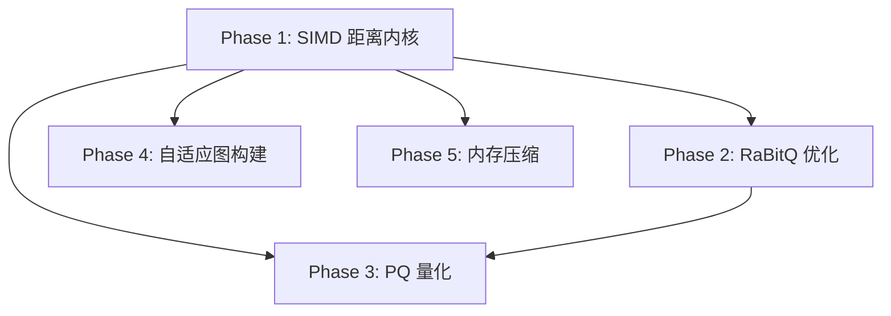

# Proposal: 从 vsag 引入优化算法提升向量搜索性能

## 1. 背景与动机 (Background & Motivation)

### 1.1 当前问题

uni-search 当前的向量搜索引擎存在多个性能瓶颈：

1. **SIMD 汇编内核未实现**（最大瓶颈）：`internal/simd/dot_purego.go` 仅有 8x 展开 pure Go 基线，`internal/simd/dist_asm.go` 是占位文件，`internal/simd/asm/gen.go` 只输出 placeholder stub。`DotF32`/`L2F32`/`DotF32Batch16` 三个函数指针在 init 时绑定 pure Go 实现，`DotF32Batch16` 只是循环 16 次调用 `dotF32PureGo`，无批量优化。

2. **RaBitQ 量化路径效率低**：`internal/index/hnsw/rabitq.go` 中投影矩阵 `proj [][]float32` 为 slice-of-slice（cache 不友好），`Quantize` 为标量双重循环，`HammingDistance` 用 `x & (x-1)` 逐 bit 软件 popcount。

3. **量化方式单一**：仅有 SQ8 和 RaBitQ 两种，缺少 PQ（Product Quantization）这一在内存受限场景下广泛使用的量化方式。

4. **图构建算法固定**：`heuristic` 方法实现固定策略 Alg. 4，无 alpha 参数调优，无距离缓存，`insert` 逐条插入无批量构建路径。

5. **邻接表内存占用大**：CSR `neighbors []int32` 每 4 字节/邻居 ID，对大规模图内存压力显著。

### 1.2 用户期望

通过对 vsag（C++ 向量搜索库）的深入代码分析，引入 5 个优化方向，全部以纯 Go 实现（Go 汇编除外），通过 `simd_asm` build tag 可选启用汇编加速。

## 2. 目标 (Objective)

- **SIMD 距离计算内核** 4-8x 加速（解决最大性能瓶颈）
- **RaBitQ 搜索路径** 2-4x 加速（投影矩阵扁平化 + 硬件 popcount）
- **新增 PQ 量化方式**，提供内存/速度新选择（标准 8bit PQ 先行，FastScan 后续）
- **图构建质量和批量导入速度提升**（自适应剪枝 + ODescent 批量构建）
- **邻接表内存压缩** 30-50%（Elias-Fano 编码）

## 3. 方案设计 (Approach)

### 3.1 设计原则

- **纯 Go 实现**：所有算法用 Go 实现，Go 汇编（avo 框架，plan9 assembly）除外，不引入 CGO/C++ 依赖
- **可选启用**：SIMD 汇编通过 `simd_asm` build tag 可选启用，默认构建仍用 pure Go，零风险
- **渐进式引入**：分 5 个 Phase 实施，每个 Phase 独立可交付，有明确的依赖关系
- **向后兼容**：序列化格式变更需保持旧格式可加载

### 3.2 核心方案

分 5 个 Phase 实施，依赖关系如下：



**推荐实施顺序**: Phase 1 → 2 → 4 → 3 → 5

#### Phase 1: SIMD 距离计算内核（最高优先级）

用 avo 框架生成 Go plan9 汇编（非 CGO，不受 `CGO_ENABLED=0` 限制），通过 `simd_asm` build tag 可选启用，运行时用 `golang.org/x/sys/cpu` 检测 ISA 自动分发。

需实现的汇编内核：

| 内核函数 | 用途 | amd64 指令集 | arm64 指令集 |
|---------|------|-------------|-------------|
| `dotF32Asm` | 单对向量点积 | AVX2 `VMOVUPS` + `VFMADD231PS` + `VHADDPS` | NEON `LD1` + `FMLA` + `FADDP` |
| `l2F32Asm` | 单对向量 L2 距离 | AVX2 `VSUBPS` + `VFMADD231PS` | NEON `FSUB` + `FMLA` + `FADDP` |
| `dotF32Batch16Asm` | 1-query × 16-candidate 批量点积 | AVX2 16 路并行累加 | NEON 8 路并行 + 二次循环 |
| `dotI8F32Asm` | int8 × float32 混合点积（SQ8 距离） | AVX2 `VPMOVSXBD` + `VFMADD231PS` | NEON `SXTL` + `FMLA` |
| `hamming64Asm` | 64 位 popcount 批量 Hamming（RaBitQ） | `POPCNT` + `XOR` | NEON `CNT` + `EOR` |

核心实现思路：
- `dotF32Asm`：8 float32/组加载 `VMOVUPS ymm`，`VFMADD231PS` 融合乘加到 8 个独立累加器，尾部标量处理 `n%8`
- `dotF32Batch16Asm`：query 向量常驻 ymm 寄存器，16 个候选逐个点积，消除重复加载
- `dotI8F32Asm`：`VPMOVSXBD` int8→int32 符号扩展，`VCVTDQ2PS` 转 float32，`VFMADD231PS` 累加
- `hamming64Asm`：8 字节 XOR 后 `POPCNT` 累加

运行时分发：保留现有函数指针架构，`dist_asm.go` 的 `init()` 按优先级链式绑定（AVX2+FMA → SSE2 fallback → NEON → pure Go）。

#### Phase 2: RaBitQ 优化（快速见效）

1. **投影矩阵扁平化**：`proj [][]float32` → `proj []float32`（连续分配），索引 `proj[i][j]` → `proj[i*nBits+j]`，消除一级间接寻址
2. **Hamming 用 `math/bits.OnesCount64`**：将 XOR 结果按 8 字节对齐为 uint64，`bits.OnesCount64` 一次 popcount 64 位（Go 编译器已利用硬件 POPCNT）。新增 `HammingDistanceBatch` 批量函数
3. **Quantize 循环优化**：转置循环顺序——外层遍历 dim 维度，内层遍历 nBits，使 `proj[i*nBits+j]` 访问连续（cache line 友好）；8x 标量展开
4. **RaBitQState.codes 扁平化**：`codes [][]byte` → `codesFlat []byte` + `codeOffsets []int32`，减少 GC 扫描开销

#### Phase 3: 标准 PQ 量化（新增量化方式）

先实现标准 8bit PQ（K-means 训练 + 编码 + LUT 查表距离），FastScan 4bit 交织打包作为后续优化。

1. **PQ 训练**：将 dim 维向量拆分为 M 个子空间（`dsub = dim/M`，M 自适应选择 `max(dim/32, 8)`），每个子空间独立 K-means 聚类（K=256，Lloyd 迭代，最大 25 轮，收敛阈值 1e-4）
2. **PQ 编码**：每个向量编码为 M 个 8bit code（M 字节/向量）
3. **LUT 查表距离**：查询时对每个子空间 j 计算 `LUT[j][256]`，候选距离 = `Σ LUT[j][code[i][j]]`
4. **搜索路径**：与 SQ8/RaBitQ 同构——PQ 粗排 + 1.5x beam 放宽 + float32 rerank

量化层级优先级：RaBitQ（~32x 压缩）→ PQ（~4x 压缩）→ SQ8（~4x 压缩，最快粗排）→ float32（精确）

#### Phase 4: 自适应图构建优化

1. **自适应剪枝（alpha 参数）**：
   - 判断条件从 `dist(e, s) < dist(e, q)` 改为 `dist(e, s) < alpha * dist(e, q)`
   - RELAX 阶段：首轮 alpha=1.2 构建，统计接受率
   - TIGHTEN 阶段：接受率 > 0.7 则减小 alpha 到 1.0；接受率 < 0.3 则增大 alpha
   - 默认 alpha=1.0（等同当前 Alg.4），仅在 Config 显式配置时启用自适应

2. **距离缓存**：
   - builder 增加 `distCache map[[2]int32]float32`
   - heuristic 的 O(m²) 比较中缓存 `(c.id, s.id)` 距离对
   - 利用对称性 `dist(a,b) == dist(b,a)`，key 统一为 `(min(a,b), max(a,b))`

3. **ODescent 批量图构建**：
   - Step 1: 初始 kNN 图——分块暴力计算 + 合并，每节点连接最近 K=2*M 个邻居
   - Step 2: 迭代优化——每轮遍历所有节点，对邻居的邻居做候选扩展，用 heuristic+alpha 重新选择
   - Step 3: 层级分配——按度数或距离分配 HNSW 多层结构
   - 入口 `BuildGraphODesc(cfg, n, dims, vecs)` 与 `BuildGraph` 签名一致
   - 对 >1M 向量采用分块策略（每块 ~10k 节点）

#### Phase 5: 内存压缩优化

1. **Elias-Fano 编码**：对单调递增的邻居 ID 序列，拆分为低 l 位（bitpack 打包）和高部分（一元编码位图）
2. 每个节点的邻居列表（有序 int32 序列）单独 EF 编码
3. per-node 偏移索引支持随机访问
4. `layerNeighbors` 从 EF 表增量解码当前节点的邻居列表
5. 复用 `internal/storage/segment/bitpack.go` 现有 bitpack 工具函数

### 3.3 技术选型

| 决策 | 选择 | 理由 |
|------|------|------|
| 汇编生成框架 | `github.com/mmcloughlin/avo` | Go 生态标准汇编生成器，生成 plan9 assembly 不受 CGO_ENABLED=0 限制 |
| ISA 检测 | `golang.org/x/sys/cpu` | Go 官方扩展库，检测 AVX2/FMA/NEON，无需第三方依赖 |
| SIMD 构建策略 | `simd_asm` build tag 可选启用 | 默认 pure Go 零风险，用户可选启用汇编加速 |
| PQ 实现深度 | 先标准 8bit PQ | 降低复杂度，FastScan 4bit 交织打包作为后续优化 |
| ODescent 范围 | 全部纳入 | 自适应剪枝 + ODescent 一步到位 |
| 图构建邻接格式 | builder 保持 `adj [][][]int32` | finish 时打包为 CSR，改动最小化 |

## 4. 变更范围 (Impact)

### 4.1 新增文件

| 文件路径 | 说明 |
|----------|------|
| `internal/simd/cpu.go` | ISA 特性检测，暴露 hasAVX2/hasFMA/hasPOPCNT/hasNEON |
| `internal/simd/cpu_amd64.go` | amd64 特性探测（golang.org/x/sys/cpu） |
| `internal/simd/cpu_arm64.go` | arm64 特性探测 |
| `internal/simd/asm/dot_amd64.go` | avo 生成器：DotF32/L2F32 AVX2+FMA amd64 内核 |
| `internal/simd/asm/batch_amd64.go` | avo 生成器：DotF32Batch16 amd64 内核 |
| `internal/simd/asm/doti8f32_amd64.go` | avo 生成器：DotI8F32 amd64 内核 |
| `internal/simd/asm/hamming_amd64.go` | avo 生成器：批量 Hamming popcount amd64 内核 |
| `internal/simd/asm/dot_arm64.go` | avo 生成器：DotF32/L2F32 NEON arm64 内核 |
| `internal/simd/asm/batch_arm64.go` | avo 生成器：DotF32Batch16 arm64 内核 |
| `internal/simd/dist_amd64.s` | avo 生成的 amd64 汇编（checked in） |
| `internal/simd/dist_arm64.s` | avo 生成的 arm64 汇编（checked in） |
| `internal/simd/hamming.go` | Hamming 距离函数指针 HammingDistanceBatch 声明 |
| `internal/index/hnsw/pq.go` | PQ 量化器：训练、编码、解码、LUT 查表距离 |
| `internal/index/hnsw/pq_test.go` | PQ 正确性、recall、内存测试 |
| `internal/index/hnsw/adaptive_pruning.go` | 自适应剪枝实现（alpha 参数 + RELAX/TIGHTEN） |
| `internal/index/hnsw/odescent.go` | ODescent 批量图构建算法 |
| `internal/index/hnsw/adaptive_pruning_test.go` | 自适应剪枝测试 |
| `internal/index/hnsw/odescent_test.go` | ODescent 测试 |
| `internal/index/hnsw/elias_fano.go` | Elias-Fano 编码/解码 |
| `internal/index/hnsw/elias_fano_test.go` | Elias-Fano 正确性和性能测试 |

### 4.2 修改文件

| 文件路径 | 修改内容 |
|----------|----------|
| `internal/simd/dist.go` | 新增 DotI8F32 和 HammingDistanceBatch 函数指针声明 |
| `internal/simd/dot_purego.go` | 增加 `!simd_asm` build tag；新增 dotI8F32PureGo 和 hammingDistanceBatchPureGo |
| `internal/simd/dist_asm.go` | 实现 init()：根据 ISA 检测链式绑定汇编内核 |
| `internal/simd/asm/gen.go` | 从占位 stub 重写为完整 avo 生成器入口 |
| `internal/index/hnsw/rabitq.go` | 投影矩阵扁平化 + Hamming 用 OnesCount64 + Quantize 循环优化 + codes 扁平化 |
| `internal/index/hnsw/quant.go` | 新增 pqState/EnablePQ/searchPQ；searchRaBitQ 改用批量 Hamming |
| `internal/index/hnsw/hnsw.go` | Config 新增 Alpha/BuildMode；heuristic 增加 alpha 参数 + 距离缓存；Graph 新增 pq/neighborsEF 字段；新增 BuildGraphODesc 入口 |
| `internal/index/hnsw/core.go` | distFunc 支持带缓存的距离计算 |
| `internal/index/hnsw/search.go` | Search 增加 PQ 分支路由（sq → pq → rb → exact） |
| `internal/index/hnsw/index.go` | Quantize 支持 QuantPQ；序列化支持 PQ/EF 格式；Build 支持 ODescent 路径 |
| `internal/index/registry.go` | QuantLevel 新增 QuantPQ 常量 |
| `go.mod` | 添加 mmcloughlin/avo 和 golang.org/x/sys 依赖 |

### 4.3 不涉及

- 存储引擎列式编码（DICT/DELTA/GORILLA/ZSTD）不在本次范围
- 混合检索融合算法（RRF/Weighted/RelativeScore）不在本次范围
- 分布式架构（Raft/gRPC/Cross-Link 协议）不在本次范围
- FastScan 4bit 交织打包格式作为后续优化，本次不实现

## 5. 接口定义 (Interface Definition)

### 5.1 新增公开 API

```go
// internal/simd/dist.go — 新增函数指针
var DotI8F32 func(q []float32, code []int8) float32
var HammingDistanceBatch func(qBits []byte, codesFlat []byte, codeOffsets []int32, ids []int32, out []int)

// internal/index/registry.go — 新增量化级别
QuantPQ QuantLevel  // PQ 乘积量化（~4x 压缩）

// internal/index/hnsw/hnsw.go — Config 新增字段
type Config struct {
    // ... 现有字段 ...
    Alpha     float64   // 自适应剪枝参数；0 或 1.0 = 标准 Alg.4
    BuildMode BuildMode // BuildModeInsert（默认）或 BuildModeODescent
}

// internal/index/hnsw/hnsw.go — 新增构建入口
func BuildGraphODesc(cfg Config, n, dims int, vecs []float32) (*Graph, error)

// internal/index/hnsw/quant.go — 新增 PQ 方法
func (g *Graph) EnablePQ(m int) error
func (g *Graph) DisablePQ()
```

## 6. 稳定性架构 (Stability Architecture)

### 6.1 限流与熔断

本任务为引擎内部优化，不涉及网络接口的限流熔断。搜索路径的 `searchBudget`（MaxVisited/MaxDistComps）现有机制不受影响。

### 6.2 资源隔离与限制

- **ODescent 批量构建内存**：分块策略（每块 ~10k 节点）控制峰值内存，避免 OOM
- **PQ 训练内存**：K-means 中心表 `[M][256]float32` 对 768d/M=24 约 18MB，可接受
- **距离缓存内存**：heuristic 候选集 ≤200，缓存矩阵 ~160KB/次，可接受
- **Elias-Fano 编码**：编码过程在 finish 时一次性完成，不增加运行时内存

### 6.3 灾难恢复

- 序列化格式变更保持向后兼容：旧格式 graph 文件可正确加载（版本号检测）
- SIMD 汇编路径通过 build tag 可选，纯 Go 基线始终可用
- ODescent 构建失败可回退到逐条插入路径

## 7. 可测性设计 (Testability Design)

### 7.1 本地手动验证

- Step 1: `go build ./...` 验证默认构建通过
- Step 2: `go build -tags simd_asm ./...` 验证汇编构建通过
- Step 3: `go test ./internal/simd/` 验证 pure Go 内核合约测试
- Step 4: `go test -tags simd_asm ./internal/simd/` 验证汇编内核合约测试
- Step 5: `go test ./internal/index/hnsw/...` 验证 HNSW 全量测试
- Step 6: `go test -run Benchmark ./internal/simd/ -bench .` 对比 pure Go vs SIMD 性能

### 7.2 自动化测试策略

- **Unit Tests**: SIMD 内核合约测试（1e-6 相对误差、边界长度 0/1/15/16/17/31/32/33）、PQ 编码/解码 roundtrip、Elias-Fano 编码/解码、自适应剪枝正确性
- **Integration Tests**: BuildGraph → EnablePQ → Search 集成测试、ODescent 构建图搜索测试、EF 编码图搜索测试、序列化兼容性测试
- **Benchmark**: DotF32 AVX2 vs pure Go 加速比、RaBitQ 搜索延迟对比、PQ vs SQ8 recall/延迟对比、ODescent vs 逐条插入构建时间对比
- **CI 矩阵**: `go test ./internal/simd/`（默认）+ `go test -tags simd_asm ./internal/simd/`（汇编）+ `GOARCH=arm64 go build`（交叉编译）

## 8. 风险与缓解 (Risks & Mitigation)

| 风险 | 缓解措施 |
|------|----------|
| FMA 融合乘加改变 float32 舍入行为 | 验证 1e-6 相对误差预算；FMA 通常更精确，但与 non-FMA 参考实现可能微小偏移 |
| arm64 交叉编译验证 | CI 矩阵覆盖 GOARCH=arm64 构建；NEON 内核在 Go 编译器默认开启 NEON 下验证 |
| avo 生成的汇编 ABI 兼容性 | 严格遵循 Go 汇编调用约定，用 NOSPLIT 避免栈分裂 |
| RaBitQ 序列化格式变更 | 版本号检测 + 旧格式升级迁移；保持向后兼容 |
| K-means 训练收敛性 | 最大迭代次数 25 轮 + 收敛阈值 1e-4；均匀分布数据 fallback 到 SQ8 |
| ODescent 初始 kNN 图对大规模数据 O(n²) | 分块策略（每块 ~10k 节点），块内暴力 + 块间合并 |
| 自适应 alpha 调参不稳定 | 默认 alpha=1.0（等同当前 Alg.4），仅在 Config 显式启用时使用自适应 |
| 距离缓存内存开销 | 候选集 ≤200，缓存矩阵 ~160KB/次，可接受；ODescent 全局缓存限制范围 |
| Elias-Fano 解码在搜索热路径的开销 | 实现增量解码（只解码当前节点邻居）；M=16 邻居列表短，解码开销可接受 |
| EF 序列化格式向后兼容 | 新增文件格式版本号，旧格式 graph 文件可正确加载 |

## 9. 验收标准 (Acceptance Criteria)

- [ ] `go build ./...` 和 `go build -tags simd_asm ./...` 均编译通过
- [ ] `go test ./internal/simd/` 和 `go test -tags simd_asm ./internal/simd/` 全绿
- [ ] `go test ./internal/index/hnsw/...` 全绿（含新增 PQ/ODescent/EF 测试）
- [ ] SIMD 内核合约测试：DotF32/L2F32 1e-6 相对误差、DotI8F32 1e-5 相对误差
- [ ] PQ recall@10 ≥ 95%（with rerank，768d 随机数据集）
- [ ] ODescent 构建图 recall@10 与逐条插入相当（±2%）
- [ ] Elias-Fano 编码图搜索结果与 CSR 完全一致
- [ ] 序列化兼容：旧格式 graph 文件可正确加载
- [ ] 基准测试：DotF32 AVX2 vs pure Go 加速 ≥ 4x
- [ ] RaBitQ 搜索延迟降低 ≥ 2x（Hamming 优化 + 投影矩阵扁平化）
- [ ] ODescent 批量构建速度 ≥ 5x（vs 逐条插入，100k 向量）
- [ ] Elias-Fano 邻接表内存减少 ≥ 30%
