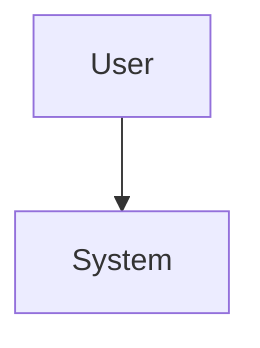

# Proposal: [任务标题]

## 1. 背景与动机 (Background & Motivation)

### 1.1 当前问题
[描述现状和痛点]

### 1.2 用户期望
[描述期望达成的效果]

## 2. 目标 (Objective)

[列出 1-3 个核心目标]

## 3. 方案设计 (Approach)

### 3.1 设计原则
[列出指导设计的核心原则]

### 3.2 核心方案
[描述具体的实现方案，如涉及多组件交互可使用架构图辅助说明]

### 3.3 核心流程（如适用）
[业务流程图、时序图]

### 3.4 技术选型（如适用）
[描述关键技术决策及其理由]

## 4. 变更范围 (Impact)

### 4.1 新增文件
| 文件路径 | 说明 |
|----------|------|
| [path] | [description] |

### 4.2 修改文件
| 文件路径 | 修改内容 |
|----------|----------|
| [path] | [changes] |

### 4.3 不涉及
[明确列出不在本次变更范围内的内容]

## 5. 接口定义 (Interface Definition)

### 5.1 外部接口及协议schema (API/CLI)
[OpenAPI 描述或 CLI 参数或函数接口]

## 6. 稳定性架构 (Stability Architecture)

### 6.1 限流与熔断 (Rate Limiting & Circuit Breaking)
*   **Rate Limiting**: [如有，定义策略，如 Token Bucket]
*   **Circuit Breaking**: [如有，定义下游依赖的熔断阈值]

### 6.2 资源隔离与限制 (Resource Isolation)
*   [定义 CPU/Memory/Disk/Network 限制]

### 6.3 灾难恢复 (Crash Recovery)
*   [定义服务重启后的状态恢复逻辑]

## 7. 可测性设计 (Testability Design)

### 7.1 本地手动验证 (Local Manual Verification)
[如何在本地开发环境手动验证核心功能]
*   Step 1: ...
*   Step 2: ...

### 7.2 自动化测试策略 (Automated Testing)
*   Unit Tests: ...
*   Integration Tests: ...

## 8. 风险与缓解 (Risks & Mitigation)

| 风险 | 缓解措施 |
|------|----------|
| [risk] | [mitigation] |

## 9. 验收标准 (Acceptance Criteria)

- [ ] **业务**: 核心架构图 (Context Diagram) 是否清晰？关键接口 (API/CLI) 是否覆盖了所有 Use Cases？
- [ ] **稳定性**: 是否定义了限流 (Rate Limiting) 和熔断 (Circuit Breaking) 策略？
- [ ] **稳定性**: 是否考虑了 Crash Recovery 和 Resource Limits？
- [ ] **运维**: 是否定义了关键的可观测性指标 (Metrics) 和 Tracing 方案？
- [ ] **可测性**: 是否包含了**本地手动验证**的详细步骤？
