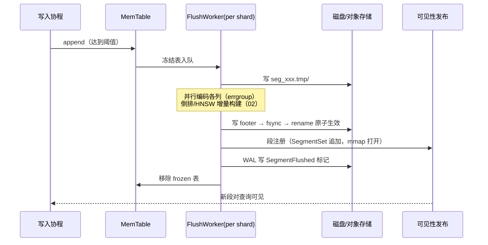
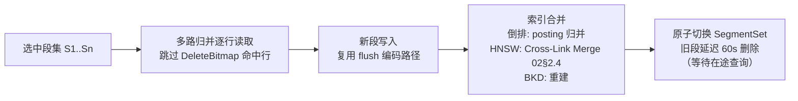

# UniSearch 详细设计 01 —— 存储引擎

> 版本：v0.1
> 日期：2026-10-17
> 上游：[概要设计 §5](../vector-database-design.md) / [00-overview.md](00-overview.md)
> 范围：数据模型、MemTable、WAL、段格式、Flush、Delete Bitmap、合并、MVCC、冷热分层
> 代码位置：`internal/storage/`、`internal/meta/`

---

## 1. 数据模型 `[M0]`

### 1.1 层级结构

```go
// pkg/types/ids.go —— 全系列共用的标识类型
type TenantID  uint32   // 租户，物理隔离单元
type IndexID   uint32   // 对标 ES index
type ShardID   uint64   // 逻辑分片（路由单位，可在线分裂）
type SegmentID uint64   // 不可变段，集群内全局唯一（雪花：时间戳+shard+序号）
type RowID     uint32   // 段内行号（0-based，段行数上限 2^32）
type FieldID   uint16   // index 内字段编号（mapping 顺序分配）
type SeqNo     uint64   // MVCC 版本号 = Raft 提交索引（M0 单机为本地 WAL 序号）
```

```go
// internal/meta/model.go —— 元数据状态机内容（存储层消费，不持有）
type IndexMeta struct {
    ID         TenantID
    Name       string            // ES index name
    Mapping    *Mapping          // 见 §1.3
    Settings   IndexSettings     // shards/replicas/refresh_interval...
    Shards     []ShardID         // 逻辑分片列表
    Aliases    []string
    CreatedAt  time.Time
}
```

层级与概要设计 §5.1 一致：`Cluster → Tenant → Index → Shard → ReplicaGroup(Raft) → Segment`。**元数据只存到 Shard 级路由**，段清单由 Shard Node 本地管理并上报心跳（数据永不进元数据，见 [05-distributed.md](05-distributed.md) §1）。

### 1.2 字段类型全集 `[M0]`

| 类型 | Go 内存表示（MemTable/执行批） | 段内编码（§4.2） | ES 对应 |
|------|------|------|------|
| `keyword` | `[]string` | 字典编码 + 字典 zstd | keyword |
| `text` | `[]string`（原文，分析在索引侧） | 不存列（倒排消费），仅 `_source` | text |
| `long` | `[]int64` | delta + zstd（或字典，基数低时） | long/integer/short/byte |
| `double` | `[]float64` | gorilla（或 SimD 拆半整数） | double/float |
| `date` | `[]int64`（epoch millis） | delta + bitpack | date |
| `boolean` | `[]bool` → 位图 | RLE 位图 | boolean |
| `ip` | `[]uint32/[]uint128` | 数值化 + delta | ip |
| `geo_point` | `[]{Lon,Lat float64}` | BKD 定点数编码（§4.2.4） | geo_point |
| `dense_vector` | `[][]float32` | float32 / SQ8 / RaBitQ（[02 §2.5](02-index-engine.md)） | dense_vector |
| `sparse_vector` | `[]map[uint32]float32` | KV 对列 + 倒排复用 | sparse_vector（本系统一等公民） |
| `nested`(v1) | 扁平化展开列 | 同其基础类型 | nested（v1 扁平化，见下） |
| `_id` | `[]string` | 字典 + 稀疏哈希索引 | `_id` |
| `_source` | `[][]byte`（原始 JSON） | zstd-19 单列 | `_source` |

**nested v1 扁平化**：`obj.sub[].field` 展开为列 `obj__sub__field`（双下划线命名，转义 `\_\_`），同文档多值行追加；段内 join 位图（每 nested 路径一个 roaring，标记「本行属于哪个父文档块」）由倒排侧维护，查询侧语义对齐 ES（概要设计 §8.5）。深度 >5 性能递减——PoC 计划见 [development-plan.md](../development-plan.md) §8。

### 1.3 Mapping 与动态推断 `[M0]`

```go
// internal/meta/mapping.go
type FieldDef struct {
    Name       string
    Type       FieldType
    Analyzer   string            // text 专用，默认 standard
    Dimensions int               // dense_vector 专用
    Element    VectorElement     // float32 | int8 | bfloat16（v1 先 float32）
    Similarity string            // cosine | dot_product | l2_norm | max_inner_product
    Index      bool              // 默认 true；false 则仅存不索引
    DocValues  bool              // 恒 true，ES 兼容层接受 false 但告警（04 §4.1）
    CopyTo     []string
    IgnoreAbove int              // keyword 超长丢弃
    NullValue  any
    Format     string            // date format
}
```

**动态推断规则**（对齐 ES 动态 mapping）：

| JSON 值 | 推断类型 |
|---|---|
| bool | boolean |
| 整数 | long |
| 浮点 | double |
| 字符串（ISO date 可解析） | date |
| 字符串 | text + keyword multi-field |
| 对象 | object（递归） |
| 数组 | 取首个元素类型（ES 语义：数组不是类型） |

冲突处理：写入值与既有 mapping 不兼容 → 默认拒绝（`400 document_parsing_exception` 风格），`dynamic: false` 时未知字段只存 `_source` 不建索引，`dynamic: strict` 全部拒绝。

---

## 2. MemTable `[M0]`

### 2.1 结构

```go
// internal/storage/memtable/memtable.go
type MemTable struct {
    shardID  ShardID
    mu       sync.RWMutex
    active   *Table        // 活跃表，写入目标
    frozen   []*Table      // 冻结表，等待 flush（最多 2 个，超过触发写入背压）
    visible  SeqNo         // 可见性水位（§8）
}

type Table struct {
    rows      int
    columns   map[FieldID]*ColumnBuilder   // 列式：按 FieldID 聚合
    sources   [][]byte                     // _source 原文（zstd 延迟到 flush 时做，内存存原文）
    ids       []string                     // _id
    seqNos    []SeqNo
    pkIndex   map[string]RowID             // _id → 行号（点查/update 定位，O(1)）
    vectors   map[FieldID]*VecBuilder      // dense/sparse 向量列
    bytes     atomic.Int64                 // 内存占用估计（触发 flush 依据）
}
```

- **写入即可见**：文档 append 到 `active` 后，`visible` 水位推进，同分片查询立即可读（强一致模式，解决 ES refresh 延迟痛点，概要设计 §2.3.2）；
- 读路径：MemTable 的读与 Segment 读在查询执行层统一为 `RowProvider`（03 §3.3 Scan 算子），MemTable 实现简单迭代（数据量小，不向量化）。

### 2.2 冻结与双缓冲

1. `active.bytes > 512MB` 或 `active` 存在超过 30s（可配）→ `active` 移入 `frozen`，新开空表；
2. `frozen` 长度 ≥ 2 → 写入侧背压（`_bulk` 返回 `429 EsRejectedExecutionException` 风格，触发客户端重试退避）；
3. flush 完成后从 `frozen` 移除，段可见性发布（§5）。

### 2.3 幂等写入 `[M0]`

`_bulk` 项可携带 `client_id + sequence`（本系统扩展 header）。MemTable 维护 `map[clientID]maxSeq` 去重窗口（容量 100 万项，LRU 淘汰），重试请求命中窗口则直接返回上次结果。ES 原生无此能力（概要设计 §5.2），默认关闭不破坏兼容。

---

## 3. WAL `[M0 本地版 → M2 Raft 化]`

### 3.1 M0：本地 WAL

M0 嵌入式/单机模式无需 Raft，但仍需 WAL 保证崩溃恢复（进程重启后 MemTable 数据不丢）。

**日志段文件布局**（`data-dir/wal/{shard_id}/{seq}.log`）：

```
文件头 (16B):  magic "USWAL01\0" | shard_id(u64)
记录 (重复至 EOF):
  ┌────────┬────────┬─────────┬──────────────┬────────┐
  │ len    │ crc32c │ seq_no  │ entry_type   │ payload│
  │ u32    │ u32    │ u64     │ u8           │ zstd   │
  └────────┴────────┴─────────┴──────────────┴────────┘
  - crc32c: 硬件加速 Castagnoli（SSE4.2/ARMv8），覆盖 seq_no+type+payload
  - entry_type: 0=Insert(文档 JSON) 1=Delete(_id) 2=Update(_id+文档)
                3=SegmentFlushed(标记, 回放时可跳过已 flush 的前缀)
                4=MetadataTick
  - 文件按 256MB 滚动；fsync 策略见 §3.2
```

**崩溃恢复**：启动时扫描每个 shard 的 WAL → 逐条校验 CRC（坏记录即截断尾部，视为未提交）→ 回放到 `SegmentFlushed` 标记之后的部分进 MemTable。

### 3.2 Group Commit `[M0]`

```
写入协程:  batch 进队列 ──┐
                        ├──► commit leader: 追加文件 → 一次 fsync → 广播完成
写入协程:  batch 进队列 ──┘
```

- 攒批窗口 `max(2ms, 4MB)` 二选一先到先触发；
- `?refresh=wait_for` 语义（04 §6.1）映射为「等待本次 group commit fsync 完成」；
- `refresh=false`（默认）仍写 WAL 但响应不等 fsync（fsync 由后台周期 100ms 兜底）——延迟与 ES wait_for 语义对齐。

### 3.3 M2：WAL 演进为 Raft Log

M2 后本节 WAL 被 [05-distributed.md](05-distributed.md) §2 的对象存储 Raft log 取代，**但日志记录格式（entry_type/payload）不变**——Raft 只是换了复制与持久化通道，回放逻辑复用。这是刻意的分层：`internal/storage/wal` 定义 `WAL` 接口（§10），M0 实现 `LocalWAL`，M2 实现 `RaftLogWAL`（adapter 到 hashicorp/raft LogStore）。

---

## 4. 段格式规格 `[M0]`

### 4.1 段目录布局

每个 Segment 是自包含目录（概要设计 §5.3），**文件集即接口**——索引引擎（02 文档）只读这些文件，不调用存储代码：

```
seg_{segment_id}/
├── meta.footer          # 段元数据（protobuf，读入后驻内存）
├── col_{field_id}.bin   # 标量列数据（编码见 §4.2）
├── vec_{field_id}.bin   # 向量列原始/量化数据
├── src.zst              # _source 列（zstd-19，按行定长索引）
├── id.dict + id.hash    # _id 字典 + 稀疏哈希（点查）
├── inv/                 # 倒排索引族（02 §3）
│   ├── terms.fst        # M0: terms.sorted；M1: FST
│   ├── post.{field}.bin # posting lists
│   └── pos.{field}.bin  # 位置信息（phrase/highlight）
├── vec.idx/             # 向量索引（02 §2）
│   ├── hnsw.graph       # CSR 图
│   ├── hnsw.levels      # 层级表
│   └── quant.state      # SQ8/RaBitQ 量化状态
├── bkd_{field_id}.bin   # 数值/日期/geo 空间索引（02 §6）
└── bitmap_{field_id}.bin# 低基数位图索引（02 §6.3）
```

### 4.2 列编码矩阵 `col_{field_id}.bin`

文件 = `ColumnHeader(protobuf) + N 个 Block`。**Block 为 8192 行**（可配），每块独立编码，块头记录编码类型与 zone map：

```protobuf
// api/proto/segment.proto（节选）
message ColumnHeader {
  uint32 field_id = 1;
  string field_name = 2;      // 调试友好，加载后可丢弃
  FieldType type = 3;
  uint64 num_rows = 4;
  repeated BlockIndex blocks = 5;   // 块偏移表
}

message BlockIndex {
  uint64 offset = 1;
  uint32 encoding = 2;        // 见下表
  ZoneMap zone = 3;
  uint32 null_count = 4;
}

message ZoneMap {
  bytes min = 1;              // 按类型的定长序列化
  bytes max = 2;
  bool  has_null = 3;
}
```

**编码选择矩阵**（flush 时按块统计自动选择，读侧按块头解码）：

| 类型 \ 块统计 | 基数 < 4096 | 基数高、单调（时间戳/自增） | 一般数值 | 浮点 |
|---|---|---|---|---|
| keyword/id | **字典编码**（字典 zstd + 索引 bitpack） | — | — | — |
| long/date | 字典编码 | **delta + bitpack** | delta + zstd | — |
| double | — | 拆半整数 delta | zstd | **gorilla** |
| boolean | RLE 位图 | RLE 位图 | RLE 位图 | — |
| geo_point | — | — | BKD 定点 interleave + zstd | — |

> ZoneMap 是查询侧跳块（03 §2 优化规则）与向量 pre-filter 选择率估算（02 §2.6）的共同数据源——**默认零成本开启**（编码时顺手计算 min/max）。

### 4.3 向量列 `vec_{field_id}.bin` `[M0]`

```
VecHeader(protobuf): dims / element_type / quantization / 对齐说明
数据区: 行主序 float32（M0 默认）或 SQ8 int8（索引构建后生成，见 02 §2.5）
```

### 4.4 `_source` 与 `_id`

- `src.zst`：整列 zstd-19 流式压缩；行偏移表 `uint64[]` 存于 footer。`_source: false` 的 index 不生成此文件（top_hits/highlight 不可用并告警，04 §4.2）；
- `id.dict`：_id 字典（排序去重，zstd）+ `id.hash`：开放寻址哈希表（`_id → RowID`，加载可选，点查路径专用）。

### 4.5 `meta.footer`

```protobuf
message SegmentFooter {
  uint64 segment_id = 1;
  ShardID shard_id = 2;
  uint64 num_rows = 3;
  uint64 min_seq_no = 4;         // §8 MVCC
  uint64 max_seq_no = 5;
  repeated ColumnStats column_stats = 6;  // 全列 min/max/null/基数
  uint64 created_at = 7;
  int64  ttl_expire_at = 8;      // ILM（04 §10）
  uint32 format_version = 9;     // 段格式版本，前向兼容判断
  bytes  checksum = 10;          // 全目录文件清单 + 各文件 crc
}
```

Footer 加载即驻内存（<1KB/段），段清单心跳上报仅含 footer 摘要（数据不进元数据）。

---

## 5. Flush 流程 `[M0]`



要点：
1. **原子可见性**：`rename(2)` 是段生效的原子点；查询侧 SegmentSet 用 `atomic.Pointer` 无锁切换；
2. flush 与查询并行（冻结表只读，active 继续写）；
3. WAL `SegmentFlushed` 标记保证：重启回放跳过已 flush 前缀，幂等；
4. 单 shard flush 并发 = 1（串行保序），多 shard 全局并发 = `min(4, CPU/2)`。

---

## 6. Delete Bitmap 与更新语义 `[M0]`

对标概要设计 §5.4——**写入放大 O(1)，非 O(part)**（针对 ClickHouse mutation 痛点）。

### 6.1 结构

```go
// internal/storage/deletes.go
type DeleteTracker struct {
    mu sync.RWMutex
    // 段级：物理段内行删除
    segmentDeletes map[SegmentID]*roaring.Bitmap
    // MemTable 内：_id → 最近删除 seq_no（防「删后旧读」）
    memDeletes map[string]SeqNo
}
```

### 6.2 语义实现

| 操作 | 流程 |
|---|---|
| `DELETE /{index}/_doc/{id}` | 定位 `_id`（MemTable pkIndex 或段 id.hash）→ 若在段内：`segmentDeletes[segID].Add(rowID)`，WAL 记 `Delete(_id)`；若在 MemTable：`memDeletes[id]=seq`。查询侧立即过滤，**无异步窗口** |
| `_delete_by_query` | 查询引擎执行（03），命中的 `(segID,rowID)` 批量写位图（04 §9 批任务框架） |
| `UPDATE` | = `DELETE(旧) + INSERT(新)`，**同一 seq_no 原子提交**（同一 WAL group commit 批次） |
| 查询过滤 | 执行计划在 Scan 之后注入 `BitmapFilter` 算子（03 §3.4），向量化 `roaring.Contains` 批判断，代价极低 |

### 6.3 物理清除

仅在段合并（§7）时物理删除位图命中的行并重建索引——查询路径永不重写。位图常驻内存部分仅为稀疏 roaring（设计估算：万级删除/亿级行 < 10MB，[概要设计 §5.4]）。

---

## 7. 段合并 `[M0]`

### 7.1 选择策略（size-tiered）

```go
// internal/storage/merge/scheduler.go —— 每 shard 每 5s 评估
// 候选：同 shard 的 sealed 段，排除：正在被查询的活跃 PIT 引用段、
//       正在分裂/迁移的段（05 §3.2）
// 规则（按优先级）：
// 1. 删除率 > 30% 的段优先合并（回收空间）
// 2. 段数 > 10 且总大小 < 5GB 的相邻 tier 组合并
// 3. _forcemerge API 触发：合并到 max_num_segments（04 §6.3）
// 限制：同时进行的合并任务数 ≤ 2/shard；合并速率自适应（GC 预算，00 §3.1）
```

### 7.2 合并流程



- 归并保序：按 `(seq_no)` 排序输出，新段 `min/max_seq_no` 继承；
- **HNSW 合并不重建全图**（Cross-Link Merge 细节在 [02-index-engine.md](02-index-engine.md) §2.4，此处只挂接）；
- 失败处理：中间产物 `tmp` 目录整体删除，旧段不受影响（合并全程旧段可读，无停顿）。

---

## 8. MVCC 与可见性水位 `[M0]`

```go
// pkg/types/snapshot.go
type Snapshot struct {
    ReadUpTo SeqNo   // 快照水位：≤ 此 seq_no 的写入可见
    PIT      bool    // 是否来自 Point-in-Time（04 §6.4）
}
```

| 机制 | 规则 |
|------|------|
| seq_no 分配 | M0：WAL group commit 批内单调递增；M2：**复用 Raft 提交索引**（一次分配，双语义：MVCC 版本 + ES `if_seq_no` 乐观锁，04 §5） |
| 水位推进 | leader 提交即推进 `applied`；查询默认读到 `applied`（强一致，即 Raft read-index 语义，05 §4.2） |
| `consistency=eventual` | 放宽到 follower 本地 `applied`（可能滞后），换读吞吐 |
| PIT（M1） | `POST /{index}/_pit` pin 一个 `ReadUpTo`，SegmentSet 与 DeleteBitmap 保留对应视图（段延迟删除已有机制天然支持），TTL 默认 5 分钟 |
| 快照读 | Scan 算子遍历段时按 `max_seq_no ≤ ReadUpTo` 裁剪段；MemTable 内按 `seqNos[i] ≤ ReadUpTo` 过滤行 |

---

## 9. 冷热分层接口 `[M2]`

概要设计 §5.5 的三级分层。存储引擎提供**段级状态机与原子切换**，量化与 DiskANN 构建由索引引擎（02）执行：

```go
// internal/storage/tiering/tiering.go
type Tier int
const (
    TierHot  Tier = iota  // NVMe + 内存：float32 + HNSW
    TierWarm              // 对象存储 + 本地缓存：RaBitQ + 精简图
    TierCold              // 仅对象存储：DiskANN
)

type TierManager interface {
    // 降级是段级后台任务：构建量化副本 → 原子切换 footer 指针 → 释放旧资源
    Degrade(ctx context.Context, seg SegmentID, to Tier) error
    Report() map[Tier]TierStats   // 水位上报（合并入 _cat/allocation，04 §7）
}
```

- 触发规则（可配）：段龄 > 24h 或读写比 > 100:1 → Warm；ILM 策略或段龄 > 7d → Cold；
- 查询跨层段自适应执行（按段 footer 的索引类型分发，[02 §2.5](02-index-engine.md)），召回率差异由 `k 过采样 + 精排回表` 补偿（03 §5）。

---

## 10. 存储引擎 Go 接口总览 `[M0]`

```go
// internal/storage/segment/reader.go
type SegmentReader interface {
    ID() SegmentID
    NumRows() int
    // 列扫描：返回按 Block 流式迭代的读取器（Block 常驻 page cache，不拷贝）
    ScanColumn(ctx context.Context, field FieldID, snap Snapshot) (ColumnIterator, error)
    // 点查路径
    LookupID(ctx context.Context, id string) (RowID, bool, error)
    Source(row RowID) ([]byte, error)   // 解压单行 _source
    Footer() *SegmentFooter
    Close() error
}

// internal/storage/segment/writer.go
type SegmentWriter interface {
    // 从 MemTable 冻结表构建段（flush）或多段归并（merge，输入带删除位图过滤）
    Write(ctx context.Context, src RowProvider, opts WriteOptions) (SegmentReader, error)
}

// internal/storage/wal/wal.go
type WAL interface {
    // Append 保证 group commit 语义：返回值代表已持久化的 seq_no
    Append(ctx context.Context, entries ...Entry) (SeqNo, error)
    Replay(ctx context.Context, from SeqNo, fn func(Entry) error) error
    TruncateBefore(seq SeqNo) error   // flush 标记之后的 GC
}

// internal/storage/shard.go —— Shard 聚合根（per-shard 单写多读）
type Shard struct { /* MemTable + WAL + SegmentSet + DeleteTracker */ }
func (s *Shard) Write(ctx context.Context, batch WriteBatch) (BulkResponse, error)
func (s *Shard) Snapshot() (Snapshot, SegmentSet)
```

---

## 11. 里程碑与验收摘要

| 能力 | 里程碑 | 验收要点（对应 [development-plan.md](../development-plan.md)） |
|------|--------|------|
| 数据模型/动态 mapping | M0 | 类型推断表全过；冲突拒绝 |
| MemTable + 本地 WAL + group commit | M0 | 崩溃恢复零数据丢失（chaos: kill -9 注入） |
| 段格式 + 编码矩阵 + zone map | M0 | 编码往返单测；8192 块跳块命中 |
| Flush 原子可见 | M0 | flush 期间查询零错误 |
| Delete Bitmap / UPDATE | M0 | 删除立即生效；同 seq_no 原子性 |
| size-tiered 合并 | M0 | 合并无查询停顿 |
| MVCC/PIT | M0(快照)/M1(PIT API) | PIT 视图一致性 |
| 冷热分层 / Raft WAL / 在线分裂位图继承 | M2 | 见 [05-distributed.md](05-distributed.md) §3.3 |

### 在线分裂的位图继承（概要设计开放问题 2 的决策）`[M2]`

分片在线分裂（[05-distributed.md](05-distributed.md) §3）时，父分片的段文件**共享不重写**，子分片按路由重新归属；DeleteBitmap 继承规则：

- 段在父子分片间共享期间（dual-read 窗口），删除操作**同时写父与命中子分片**的位图（同一 `Delete` WAL 条目，两个 Raft 组都提交）；
- 子分片接管后，扫描共享段时用「本子分片路由域内 row 集合」与父位图求交，得到子视图——无需物理切分位图；
- 父分片下线时，其位图随共享段引用计数归零而废弃。

---

*本文件与 [02-index-engine.md](02-index-engine.md) 的契约：索引引擎只消费 §4 段文件格式与 §10 接口；存储引擎不理解任何索引语义。修订段格式需同时 bump `format_version` 并给出迁移说明。*
