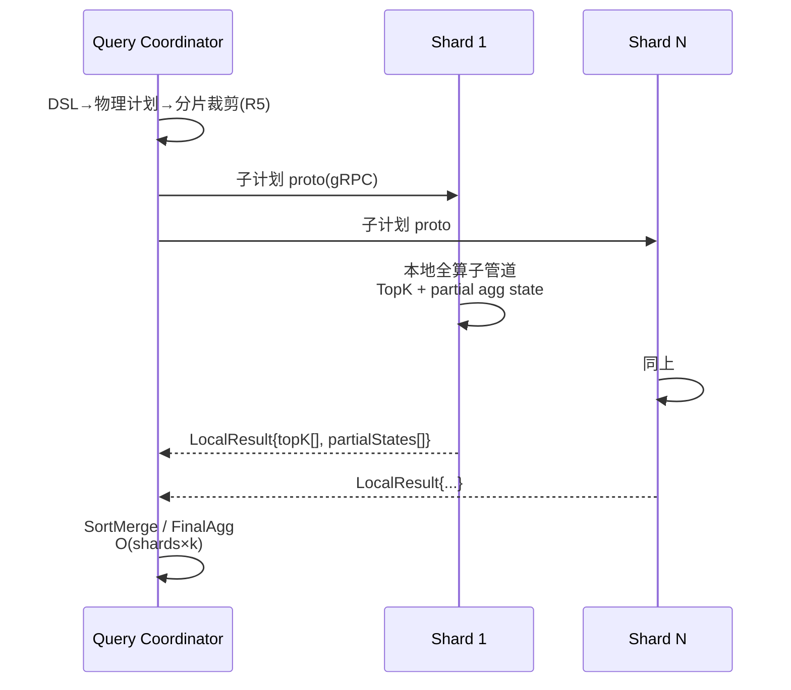

# UniSearch 详细设计 03 —— 查询引擎

> 版本：v0.1
> 日期：2026-10-17
> 上游：[概要设计 §7](../vector-database-design.md) / [00-overview.md](00-overview.md)
> 前置：[01-storage-engine.md](01-storage-engine.md)（RowProvider/快照）/ [02-index-engine.md](02-index-engine.md)（LoadedIndex.Search）
> 范围：DSL→AST、计划与优化器、向量化执行、MPP、融合、聚合、全局统计、分页、脚本、profile
> 代码位置：`internal/engine/`

---

## 1. 总体流水线 `[M0]`


M0 单机：E 之后单进程内执行；M2：E 序列化分发分片，F/G 跨进程（§4）。

---

## 2. DSL 解析层 `[M0]`

### 2.1 AST 定义（节选核心节点）

```go
// internal/engine/dsl/ast.go
type Query interface{ queryNode() }

// —— 词项级 ——
type TermQuery struct{ Field string; Value any; Boost float64; CaseInsensitive bool }
type TermsQuery struct{ Field string; Values []any; Boost float64 }
type RangeQuery struct{ Field string; Gt, Gte, Lt, Lte any; TimeZone, Format string; Boost float64 }
type ExistsQuery struct{ Field string }
type PrefixQuery / WildcardQuery / RegexpQuery / FuzzyQuery / IdsQuery struct{ ... }

// —— 全文 ——
type MatchQuery struct{ Field string; Text string; Operator string; Fuzziness string;
    MinimumShouldMatch string; Analyzer string; Boost float64 }
type MatchPhraseQuery struct{ Field, Text string; Slop int; Analyzer string }
type MatchPhrasePrefixQuery / MultiMatchQuery struct{ ... }   // multi_match: best/most/cross_fields/phrase
type QueryStringQuery struct{ Lucene string }                  // Lucene 语法递归下降解析（AND/OR/NOT/()?*""~）

// —— 组合（基石）——
type BoolQuery struct{ Must, Should, Filter, MustNot []Query; Boost float64; MinShouldMatch string }

// —— 向量/混合（核心增强）——
type KnnQuery struct{ Field string; Vector []float32; K, NumCandidates int;
    Filter []Query; Similarity float64; Boost float64 }
type SparseVectorQuery struct{ Field string; Embedding map[uint32]float32 }
type HybridQuery struct{
    Queries []Query                            // 任意路：match/sparse/knn/bool...
    Filter  []Query                            // 共享下推
    Rank    RankSpec                           // §5
}

// —— 打分修饰 ——
type ConstantScoreQuery / BoostingQuery / DisMaxQuery / FunctionScoreQuery struct{ ... }
type ScriptScoreQuery struct{ Query Query; Script *Script }
```

AST 节点全集与 ES DSL 的映射矩阵（含 🟡 partial 项差异）在 [04-es-compat-layer.md](04-es-compat-layer.md) §3 维护——**该矩阵是单一事实源，本文件不重复**。

### 2.2 解析器实现约定

- `encoding/json` 解到 `map[string]json.RawMessage` 后**逐层手工解**（非反射一把梭）：错误信息带 JSON 路径（`query.bool.must[2].match.foo`）与原因，🟡/❌ 项抛 `APIError{Unsupported}`（00 §6.1）；
- 解析器**不做语义检查**（字段存在性/类型匹配推迟到计划期，错误信息更完整）；
- fuzziness / date math / minimum_should_match 等字面量语法各有微型 parser，全部模糊测试覆盖（06 §5）。

---

## 3. 计划与优化器 `[M0]`

### 3.1 逻辑计划

```go
// internal/engine/plan/logical.go
type LogicalPlan interface{ planNode() }
type Scan struct{ Index IndexRef; Snapshot Snapshot; Projection []FieldID }   // 投影裁剪
type Filter struct{ Pred Query; Input LogicalPlan }
type ANN struct{ Field FieldID; Knn KnnQuery; FilterPlan FilterPlan /*02§2.6*/ }
type BM25 struct{ Pred Query; TopK int }                                       // 倒排驱动（非扫描）
type TopN struct{ Input LogicalPlan; Sort []SortKey; From, Size int }
type Aggregate struct{ Input LogicalPlan; Aggs []AggSpec }
type Fusion struct{ Inputs []LogicalPlan; Rank RankSpec }
```

### 3.2 优化器规则集（固定顺序，可解释）

| # | 规则 | 说明 |
|---|------|------|
| R1 谓词下推 | bool.filter 提取常量谓词下推至 Scan/ANN（ANN 走 02 §2.6 规划器） |
| R2 跳块注入 | 谓词中的字段范围 → Scan 附加 ZoneMap 谓词（01 §4.2） |
| R3 投影裁剪 | 只保留 sort/agg/hits/_source 需要的列 |
| R4 pre/post-filter 决策 | 调 `hnsw.PlanVectorFilter`（02 §2.6），结果物化为 `FilterPlan` |
| R5 分片裁剪 | M2：路由键（routing/alias）命中 → 裁剪分片子计划（05 §3.1） |
| R6 BM25 段上界剪枝 | 纯文本 TopK：按段 maxScore 排序段，逐段执行直到剩余段上界 < 当前第 k 名 |
| R7 聚合局部化 | MPP：Aggregate 拆 Partial（分片）+ Final（协调器），partial state 协议 §6.2 |

优化器 trace 输出到 `profile` API（§11）。

### 3.3 物理计划与执行算子 `[M0]`

```go
// internal/engine/exec/operator.go
// 拉取（Volcano）模型 + 向量化批：Next 每次产出一个 ColumnBatch。
type Operator interface {
    Next(ctx context.Context) (*ColumnBatch, error)   // io.EOF 结束
    Close()
}

// ColumnBatch：4096 行定长（00 §3.1 池化）
type ColumnBatch struct {
    Rows    int
    Cols    []ColumnVec          // 投影裁剪后的列
    Sel     *roaring.Bitmap      // 选择向量（过滤不拷贝，位图标注）
    DocIDs  []GlobalDocID        // (SegmentID, RowID) 定长编码 u64
    Scores  []float32            // 打分路（BM25/ANN）有效
}
```

算子清单：

| 算子 | 职责 | 关键实现 |
|------|------|---------|
| `Scan` | 段列流 → ColumnBatch | 块解码 + ZoneMap 跳块（R2）+ MVCC 过滤（01 §8） |
| `BitmapFilter` | DeleteBitmap 剔除 | 向量化 `roaring.Contains`（01 §6.2） |
| `PredFilter` | 标量谓词 | 列批 SIMD 比较 → Sel 位图 |
| `ANN` | HNSW 搜索 | 消费 `LoadedIndex.Search`（02），pre-filter 位图受限遍历 |
| `BM25Score` | 倒排驱动打分 | term→posting 游标合并，TF/IDF 批计算；M1 WAND 剪枝（02 §3.4） |
| `HashAggregate` | 分组聚合 | §6.1 |
| `TopN` | 归并排序截断 | 有界堆（大小 From+Size，上限 10000，§8） |
| `SortMerge` | 多段/多分片结果归并 | O(shards×k) loser tree |
| `Fusion` | 混合路融合 | §5 |
| `Rescore` / `Collapse` / `ScriptEval` / `RuntimeMap` | 修饰类 | §10 |
| `Limit` / `Project` | 常规 | — |

**执行模型**：单 goroutine per 分片子计划（算子间函数调用，无 channel 开销）；跨分片 `errgroup` 并行（00 §3.3）。

### 3.4 查询计划示例（概要设计 §10 示例 2 的计划）

```
hybrid(match(content), knn(emb)) + filter term(project_id) + rrf
→ 物理计划：
TopN(sort=_score desc, from=0,size=10)
└─ Fusion(rrf, k=60, window=500)
   ├─ PredFilter(project_id=p-42)          ← R1 下推
   │  └─ BM25Score(match(content), TopK=500)
   └─ ANN(emb, k=50, num_candidates=200, FilterPlan=PreFilter(sel≈0.1%))   ← R4
```

---

## 4. 两阶段 MPP 执行 `[M2]`

对标 Milvus broadcast-collect 瓶颈（概要设计 §2.3.1 / §7.1）：



- 子计划序列化：`api/proto/plan.proto`（物理计划节点与 LocalResult 的 protobuf schema，含 PartialState any 编码）；
- 协调器**只收局部 TopK + partial state**，无全量数据过汇聚点；
- 超时与部分失败：分片级重试（replica 切换，05 §4.2），`?allow_partial_search_results=false` 时任一分片失败即整体失败（ES 语义对齐）。

---

## 5. 混合检索融合 `[M0]`

```go
// internal/engine/fusion/fusion.go
type RankSpec struct {
    Method     RankMethod   // rrf | weighted | relative_score | rerank
    RankConst  int          // rrf: rank_constant，默认 60
    Weights    []float64    // weighted: 每路权重
    WindowSize int          // 每路取前 window（默认 500），融合预算控制
    Rerank     *RerankSpec  // method=rerank 时
}
type Fusion interface {
    Merge(cands [][]ScoredDoc) ([]ScoredDoc, error)
}
```

| 方法 | 公式/协议 | 说明 |
|------|----------|------|
| `rrf` | `score(d) = Σ_i 1/(k + rank_i(d))` | 免调参默认；ES RRF 常数语义一致（k=60） |
| `weighted` | 各路 min-max 归一（路内：`(s-min)/(max-min)`）后 `Σ w_i·ŝ_i` | 对标 ES linear retrieval / Weaviate weightedRanker |
| `relative_score` | 以 BM25F 为基线的相对分数（Weaviate 式）：向量分映射到 BM25 分布同尺度 | `baseline=bm25f` 参数 |
| `rerank` | 融合 TopN（默认 window）→ POST 外部 reranker（HTTP，模型服务地址 `settings.inference.rerank_url`）→ 重排 | 协议：`{query, docs[]}` → `{scores[]}`；超时 2s 降级 rrf；M3 内置本地模型 |

- `filter` 共享下推（R1/R4）对所有路生效；
- 召回补偿：跨层段（01 §9）参与时 window 自动 ×2 + 精排回表。

---

## 6. 聚合引擎 `[M1]`

### 6.1 向量化分组聚合 `[M1]`

- 哈希表：**flat 开放寻址**（`[]uint64 keys + []float64/[]int64 slots`），key = group-key 定长序列化（多字段拼接 hash）；零指针，池化复用；
- 列批聚合内核：`sum/min/max/count` 按列 SIMD 归约（`internal/simd` 复用）；`avg` 拆 sum+count；
- cardinality：HLL++（sparse/dense 自适应，`precision_threshold` 语义与 ES 一致——阈值内精确（位图直算）、超阈值近似）；
- percentiles：t-digest（centroid 压缩序列化）。

### 6.2 PartialState 协议（MPP 前提）`[M1 单机预留 / M2 分片]`

```protobuf
// api/proto/plan.proto（节选）
message PartialState {
  string agg_id = 1;
  oneof state {
    HLLSketch hll = 2;         // 寄存器压缩（gamma 编码）
    TDigestSketch tdigest = 3; // centroid 数组
    TopState top = 4;          // top_hits/terms 的 (key,count/doc_count) 数组
    SumState numeric = 5;      // sum/count/min/max 四元组
  }
}
```

Final 阶段：terms 桶合并（同 key 加和）、HLL 寄存器按 max、t-digest centroid 归并重压缩。桶裁剪（`size`/`shard_size`）在 partial 与 final 两级执行（ES 同构）。

### 6.3 聚合类型清单

bucket：terms / range / date_range / filter / filters / missing / nested / histogram / date_histogram / auto_date_histogram / significant_terms / sampler / global / composite / multi_terms / rare_terms / ip_range / geo_distance；metric：min/max/sum/avg/stats/extended_stats/value_count/cardinality/percentiles/percentile_ranks/top_hits/weighted_avg/median_absolute_deviation/geo_centroid/geo_bounds/boxplot/string_stats；pipeline：bucket_sort/bucket_selector/bucket_script/derivative/cumulative_sum/moving_avg/avg_bucket/max_bucket/sum_bucket/stats_bucket/serial_diff/normalize。逐条与概要设计 §8.4 矩阵对齐（04 §3.2）。

---

## 7. BM25 全局统计 `[M1]`

ES 经典痛点：IDF 按分片局部计算，分数跨分片不可比（概要设计 §7.1）。

- **全局词频统计表**：`docFreq_global(term)` = Σ 段 `docFreq`。维护：段 footer 的 `term_stats` 摘要（高频 top 10 万词项）随段注册上报 → meta 集群聚合（增量合并，5 分钟周期刷新）→ coordinator 下推到各分片快照缓存；
- 查询打分：`global_stats=true`（settings，默认 false 对齐 ES 行为）时 IDF 用全局表，否则段局部（分数与 ES 语义可比）；
- 统计漂移（概要设计 §14）：刷新周期内的新词项回退局部 IDF——差异清单标注（04 §3.3）。

---

## 8. 分页与游标 `[M0 from/size · M1 search_after/PIT]`

| 方式 | 实现 |
|------|------|
| `from/size` | TopN 堆容量 `from+size ≤ 10000`（ES `max_result_window` 同限）；超限报错同 ES 文案 |
| `search_after` | 排序键序列化：`(sortValues..., _shard_doc)` 严格全序（tie-breaker 强制追加）；游标编码 base64 透明传输，比较器逐 key 二进制比较 |
| `PIT` | `POST /{index}/_pit` → `Snapshot{ReadUpTo}` 注册（TTL 5 分钟，LRU 上限 10000 个），段延迟删除机制天然支撑视图稳定（01 §8）；`search_after` + `pit` 组合为深分页推荐路径 |
| `scroll` | 04 §6.4：接收并内部转译为 search_after+PIT（scroll_id 兼容返回） |
| `terminate_after` / `track_total_hits` | 前者：行数阈值提前终止（Limit 算子）；后者：`false`→ 不精确计数（跳过 Count 路）、数值→精确计数上限 |

---

## 9. 脚本引擎（painless 子集）`[M1]`

```go
// internal/engine/script/script.go
type Script struct {
    Lang   string            // "painless"（唯一）；其他 lang → unsupported 错误
    Source string
    Params map[string]any
}

// 求值器：AST 直译（树遍历），v2 预留字节码编译接口
type Evaluator interface {
    // ctx 提供 doc['field']、params、_score、向量函数
    Eval(ctx *ScriptCtx) (any, error)
}
```

- 支持子集：算术/逻辑/比较、字符串拼接与常用方法（length/substring/startsWith…）、`doc['f'].value`、`params.x`、`_score`、`Math.*` 子集、三目、`emit`（script_fields）；
- **向量函数一等公民**：`cosineSimilarity(query, doc['emb'])`、`dotProduct`、`l1norm`、`l2norm`（复用 `internal/simd` 内核，script_score 向量打分不衰减）；
- 安全：无 IO/反射/无限循环（静态语法白名单 + 求值步数预算 10 万步，超限中断报错）；
- 场景挂接：`script_score`、`script_fields`、`bucket_script`、`runtime_mappings`（§10）。

---

## 10. 修饰能力挂接 `[M1]`

| 能力 | 挂接点 |
|------|--------|
| `rescore` | 主查询 TopN（window 内）→ `Rescore` 算子二次打分（query_weight/rescore_query_weight 语义对齐 ES）；window 默认 10 |
| `collapse` | 按字段分组取首：TopN 后注入 `Collapse` 算子（组内 top_hits 保留 `inner_hits`） |
| `highlight` | TopK 后处理：`BM25Score` 路记录的 posting offsets（02 §3.5）+ 查询词项重匹配 |
| `suggester` | term/phrase：词典 Levenshtein 自动机（02 §3.1 fuzzy 同基建）；completion：FST（02 §7） |
| `runtime_mappings` | Scan 之后 `RuntimeMap` 算子：表达式（§9）逐批计算虚拟列，仅参与过滤/排序/聚合（不可索引） |
| `function_score` | `FunctionScoreQuery`（§2.1）：field_value_factor/random_score/weight/decay(gauss/lin/exp) 批量向量计算 |

---

## 11. Profile API `[M1]`

`?_profile=true` 输出对齐 ES profile 结构（概要设计 §8.3）：

```json
{ "profile": { "shards": [ { "id": "[x][0]", "searches": [ {
    "query": [ { "type": "BooleanQuery", "description": "...", "time_in_nanos": ...,
                  "breakdown": { "create_weight": ..., "next_doc": ..., ... } } ],
    "aggregations": [...], "rewrite_time": ...
} ] } ] } }
```

- `type/description` 映射：AST 节点 → ES 查询名（BoolQuery/TermQuery…），值从优化器 trace（§3.2）与算子计时采集；
- breakdown 字段以本系统算子阶段填充（plan/scan/filter/score/agg），语义对齐字段名——ES 监控面板（若接 Kibana profile UI）直接可用。

---

## 12. 里程碑汇总

| 能力 | M0 | M1 | M2 |
|------|----|----|----|
| DSL 子集（bool/term/terms/range/exists/match/match_phrase/knn/sparse/hybrid/function_score） | ✅ | | |
| 优化器 R1-R4/R6 | ✅ | | R5/R7 |
| 向量化执行（ColumnBatch + Scan/Filter/ANN/BM25/TopN/Fusion） | ✅ | | |
| RRF/weighted/relative_score 融合 | ✅ | | |
| rerank（外部 HTTP） | | ✅ | |
| 聚合全量 + partial state | | ✅ | 分片并行 |
| search_after/PIT/scroll 兼容 | | ✅ | |
| 脚本引擎/rescore/collapse/highlight/suggester/profile | | ✅ | |
| MPP 分片执行 + 全局 BM25 统计下发 | | | ✅ |

---

*本文件与 [04-es-compat-layer.md](04-es-compat-layer.md) 的契约：DSL 语法树的合法性、兼容矩阵、错误文案由 04 维护；执行语义（分数/时序/内存）由本文件维护。与 [02-index-engine.md](02-index-engine.md) 的契约：`SearchBudget{ef, deadline, mem}` 控制索引搜索资源；`SearchResult` 含 `MaxScore` 供 R6 剪枝。*
