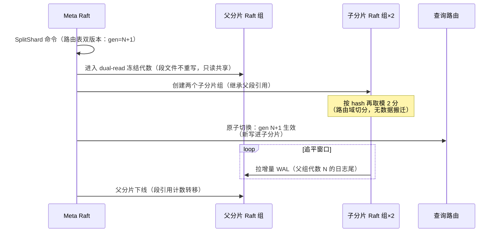

# UniSearch 详细设计 05 —— 分布式架构

> 版本：v0.1
> 日期：2026-10-17
> 上游：[概要设计 §9](../vector-database-design.md) / [00-overview.md](00-overview.md)
> 前置：[01-storage-engine.md](01-storage-engine.md)（WAL/段/位图）/ [03-query-engine.md](03-query-engine.md)（MPP）
> 范围：元数据 Raft、对象存储 WAL、分片路由与在线分裂、副本与恢复、多租户、Coordinator、gRPC 协议、部署、混沌
> 代码位置：`internal/raft/`、`internal/meta/`、`internal/coordinator/`、`internal/tenant/`、`internal/objstore/`

---

## 1. 元数据集群 `[M0 单机形态 / M2 集群]`

### 1.1 状态机内容（有限且小）

对标痛点：Milvus 依赖 etcd + Weaviate 单 Raft 规模上限（概要设计 §2.4）。

```go
// internal/meta/state.go —— Raft FSM（hashicorp/raft）
// 铁律：数据永不进元数据存储（概要设计 §9.1）。状态机只含：
type MetaState struct {
    Version   uint64                       // 状态机版本
    Schemas   map[IndexID]*IndexMeta       // 含 mapping/settings/别名（01 §1.1）
    Routes    map[ShardID]*RouteEntry      // 分片 → 副本组成员列表
    Tenants   map[TenantID]*TenantMeta     // 租户/配额/隔离模式（§5）
    Watermarks map[ShardID]SeqNo           // 各分片可见性水位摘要（查询路由参考）
    Members   []NodeInfo                   // 集群成员（shard node 心跳注册）
}

type RouteEntry struct {
    ShardID    ShardID
    IndexID    IndexID
    RaftGroup  []NodeID                   // 副本组（1 leader + N follower）
    Generation uint64                     // 分裂/迁移代数（§3.2 双版本依赖）
}
```

- 单条路由 < 1KB，10 万分片 < 100MB——单 Raft 组可支撑**万级索引**（概要设计 §9.1 估算）；
- 变更命令：`CreateIndex/AddReplica/SplitShard/Migrate/UpdateQuota/...`（protobuf，FSM Apply 幂等）。

### 1.2 hashicorp/raft 封装

| 关注点 | 设计 |
|--------|------|
| 选型理由 | `LogStore/StableStore/Transport/SnapshotStore` 四接口全可自定义（对象存储 WAL 的前提）；Consul/Nomad 生产背书（00 §2.1） |
| 快照 | `SnapshotStore` 自定义：状态机 protobuf 序列化 → 对象存储；恢复即拉快照 + 重放增量日志 |
| 读写 | 写走 Raft Apply；**读默认 ReadIndex**（线性一致，无日志）；follower 读 = 本地 applied（`eventual`，01 §8） |
| 心跳 | shard node 每 5s 上报（段 footer 摘要 + 水位 + 资源水位）→ members 表 |

### 1.3 超大规模：Multi-Raft 分组 `[M2+]

路由条目超内存阈值（默认 500 万条）→ 按 index namespace 哈希切分元数据 Raft 组（组间无交易需求——所有跨索引操作走协调器两阶段，无跨组原子性要求）。嵌入式模式退化为单节点 Raft（快照恢复），升级云原生时：`--join` 首节点导入嵌入式快照 → 自动三副本化（概要设计 §9.1）。

---

## 2. WAL 即 Raft 日志（对象存储 WAL）`[M2]`

对标 Milvus Woodpecker（概要设计 §2.2/§5.2）：去掉独立 MQ，日志段直接落对象存储。

### 2.1 架构

```mermaid
flowchart LR
    subgraph Raft Group (per shard)
        L[Leader] -->|AppendEntries<br/>gRPC 流| F1[Follower]
        L --> F2[Follower]
    end
    L -->|日志段 256MB 滚动| O[(对象存储<br/>wal/{shard}/{gen}/{seq}.log)]
    F1 -->|追赶：直接拉对象存储<br/>（leader 只发指针）| O
    F2 --> O
    L -->|双写热副本| N[(本地 NVMe<br/>wal-local/)]
```

### 2.2 关键设计

| 项 | 设计 |
|----|------|
| LogStore 实现 | 实现 hashicorp/raft `LogStore`/`StableStore`：`AppendLogs` 异步上传对象存储（批量 + zstd），**本地 NVMe 双写热副本先行确认**——概要设计 §14「对象存储延迟抖动」的缓解：Raft quorum 判定基于本地 NVMe fsync，对象存储是归档副本（慢只影响追赶，不影响提交延迟） |
| 日志段格式 | 复用 01 §3.1 记录格式（`entry_type/payload` 不变）——Raft 只是复制通道，回放逻辑 M0/M2 共用 |
| follower 追赶 | leader AppendEntries 只携带 `(objPath, offset)` 指针；follower 从对象存储并行拉段（限速令牌桶，避免打爆出口带宽） |
| GC | 段被 Raft 快照覆盖（`SnapshotIndex > segmentMaxSeq`）→ 延迟 24h 删除（供慢 follower 补拉窗口） |
| 恢复 | 新 leader = Raft 选举（本地 NVMe 日志参与投票）→ 上任后从对象存储校验补齐 → 回放 FSM（MemTable，01 §3.1 同逻辑） |

---

## 3. 分片与路由 `[M0 静态 / M2 分裂]`

### 3.1 路由算法

`shard = hash(routing or _id) % number_of_shards`（与 ES 路由兼容，04 §4.2）。`number_of_shards` 为**逻辑分片数**：与 ES 的差异（需重索引才能扩分片）——UniSearch 支持在线分裂（概要设计 §8.5/§9.4）。

### 3.2 在线分裂协议 `[M2]`



- **DeleteBitmap 继承**：已在 [01-storage-engine.md](01-storage-engine.md) §11 决策（dual-read 窗口双写、接管后位图与路由域求交、引用计数归零废弃）；
- **crosslinks 重定向**：共享段的 HNSW crosslink 指向父 `SegmentID`——段引用不变（共享），路由层 `Generation` 变更后 crosslink 解析自动跟随（02 §2.4.2 编码含 SegmentID，段归属不影响段间跳段）；
- 查询无感知：切换瞬间父/子同代数双答（路由层 gen 比较 + 幂等去重）。

### 3.3 副本放置 `[M2]`

创建/迁移时调度约束：机架感知（label spread）、租户隔离约束（§5）、磁盘/内存/QPS 水位打分（`_cat/allocation` 数据源）。

---

## 4. 副本一致性与故障恢复 `[M2]`

| 项 | 设计 |
|----|------|
| 写入 | 每分片一 Raft 组，quorum 提交（1 leader + 2 follower 默认）→ seq_no = Raft index（01 §8） |
| 读 | 默认 leader（ReadIndex 线性一致）；`preference=_replica` → follower 本地 applied（最终一致 + 最低延迟） |
| 故障接管 | leader 失联：Raft 选举超时（默认 1.5s）；新 leader 从本地 NVMe 日志 + 对象存储补齐 → 回放 FSM（秒级，**RTO < 30s 演练门禁**，概要设计 §9.2） |
| 数据校验 | 段 footer checksum（01 §4.5）+ 周期性副本比对（抽样行 hash 对账） |
| 再均衡 | 三阶段：目标节点拉快照（段文件对象存储直拷 + 元数据注册）→ 增量日志同步 → 路由表原子切换（Gen+1）；全程旧副本可服务 |
| 背压 | follower 落后超 256MB 日志 → leader 限流写入（`429` 上抛，复用 01 §2.2 背压通道） |

---

## 5. 多租户 `[M0 数据模型 / M1 shared-shard / M2 全量]`

对标 Weaviate 原生多租户（概要设计 §9.3）。

### 5.1 租户模型

租户 = 路由表一级实体：`TenantMeta{Mode, Quota, ResourceGroup}`；索引创建必须携带租户上下文（默认 `default` 租户，兼容层透传）。

### 5.2 三种隔离模式

| 模式 | 实现 | 里程碑 |
|------|------|--------|
| `dedicated` | 租户的分片组独占 Shard Node（调度约束 §3.3 硬性） | M2 |
| `shared-shard` | 分片混部 + 资源组限额：**cgroup v2**（CPU/内存/IO 由节点代理下发）+ **查询并发 semaphore**（per-tenant 并发预算）+ 写入 TPS 令牌桶 | M1 |
| `cold` | 租户级暂停：段从打开集合卸载（mmap close），元数据保留；唤醒 = 重新打开段（秒级，page cache 预热可选） | M2 |

### 5.3 配额（四维，概要设计 §9.3）

`存储字节 / 向量条数 / 查询 QPS / 写入 TPS`——由心跳聚合到 meta，超额写 `429` + 租户标识错误体（`_cat/tenant` 扩展 cat 端点，运维观测）。

---

## 6. Coordinator 层 `[M2]`

### 6.1 Ingest Coordinator

- `_bulk` 按路由键（`_id`/`routing` 哈希）**分片内攒批**（4MB/2ms，与 01 §3.2 group commit 对齐）；
- 背压：per-shard 队列水位（上限 64MB）→ 信用流控（分片 ack 后发放额度）→ 上游 `429`；
- 幂等：`client_id+sequence` 去重窗口（01 §2.3）在 coordinator 侧实施（重试在入口拦截，不打到 Raft）。

### 6.2 Query Coordinator

03 §4 MPP 的协调端：物理计划分片裁剪（R5）→ 子计划 gRPC 分发 → `SortMerge/FinalAgg` 归并。分片失败重试换副本（§4），`allow_partial_search_results=false` 全或无。

---

## 7. 内部 gRPC 协议 `[M2]`

```protobuf
// api/proto/shard.proto（节选）
service ShardService {
  rpc Write(WriteBatch) returns (WriteAck);            // Ingest → shard leader
  rpc Search(SubPlan) returns (stream LocalResult);   // Coordinator → shard（含 partial state 流式）
  rpc Get(GetRequest) returns (GetResponse);          // 点查/复述
  rpc PullWAL(WALCursor) returns (stream LogChunk);   // follower 追赶（本地 NVMe 快路径）
  rpc Snapshot(SnapshotRequest) returns (SnapshotMeta); // 再均衡拉快照
}
// api/proto/meta.proto
service MetaService {
  rpc Apply(MetaCommand) returns (ApplyResult);
  rpc Watch(WatchRequest) returns (stream MetaEvent);   // 路由/水位推送（coordinator 缓存失效）
  rpc Heartbeat(NodeInfo) returns (HeartbeatAck);
}
```

- 序列化：物理计划/PartialState 走 `plan.proto`（03 §4/§6.2 定义）；
- 流控：`LocalResult` 流式（每 1MB flush），大聚合 partial 不整包驻协调器内存。

---

## 8. 部署拓扑 `[M2]`

```
模式一（嵌入式，M0）：unisearch --embedded --data-dir ... --listen :9200
模式二（云原生，M2）：
  meta×3       ：unisearch --cloud --role meta  --raft-peers ...
  coordinator×N：unisearch --cloud --role coordinator --meta-addrs ...
  shard×M      ：unisearch --cloud --role shard --meta-addrs ... --objstore s3://...
```

- K8s：StatefulSet（meta/shard）+ Deployment（coordinator）+ Service；Operator 需求（M2 后期）：分片调度感知（§3.3 约束下自动化再均衡）、分裂自动化、租户配额 CRD；
- 配置示例与最小化清单见 `build/deploy/`（随实现交付）。

---

## 9. 混沌工程场景（M2 验收，对应概要设计 §13）`[M2]`

| # | 场景 | 注入方式 | 期望 |
|---|------|---------|------|
| C1 | shard leader kill -9 | 进程杀 | ≤30s 接管，零提交数据丢失（WAL quorum），查询错误率窗口 < 切换时长 |
| C2 | 网络分区（meta 少数派） | iptables/tc | 多数派继续服务；少数派只读降级 |
| C3 | 对象存储慢 IO（+2s 延迟） | tc 代理 | 写入 P99 退化 < 2×（NVMe 双写热路径兜底，§2.2） |
| C4 | 磁盘满（NVMe 90%） | 填充 | 合并暂停 + 告警 + 只读保护（`429 cluster_read_only`） |
| C5 | 分裂期间 leader 双杀 | 组合 C1+分裂 | dual-read 窗口内父组重建或子组重新发起分裂（Gen 回退） |
| C6 | follower 长期落后后追赶 | 停 follower 1h | 对象存储补拉成功，最终一致 |

工具：`test/chaos/`（toxiproxy + 脚本编排），每夜演练，报告归档（06 §5）。

---

## 10. 里程碑汇总

| 能力 | M0 | M1 | M2 | M3 |
|------|----|----|----|----|
| meta 单机形态（JSON+fsync，接口与 FSM 命令集同 M2） | ✅ | | | |
| 租户数据模型/配额 | ✅（配额记账） | ✅ shared-shard 资源组 | ✅ dedicated/cold | |
| Raft meta 集群 + 对象存储 WAL + Multi-Raft 预留 | | | ✅ | |
| 在线分裂 + 位图继承 + crosslinks 重定向 | | | ✅ | |
| 再均衡 / 故障恢复 RTO<30s / 混沌演练 | | | ✅ | |
| K8s Operator / 租户 CRD | | | 后期 | ✅ |

---

*本文件与 [01-storage-engine.md](01-storage-engine.md) 的契约：Raft 日志条目格式 = 01 §3.1 WAL 记录格式；`Shard` 聚合根（01 §10）在 M2 由 Raft FSM 驱动。与 [03-query-engine.md](03-query-engine.md) 的契约：MPP 子计划与 PartialState 走本文件 §7 协议。修订分裂协议需同步 01 §11 与 02 §2.4.2。*
