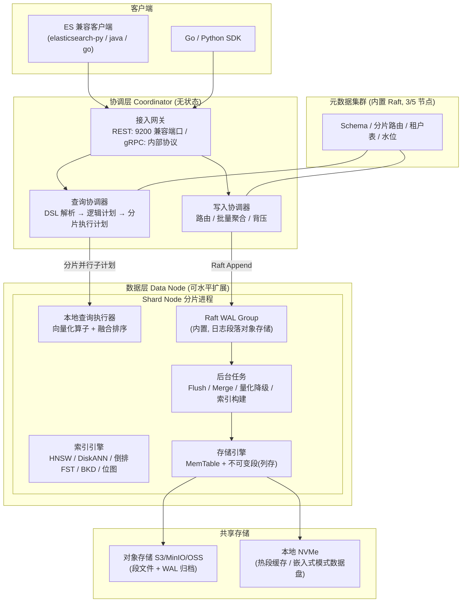

# UniSearch 设计文档 —— 融合型统一检索数据库（全文 + 关键词 + 向量）

> 版本：v0.1（草案）
> 日期：2026-10-17
> 状态：设计评审中
> 暂定名：UniSearch（统一混合检索引擎）

---

## 1. 概述

### 1.1 背景

AI 应用（RAG、语义搜索、推荐、Agent 记忆）对检索基础设施提出了「**一次查询，同时命中语义与关键词**」的需求。当前没有一款开源系统能同时做到：

- 向量检索达到 Milvus 级别的规模与性能；
- 全文/关键词检索达到 Elasticsearch 级别的 DSL 表达力与生态兼容性；
- 部署与运维像 ClickHouse 一样轻（单二进制、单容器起步）；
- 多租户与混合检索像 Weaviate 一样原生。

团队通常被迫同时维护「ES + 向量库」两套系统，或接受 ES 向量能力的性能/成本缺陷。UniSearch 的目标是用一个系统解决这一问题。

### 1.2 一句话定位

**单二进制、存算分离、以 ES DSL 为查询接口的实时混合检索数据库：列存 + 不可变段 + 内置 Raft WAL + 多引擎统一索引。**

### 1.3 核心卖点（Design Pillars）

| # | 卖点 | 来源借鉴 |
|---|------|----------|
| 1 | 完整兼容 ES Query DSL / Aggregations / REST API，存量应用零改造迁移 | Elasticsearch |
| 2 | 全文（BM25）+ 稀疏向量 + 稠密向量 + 标量过滤的统一混合检索，服务端融合 | Weaviate、Milvus 2.5 |
| 3 | 列存 + 向量化执行，聚合分析性能比肩 ClickHouse | ClickHouse |
| 4 | 十亿级向量、分布式可水平扩展 | Milvus |
| 5 | 单二进制/单容器起步，零外部依赖（无 etcd / Kafka / Pulsar / ZooKeeper） | Milvus Woodpecker 的教训 |
| 6 | 原生多租户，租户级物理隔离 | Weaviate |

---

## 2. 竞品调研

### 2.1 四款系统架构概览

| 维度 | Milvus | Elasticsearch | Weaviate | ClickHouse |
|------|--------|---------------|----------|------------|
| 主语言 | Go / C++ | Java（Lucene 核心为 Java） | Go | C++ |
| 存储模型 | 段式（Growing + Sealed Segment），列存 binlog | Lucene 段式（倒排 + doc values + BKD + HNSW） | 对象存储 + 段式，行式为主 | MergeTree 列存 part，不可变 |
| 向量索引 | HNSW / IVF / DiskANN / GPU CAGRA | Lucene HNSW（每 segment 一棵图）+ quantized IVF | HNSW / flat / 动态索引 | 实验性向量相似度索引（HNSW / IVF / RaBitQ 量化） |
| 全文检索 | 2.5+ 内置 BM25（tantivy 引擎） | 业界标杆（Lucene 倒排 + BM25 + 分析器全家桶） | 内置 BM25 + 模块化 tokenization | 弱（hasToken 等函数级支持） |
| 混合检索 | 2.5+ RRW/RRF 加权 | RRF / linear retrieval（8.14+） | 原生 hybrid：BM25F + 向量，relativeScoreFusion / weightedRanker / RRF | 手工 SQL 融合 |
| 实时性 | 流式管道，秒级可见 | 近实时（refresh 1s） | 段落盘后可见，内存 pending | 秒级，依赖 part merge |
| 分布式 | Proxy + QueryNode + DataNode + StreamingNode + etcd + 对象存储 | 主分片/副本分片，master 选举，Zen2/ATS | 单集群 Raft（有限规模），企业版分布式 | ZooKeeper/ClickHouse Keeper，分片复制 |
| 多租户 | Partition / Database 级，较弱 | 索引别名/权限模拟，非原生 | 原生 multi-tenancy（租户即分片组） | 弱（库/表权限模拟） |
| 外部依赖 | 2.5-：etcd + Pulsar/Kafka + MinIO；2.6+ Woodpecker WAL、内置元数据趋势 | 自包含 | 自包含 | Keeper（自带，可外置） |

### 2.2 优秀功能提炼（要继承的）

| 来源 | 优秀功能 | 在 UniSearch 中的落点 |
|------|----------|----------------------|
| Milvus | 段式不可变存储 + 存算分离；多级向量索引（HNSW/IVF/DiskANN/GPU）；Milvus Lite 嵌入式形态 | 存储层段模型；索引插件化；嵌入式单机模式 |
| Milvus 2.6 | Woodpecker：对象存储上的零磁盘 WAL，去掉 Kafka/Pulsar | 内置 Raft+WAL，日志段直接落对象存储 |
| Elasticsearch | Query DSL 的表达力（bool 组合、aggregations、rescore、search_after、PIT）；_bulk 协议；analysis 分析器生态；ILM 生命周期 | 兼容层 1:1 实现；统一复用；生命周期管理模块 |
| Elasticsearch | BKD 标量索引、doc values 列存、_source 列存压缩 | 标量子系统直接采用同构设计 |
| Weaviate | 原生 hybrid 检索（关键词+向量单次查询、服务端融合）；多租户物理隔离；模块化（向量化器可插拔） | 查询引擎一级能力；租户模型；embedding 模块接口 |
| ClickHouse | 列存 + 向量化执行 + MergeTree part 模型；min-max/zone map 跳数索引；极致聚合吞吐 | 列存段格式与执行引擎基础 |

### 2.3 痛点剖析（要解决的）

#### 2.3.1 Milvus

| 痛点 | 事实依据 | 严重度 |
|------|----------|--------|
| 部署组件多、外部依赖重 | 2.5 及以前需要 etcd + Pulsar/Kafka + MinIO 三类外部件；2.6 才引入 Woodpecker 收敛 | 高 |
| 流水线复杂，实时段（Growing Segment）链路长 | WAL → 流式节点 → 增长段 → 刷盘密封段，故障恢复路径复杂 | 高 |
| 查询扇出模式瓶颈 | broadcast-collect 模式，汇聚节点随 worker 数增长成为瓶颈；写放大实测可达 2.8× [P2，社区基准] | 中 |
| 全文/聚合能力弱于 ES/CH | BM25 2.5 才引入；无聚合分析体系 | 中 |
| 多租户隔离弱 | 仅 partition 级软隔离，租户间共享资源 | 中 |

#### 2.3.2 Elasticsearch

| 痛点 | 事实依据 | 严重度 |
|------|----------|--------|
| 每 segment 一棵 HNSW 图，搜索需遍历所有段 | 官方文档：kNN 必须扫描每个 segment，段数直接影响性能 | 高 |
| 后台 merge 重建 HNSW 图，CPU 争抢 | 官方博客：vectordb 模式下 merge 不限流并行执行，索引耗时上升 9%~26% | 高 |
| 内存随数据集线性增长 | 官方设计说明：HNSW 随机访问多，数据集需常驻 page cache，RAM 需按向量规模规划 | 高 |
| JVM GC 与调优负担 | Java 技术栈，大堆 GC、堆外内存管理复杂 | 中 |
| refresh 延迟与近实时语义 | 写入后默认 1s 可见，实时点查需 get API 绕行 | 中 |
| 向量化/聚合性能弱于 ClickHouse | 行存 _source + doc values 双份存储，聚合需解压 | 中 |

#### 2.3.3 ClickHouse

| 痛点 | 事实依据 | 严重度 |
|------|----------|--------|
| 更新/删除代价极高 | mutation 异步重写整个 part；官方最佳实践文档明确建议避免 mutation | 高 |
| 向量索引生产可用性不足 | 官方文档标注构建成本高、内存占用大、高选择性 WHERE 过滤受限；量化 codec 建后不可 ALTER | 高 |
| 无原生全文检索与 BM25 打分 | 仅 token 函数级支持，无分析器、无相关度模型 | 高 |
| 实时性受 merge 制约 | 数据可见依赖 part 合并，高频小批量写会产生大量小 part | 中 |

#### 2.3.4 Weaviate

| 痛点 | 事实依据 | 严重度 |
|------|----------|--------|
| 集群规模上限 | 单集群 Raft 元数据，写入吞吐随节点扩展受限（社区共识，企业版补齐） | 高 |
| 写入吞吐与段管理 | 大批量导入期间段数量多、合并策略简单 | 中 |
| 生态兼容性 | 自有 GraphQL/REST API，ES 存量用户迁移成本高 | 中 |

### 2.4 痛点 → 设计对策映射

| 痛点 | 对策 | 详见章节 |
|------|------|----------|
| ES：段多图多、merge 重建图 | 全局统一图 + 增量邻接交换（Cross-Link Merge） | §6.1 |
| ES：RAM 随数据线性增长 | 分级索引：热 HNSW 内存 / 温 RaBitQ 量化 / 冷 DiskANN 磁盘，按段生命周期自动降级 | §6.1 |
| CH：mutation 重写 part | 主键索引 + 删除位图（delete bitmap），合并时物理清除 | §5.4 |
| Milvus：外部依赖多 | 全内置：Raft WAL + 内置元数据，单二进制 | §5.2 / §9.1 |
| Milvus：broadcast-collect 汇聚瓶颈 | 两阶段执行：分片级预聚合 + 协调器归并（MPP 风格） | §7.1 |
| Weaviate：集群规模受限 | 元数据仅存路由与 schema（数据不进元数据存储），Raft 组可分片 | §9.1 |
| 各家：实时性与一致性折衷 | Raft WAL 强一致 + 可见性水位（MVCC 快照读） | §5.2 |

---

## 3. 设计目标与非目标

### 3.1 目标

**G1 — 查询能力**
- 100% 覆盖 ES Query DSL 常用子集（详见 §8.3 兼容矩阵），agg 覆盖 bucket + metric + pipeline 主流类型；
- 原生混合检索：一次请求同时包含 BM25 关键词、稀疏向量、稠密向量、标量过滤，服务端融合排序（RRF / weighted / relative score）。

**G2 — 性能与规模**
- 单分片 5000 万 768 维向量，P99 < 50ms（HNSW，ef=64，无过滤）；
- 集群水平扩展至 10 亿级向量；
- 聚合吞吐对齐 ClickHouse 同硬件的 50% 以上（列存向量化执行）；
- 写入可见性 P99 < 200ms（强一致模式）。

**G3 — 运维与部署**
- 单二进制（Rust 静态编译）/ 单容器起步；
- 零外部依赖：元数据、WAL、对象存储客户端全部内建，兼容 S3/MinIO/OSS；
- 存算分离可选项：本地盘模式（嵌入式）与对象存储模式（云原生）共用一套代码。

**G4 — 兼容与生态**
- ES REST API 兼容层（_search、_bulk、_mapping、_cat 等），支持主流客户端（Java/Python/Go/Node ES client）直连；
- 官方 Go / Python SDK，gRPC 内部协议。

### 3.2 非目标（v1 阶段）

- 不做 ES 的 X-Pack 商业功能（安全 RBAC 只做基础多租户隔离、无 SIEM/ML job）；
- 不做跨集群复制 CCR、快照到多目标仓库；
- 不做通用 OLTP 事务（无跨行事务、无二级唯一约束回滚语义）；
- 不追求 Lucene 分析器 100% 等价（支持 20 个主流分析器 + 自定义词典，极小语种分析器后置）。

---

## 4. 总体架构

### 4.1 架构图



### 4.2 核心组件职责

| 组件 | 职责 | 实例形态 |
|------|------|----------|
| Gateway | 协议终结：ES 兼容 REST（9200）+ 原生 gRPC；鉴权、限流 | 无状态，可 LB |
| Query Coordinator | DSL 解析 → 逻辑计划 → 物理计划 → 分发到相关分片副本 → 两阶段归并 | 无状态 |
| Ingest Coordinator | _bulk 路由、按分片攒批、写入背压、幂等去重 | 无状态 |
| Shard Node | 一组分片的宿主进程；承载存储引擎 + 索引引擎 + 本地执行器 + Raft WAL 组 | 有状态 |
| Metadata Cluster | 内置 Raft（3/5 节点）：schema、路由表、租户、可见性水位、节点成员 | 有状态，轻负载 |
| Background Worker | flush、段合并、量化降级、索引构建、TTL/ILM 执行 | 寄生于 Shard Node |

**部署形态**：
- **嵌入式**：单进程 = 网关 + 元数据（单点 Raft）+ 全部分片，数据落本地盘（对标 Milvus Lite / ClickHouse 单机）；
- **云原生**：协调层与数据层分离部署，元数据 3/5 节点，数据层按分片组扩缩，段与 WAL 归档落对象存储。

---

## 5. 存储引擎设计

### 5.1 数据模型

```
Cluster
 └─ Tenant（租户，物理隔离单元）
     └─ Index（对标 ES index；含 mapping 与 settings）
         └─ Shard（哈希分片，默认 2 片，可动态分裂）
             └─ Replica Group（Raft，1 leader + 2 follower）
                 └─ Segment（不可变列存段）
                     ├─ 列存数据（各列独立编码压缩）
                     ├─ 倒排索引（FST + BM25 统计）
                     ├─ 向量索引（HNSW 图 / DiskANN 码本）
                     ├─ 标量索引（BKD / zone map / 位图 / 布隆）
                     └─ Delete Bitmap（删除位图）
```

- **文档模型**：与 ES 一致的 JSON 文档（`_id`、`_source`、动态/显式 mapping），字段类型覆盖 keyword、text、long/double、date、boolean、ip、geo_point、dense_vector、sparse_vector、nested（v1 扁平化展开）。
- **`_source` 单列存储**：zstd 压缩，不参与检索（对标 ES 但避免双份开销——检索只走列存与索引）。
- **动态 mapping**：写入时自动推断类型；mapping 冲突默认拒绝写入，可用 `dynamic: false` 关闭。

### 5.2 写入路径（解决 Milvus 流水线复杂 + CH 无实时更新）

```
Ingest Coordinator
   │  按路由键攒批（分片内 batch）
   ▼
Shard Raft Group（内置 WAL）
   │  1. Raft AppendEntries（follower 并行持久化）
   │  2. Leader 提交 → 分配连续 seq_no（MVCC 版本）
   ▼
MemTable（按列组织 + 行存副本）
   │  3. 写入即入 MemTable，可见性水位推进
   │     → 立即可被同分片查询读到（强一致）
   ▼
Flush（异步，默认 512MB 或 30s 触发）
   │  4. MemTable + 冻结的删除位图 → 生成不可变 Segment
   ▼
Segment 落盘（本地 NVMe 直写 / 异步上载对象存储）
```

关键决策：
- **WAL 即 Raft 日志，无独立 MQ**。日志段文件直接写对象存储（借鉴 Woodpecker 零磁盘设计），follower 从对象存储补拉日志追赶，避免双写放大；
- **可见性水位（visibility watermark）**：查询默认读到「已提交的最新水位」，支持 `?consistency=eventual` 放宽到 follower 秒级数据换取读吞吐；
- **幂等写入**：`_bulk` 请求携带 client_id + sequence，重试去重，避免 ES 无去重导致的重复文档问题（`_id` 外的显式去重能力）。

### 5.3 段格式（列存，借鉴 ClickHouse + Lucene）

每个 Segment 是一个自包含目录，schema 与 Index mapping 绑定：

| 区域 | 内容 | 编码 |
|------|------|------|
| `col.*.bin` | 各标量列数据 | 字典编码 / zstd / delta / gorilla（浮点） |
| `vec.*.bin` | 向量列 | float32 原始（热）/ RaBitQ 或 scalar-quantized int8（温/冷） |
| `source.zst` | `_source` | zstd-19 |
| `inv.term.fst` | 倒排词典 | FST（Finite State Transducer） |
| `inv.post.*` | 倒排 posting lists | Roaring Bitmap + FOR 压缩，含 per-doc term frequency 与 field length（BM25 打分所需统计） |
| `vec.graph` | 向量近邻图 | HNSW 图结构（邻接表 CSR 布局） |
| `scalar.bkd` | 数值/日期/geo | BKD 树 |
| `meta.footer` | 段级统计：行数、各列 min/max、null 计数、TTL | Footer 元数据（读一次驻内存） |

Zone map（min/max per block）默认开启，等值/范围过滤可直接跳过数据块——这是 ClickHouse 聚合快的基础，也是标量过滤下推的前提。

### 5.4 删除与更新（解决 ClickHouse mutation 痛点）

这是与 ClickHouse 最大的架构分歧：**写入放大 O(1)，而非 O(part)**。

```
UPDATE/DELETE 语义实现：
1. DELETE ... WHERE cond
   → 生成「删除任务」：命中行记录 (segment_id, row_id) 写入全局 Delete Bitmap
   → 查询时算子过滤位图命中的行（向量化判断，代价极低）
   → 删除立即生效（查询侧），无异步窗口

2. UPDATE = DELETE + INSERT（同一 seq_no 原子提交）
   → 新版本行进入 MemTable，旧版本位图标记

3. 后台 Merge 时物理清除位图命中的行，同时物理重建受影响列的索引
   → 查询路径只承担 O(bitmap) 判断，不做任何重写
```

- Delete Bitmap 采用 Roaring Bitmap，按段组织，常驻内存的部分仅是稀疏位图（实测万级删除/亿级行内存开销 < 10MB 量级，标 [设计估算]）；
- 提供与 ClickHouse `lightweight delete` 对齐的语义，但查询侧透明过滤对用户无感（CH 的 lightweight delete 需 `_row_exists` 参与过滤）。

### 5.5 存算分离与冷热分层

| 层级 | 介质 | 内容 | 触发 |
|------|------|------|------|
| 热 | 本地 NVMe + 内存 | 原始精度向量 + HNSW 图 | 新鲜段（< 24h） |
| 温 | 对象存储 + 本地缓存 | RaBitQ 1-bit/4-bit 量化向量 + 精简图 | 段龄 > 24h 或读写比 > 100:1 |
| 冷 | 仅对象存储 | DiskANN（PQ 码本 + 磁盘图），无本地缓存 | ILM 策略 / 段龄 > 7d |

降级过程是**段级后台任务**：生成量化副本 → 原子切换段元数据指针 → 释放内存图。查询跨层段时按段索引类型自适应执行，召回率差异通过 `k 过采样 + 精排回表` 补偿。

---

## 6. 索引引擎设计

### 6.1 向量索引（解决 ES 段多图多 + merge 重建痛点）

**问题回顾**：ES 每 segment 一棵 HNSW，查询遍历所有段图；merge 时在 merge 线程里重新构建大图（9%~26% 索引耗时上涨）。

**UniSearch 方案：分层段图 + Cross-Link Merge**

```
                ┌─────────────────────────────┐
                │  Global Routing Layer        │
                │  (段级入口: 顶点指针数组)      │
                └──────────┬──────────────────┘
        ┌──────────────────┼──────────────────┐
   ┌────▼────┐        ┌────▼────┐        ┌────▼────┐
   │ Seg A   │        │ Seg B   │        │ Seg C   │
   │ HNSW-L2 │◄──────►│ HNSW-L2 │◄──────►│ HNSW-L2 │  跨段顶层邻接
   │ (3天)    │        │ (1天)   │        │ (新段)   │  (Cross-Links)
   └─────────┘        └─────────┘        └─────────┘

查询：从路由层选最优入口段 → 段内图遍历 → 跨段链跳跃 → 全局 TopK 归并
```

- **跨段顶层邻接（Cross-Links）**：新段构建完成后，仅对顶层入口节点与相邻段的顶层节点做互连（每段 O(√N) 次距离计算），查询可在段间跳跃，大幅缓解「逐段扫描」；
- **增量合并（Cross-Link Merge）**：两段合并时**不重建全图**——以较大段图为主图，将小段节点按其层级逐层插入主图（HNSW 标准插入流程），复杂度 O(N_small × log N)，远低于全量构建；小段图保留为回滚快照，切换原子；
- **量化分层**（对标 Milvus 的 index 级参数，但自动化）：
  - `HNSW-SQ8`：默认，内存 1/4，召回 ≈ 98%@ef64 [设计目标值]；
  - `HNSW-RaBitQ`：1-bit 量化 + 精排回表，内存 1/32；
  - `DiskANN`：冷层， billion 级单分片上限场景；
  - `IVF-PQ`：可选，GPU 训练码本（v2）。
- **标量过滤 × 向量检索统一规划**：优化器按过滤选择率自动选择——
  - 选择率 < 10%：**pre-filter**（倒排/BKD 求交得候选集，在候选集上做图受限遍历，借鉴 Milvus bitmask + Weaviate filtered HNSW）；
  - 选择率 > 30%：**post-filter**（ANN 取 5×k，过滤后截断，不足自动扩 ef 重试）；
  - 中间态：**迭代 pre-filter**（WAND 剪枝 + 图遍历交替）。

### 6.2 全文与稀疏向量索引

| 能力 | 设计 |
|------|------|
| 倒排 | 段内 FST 词典 + Roaring posting lists；BM25（k1/b 可按字段调）+ 可选 BM25F 字段加权（对齐 Weaviate hybrid 的 BM25F 行为） |
| 分析器 | 内置：standard、simple、whitespace、ik（中英）、jieba、ngram、edge_ngram、path、email、kuromoji、lucene 各语言 minimal 共 20+；插件接口支持自定义 |
| 稀疏向量 | 原生 `sparse_vector` 类型，倒排存储；支持 BGE-M3 / SPLADE 输出直接写入，服务端与稠密向量联合融合 |
| 高亮 | posting list 偏移记录（Lucene 同构 offsets），`highlight` API 直接返回片段 |
| WAND/Block-Max WAND | 多词查询词项级剪枝，长尾查询加速 |

### 6.3 标量索引

- **BKD 树**：数值/日期/ip/geo_point（对标 Lucene BKD，含 geo 距离排序与 geo_shape v2）；
- **Zone Map**：块级 min/max，默认开启，零成本；
- **位图索引**：低基数 keyword 列（cardinality < 4096 自动启用）；
- **布隆过滤器**：高基数 keyword/uuid 等值查询可选开启；
- **主键索引**：`_id` 列存 + 稀疏哈希索引，支持 O(1) 点查与 update 定位。

### 6.4 索引插件化

所有索引实现统一 trait 接口（构建 / 加载 / 搜索 / 合并 / 量化降级 / 内存预算上报），以 Rust trait + 动态库插件（v2）形式注册，保证新算法（如 GPU CAGRA、SPANN）可以后接入而不动引擎主干。

---

## 7. 查询引擎设计

### 7.1 执行模型（解决 Milvus broadcast-collect 汇聚瓶颈）

两阶段 MPP 风格执行，避免单汇聚点：

```
Coordinator                          Shard Nodes (并行)
────────────                         ──────────────────
DSL → 逻辑计划
   → 物理计划(分片裁剪)
   → 拆发子计划 ──────────────────►  [S1] 局部执行:
                                         标量过滤 → 向量ANN/BM25 → 局部TopK
   ◄──── 分片级「预聚合/预排序」结果      [S2] 局部执行 + partial agg
归并排序 / 最终聚合
   → 返回
```

- 分片返回的是**局部 TopK + 归并所需的打分统计**（BM25 的 IDF 修正、聚合的 partial state），协调器只做 O(shards × k) 归并，无全量数据过汇聚点；
- BM25 跨分片相关性一致性问题（ES 经典痛点：IDF 按分片局部计算导致分数不可比）通过**全局词频统计表**（元数据集群维护、定期刷新）修正，提供 `bm25.global_stats=true` 开关；
- 算子向量化（SIMD）：过滤、距离计算、聚合全部批量列式执行（借鉴 ClickHouse）。

### 7.2 混合检索与融合排序

一次 `_search` 可同时携带多路检索，服务端融合：

```json
POST /my-index/_search
{
  "query": {
    "hybrid": {
      "queries": [
        { "match": { "content": "向量数据库 混合检索" } },
        { "sparse_vector": { "embedding": { "...": 0.83 } } },
        { "knn": { "field": "dense_vec", "query_vector": [0.1, ...], "k": 100, "num_candidates": 500 } }
      ],
      "filter": [
        { "term": { "tenant_tags": "cn" } },
        { "range": { "publish_date": { "gte": "2026-01-01" } } }
      ],
      "rank": { "method": "rrf", "rank_constant": 60, "window_size": 500 }
    }
  },
  "aggs": { "by_category": { "terms": { "field": "category" } } },
  "highlight": { "fields": { "content": {} } }
}
```

融合方法（`rank.method`）：

| 方法 | 说明 |
|------|------|
| `rrf` | Reciprocal Rank Fusion，免调参默认项 |
| `weighted` | 各路分数 min-max 归一后加权（对标 ES linear/weighted） |
| `relative_score` | Weaviate 式相对分数融合，以 BM25F 归一基线 |
| `rerank` | 融合 TopN 后送外部 reranker（HTTP 模型服务，v2 内置本地模型） |

`filter` 对所有路共享下推（§6.1 统一规划器决定 pre/post-filter 策略）。

### 7.3 聚合引擎

- **向量化聚合**：group by / terms / range / histogram / date_histogram / cardinality(HyperLogLog++) / percentiles(t-digest) / top_hits / nested agg 组合；
- **partial 状态分片并行**：分片内产出可序列化的中间状态（t-digest、HLL sketch、top 数组），协调器合并；
- **近似聚合开关**：`precision_threshold` 语义与 ES 一致。

---

## 8. Elasticsearch DSL 兼容层（核心章节）

### 8.1 兼容策略

1. **协议级兼容**：`http://host:9200` 直接替换 `elasticsearch` 主机名；兼容主流客户端库的版本探测（`GET /` 返回结构含 `version.number`，报告兼容版本 8.x）；
2. **语义优先，实现自研**：DSL 语法树 → UniSearch 逻辑计划，不内嵌 Lucene，行为以「语义等价 + 可量化差异清单」为承诺；
3. **兼容分级**：每个 API/DSL 特性标注 `✅ full` / `🟡 partial（附差异）` / `❌ unsupported（报 ES 风格错误）`，发布兼容性报告自动化测试（用 ES 官方 clients test 套件做金标准）。

### 8.2 REST API 兼容面

| API | 状态 | 说明 |
|-----|------|------|
| `GET /` `GET /_cluster/health` `GET /_cat/*` | ✅ full | _cat 支持主流索引：indices/health/shards/nodes/allocation |
| `PUT/GET/DELETE /{index}` `PUT /{index}/_mapping` `GET /{index}/_mapping` | ✅ full | mapping 语义子集见 §8.5 |
| `PUT /_index_template` `PUT /_component_template` `GET /_index_template/{name}` | ✅ full | 含 composable template 优先级与别名 |
| `POST/PUT /{index}/_doc/{id}` `GET /{index}/_doc/{id}` `DELETE` `PUT /{index}/_create/{id}` | ✅ full | 含 optimistic concurrency（if_seq_no/if_primary_term） |
| `POST /_bulk` `POST /{index}/_bulk` | ✅ full | NDJSON 协议、refresh/wait_for/refresh=false 语义一致 |
| `POST /{index}/_search` `GET /{index}/_search` `POST /_search` | ✅ full（DSL 子集见 §8.3） | 分页 from/size、track_total_hits、min_score、terminate_after |
| `POST /{index}/_count` `POST /{index}/_explain/{id}` | ✅ full | |
| `POST /{index}/_msearch` | ✅ full | |
| `POST /{index}/_search?scroll=` `POST /_search/scroll` | 🟡 partial | 兼容接收并内部转换为 search_after + PIT 实现（见下），scroll_id 可用但建议迁移 |
| `POST /{index}/_pit` `POST /_pit/delete` + `search_after` | ✅ full | 深分页推荐路径，MVCC 快照一致性 |
| `POST /{index}/_delete_by_query` `POST /{index}/_update_by_query` | ✅ full | 底层映射为 §5.4 删除/更新机制 |
| `POST /{index}/_update/{id}`（scripted upsert、painless script） | 🟡 partial | script 仅支持 painless 常用子集（算术/字符串/字段访问），无 Java 类加载 |
| `POST /{index}/_refresh` `POST /{index}/_flush` `POST /{index}/_forcemerge` | ✅ full | _forcemerge 映射为段合并任务 |
| `PUT /{index}/_settings` `GET /{index}/_settings` | 🟡 partial | 常用 settings（number_of_shards/replicas、refresh_interval、analysis）支持 |
| `PUT /{index}/_alias` `POST /_aliases`（原子切换） | ✅ full | 蓝绿发布惯用法 |
| `PUT /_ilm/policy` `PUT /{index}/_ilm` | 🟡 partial | 支持 rollover / delete / forcemerge / shrink 动作子集 |
| `POST /{index}/_analyze` | ✅ full | |
| `_reindex` | 🟡 partial | 单集群内源-目标 |
| `_field_caps` | ✅ full | |
| `_mget` | ✅ full | |
| `_terms_enum` | ✅ full | |
| `_knn_search`（deprecated 8.4 前接口） | ✅ full | 转译为 knn query |
| `_security` / `_xpack` / ML / watch / transform | ❌ | 明确报错，不做静默降级 |

### 8.3 Query DSL 兼容矩阵

**全文检索类**

| DSL | 状态 | 备注 |
|-----|------|------|
| `match`（operator/fuzziness/minimum_should_match/analyze） | ✅ full | fuzziness 走 Damerau-Levenshtein 自动补全词典 |
| `match_phrase` / `match_phrase_prefix` | ✅ full | 位置 posting（positional index） |
| `multi_match`（best_fields/most_fields/cross_fields/phrase/best_fields^boost） | ✅ full | cross_fields 用 per-term blended IDF |
| `match_bool_prefix` | ✅ full | |
| `intervals` | 🟡 partial | 常用规则（match/all_of/any_of）支持 |
| `combined_fields` | 🟡 partial | 转译为 cross_fields multi_match |
| `query_string` / `simple_query_string` | ✅ full | Lucene 语法解析（AND/OR/NOT/()/?/*/""/~） |
| `semantic`（8.15+ semantic_text 语义） | 🟡 partial | 映射到内置 embedding + knn，模型通过 inference 配置 |

**词项级**

| DSL | 状态 | 备注 |
|-----|------|------|
| `term` / `terms` / `terms_set` | ✅ full | |
| `range`（数值/日期/date math/相对时间 now-7d） | ✅ full | |
| `exists` / `prefix` / `wildcard` / `regexp` / `fuzzy` / `ids` | ✅ full | wildcard/regexp 有长度与状态数上限保护 |
| `constant_score` / `boosting` / `dis_max` / `function_score` | ✅ full | function_score 支持 field_value_factor / random_score / weight / decay（gauss/lin/exp） |
| `script_score` | 🟡 partial | painless 子集 + 内置函数（cosineSimilarity 等向量函数一等支持） |

**全文+向量组合（本系统核心增强）**

| DSL | 状态 | 备注 |
|-----|------|------|
| `bool`（must/should/filter/must_not，嵌套，boost，min_should） | ✅ full | 本系统的基石：任意嵌套组合 |
| `knn` 顶层子句（8.12+ 语法：knn in search body，k/num_candidates/filter/similarity/boost） | ✅ full | filter 与 bool 共享下推规划 |
| `knn` as query（8.14+ knn query 子句） | ✅ full | |
| `dense_vector` mapping（dims/element_type float|byte|bfloat16/index/index_options） | ✅ full | similarity: cosine/dot_product/l2_norm/max_inner_product |
| `sparse_vector` mapping + query | ✅ full | 原生类型（ES 为废弃 warning 的实验态，本系统为一等公民） |
| `hybrid`（本系统新增） | ✅ 独有 | 见 §7.2 |
| `percolate` | 🟡 partial | 反向检索按「查询即文档」实现 |
| `rank_feature` / `rank_features` | 🟡 partial | saturation/log/ sigmoid 函数子集 |
| `distance_feature` | ✅ full | |
| `more_like_this` | ✅ full | |
| `pinned` / `wrapper` | ✅ full | |
| `geo_shape` 查询 | ❌ v1 / v2 规划 | geo_point ✅，geo_shape 延后 |

**Suggester 与其他**

| DSL | 状态 | 备注 |
|-----|------|------|
| `term suggester` / `phrase suggester` | ✅ full | |
| `completion suggester` | ✅ full | FST 前缀索引实现（与 Lucene 同构） |
| `highlight`（unified/plain/fvh 参数子集） | ✅ full | unified 为主 |
| `collapse`（field collapse） | ✅ full | 组内 top_hits |
| `rescore`（query rescore + window） | ✅ full | rescore 可用 knn/rerank |
| `search_after` / `sort`（_doc/_score/field/geo_distance/script based） | ✅ full | |
| `runtime_mappings` | 🟡 partial | 常用表达式子集，无法动态编译 Groovy/Painless 全语法 |
| `script_fields` | 🟡 partial | 同上 |
| `collapse`+`inner_hits` | ✅ full | |
| `profile` API | ✅ full | 输出 UniSearch 执行计划（字段语义对齐 ES profile 结构） |

### 8.4 Aggregations 兼容矩阵

| 类别 | ✅ full | 🟡 partial | ❌ v1 |
|------|---------|------------|-------|
| Bucket | terms, range, date_range, filter, filters, missing, nested, histogram, date_histogram, auto_date_histogram, significant_terms, sampler, global, composite, adjacency_matrix, multi_terms, rare_terms, ip_range, geo_distance, histogram(geo) | diversified_sampler, geohash_grid(→ geo_histogram) | parent/child(join 类) |
| Metric | min, max, sum, avg, stats, extended_stats, value_count, cardinality, percentiles, percentile_ranks, top_hits, weighted_avg, median_absolute_deviation, geo_centroid, geo_bounds, boxplot, string_stats | scripted_metric(painless 子集) | — |
| Pipeline | bucket_sort, bucket_selector, bucket_script, derivative, cumulative_sum, moving_avg/movfn, avg_bucket, max_bucket, sum_bucket, stats_bucket, serial_diff, normalize | extended_stats_bucket | — |

### 8.5 Mapping / Settings 语义映射

| ES 概念 | UniSearch 实现 | 差异 |
|---------|----------------|------|
| `text` + analyzer | text 类型 + 段内倒排 | 分析器语义差异清单化发布（ik/jieba 版本锁定） |
| `keyword` | keyword（列存字典 + 位图/布隆可选） | 无 norms |
| `doc_values` | 默认列存即 doc values | 恒开启，`doc_values: false` 忽略并告警 |
| `_source` | zstd 列存 | 默认开启；`_source: false` 支持但 top_hits/highlight 不可用 |
| `dynamic` / `dynamic_templates` | ✅ 同语义 | |
| `nested` | v1 扁平化（parent__child__ 内部列 + 段内 join 位图），语义对齐 | 深度 > 5 性能递减 |
| `object` | 同 ES | |
| `copy_to` / `multi-fields`（fields） | ✅ full | |
| `coerce/similarity/null_value/ignore_above` | ✅ full | |
| `_id` 自动生成 / 路由 `routing` | ✅ full | |
| Shard 数量语义 | number_of_shards 为**逻辑分片数**，路由算法兼容（hash(_routing) % n），但支持在线分裂（ES 需 split API + 新索引） | 扩容体验优于 ES |

### 8.6 不兼容项处理原则

1. 静默吞掉不支持参数是反模式：返回 `400` + ES 风格错误体（`error.reason` 含 `unsupported_capability` 指南字段），让上层应用显式感知；
2. 提供迁移评估工具 `uniadm es-compat --index-pattern logs-*`：扫描存量 mapping/query 日志，输出兼容性报告；
3. 版本承诺：兼容矩阵随版本发布，语义变更走 RFC 流程，大版本前不回退兼容级别。

---

## 9. 分布式架构

### 9.1 元数据集群（解决 Milvus 依赖 etcd + Weaviate 规模上限）

- 内置 Raft 组（3/5 节点），仅存储**小状态**：schema、路由表、租户映射、可见性水位、成员列表；
- **数据永不进元数据存储**（Weaviate 的教训与 Milvus etcd 的共同约束），单 Raft 组可支撑万级索引路由表（单条路由 < 1KB）；
- 超大规模（路由表 > 内存阈值）时自动切分多 Raft 组，按 index namespace 分片——元数据自身可水平扩展；
- 嵌入式模式退化为单节点 Raft（快照恢复），升级云原生模式时自动三副本化。

### 9.2 分片与副本

- **路由**：`shard = hash(routing or _id) % logical_shards`；逻辑分片可在线一分为二（段文件共享，无需重写——区别于 ES split 的 reindex 语义）；
- **副本一致性**：每分片一个 Raft 组，写入 quorum 提交；读默认 leader，`preference=_replica` 读 follower（最终一致 + 最低延迟）；
- **故障恢复**：WAL 段在对象存储 → 新 leader 秒级接管（回放日志段），follower 增量补拉；单分片恢复 RTO < 30s [设计目标]；
- **再均衡**：后台调度器按分片磁盘/内存/QPS 水位迁移副本，迁移 = 拉快照 + 增量日志同步 + 原子切换。

### 9.3 多租户（借鉴 Weaviate）

- 租户 = 路由表的一级实体，**每个租户的分片独立放置**（物理隔离），支持三种模式：
  - `dedicated`：独占 Shard Node（大客户/合规）；
  - `shared-shard`：分片混部 + 资源组限额（CPU/内存/IO cgroup + 查询并发预算）；
  - `cold`：租户级暂停（段下线，元数据保留，秒级唤醒）；
- 计费与配额以租户为粒度：存储字节、向量条数、QPS、写入 TPS 四维配额。

### 9.4 弹性

- 数据层节点无状态可横向加入（接分片副本）；
- 逻辑分片在线分裂：父分片段文件 dual-read → 子分片接管路由 → 父分片下线，全程查询无感知（路由表原子双版本）。

---

## 10. 关键 API 示例（ES 兼容）

**示例 1：存量 ES 用户——标准全文检索（零改造）**

```json
POST /products/_search
{
  "query": {
    "bool": {
      "must": [{ "match": { "title": "无线降噪耳机" } }],
      "filter": [
        { "term": { "brand": "sony" } },
        { "range": { "price": { "gte": 500, "lte": 3000 } } }
      ]
    }
  },
  "aggs": { "avg_price": { "avg": { "field": "price" } } },
  "sort": [{ "_score": "desc" }, { "sales": "desc" }]
}
```

**示例 2：混合检索（RAG 典型）——同一接口加一路向量**

```json
POST /docs/_search
{
  "query": {
    "hybrid": {
      "queries": [
        { "match": { "content": "分布式事务 一致性协议" } },
        { "knn": { "field": "emb", "query_vector": [/* 1024-dim */], "k": 50, "num_candidates": 200 } }
      ],
      "filter": [{ "term": { "project_id": "p-42" } }],
      "rank": { "method": "rrf" }
    }
  },
  "highlight": { "fields": { "content": {} } }
}
```

**示例 3：_bulk 写入（ES 客户端直连）**

```json
POST /_bulk
{ "index": { "_index": "docs", "_id": "1" } }
{ "title": " raft consensus", "emb": [0.1, ...] }
{ "create": { "_index": "docs", "_id": "2" } }
{ "title": "segment merge", "emb": [0.2, ...] }
```

**示例 4：Go 官方 SDK（原生协议，类型安全）**

```go
client := unisearch.New(unisearch.WithEndpoint("http://127.0.0.1:9200"))

res, err := client.Search(ctx).
    Index("docs").
    Hybrid(hybrid.New().
        Match("content", "向量数据库 混合检索").
        Knn("emb", queryVec, hybrid.WithK(50)).
        Rank(hybrid.RRF())).
    Filter(term("project_id", "p-42")).
    Do(ctx)
```

---

## 11. 性能与资源目标

| 指标 | 目标值 | 备注 |
|------|--------|------|
| 写入吞吐（单分片，768d 向量 + 2KB 文档） | ≥ 20k docs/s | 16C64G，强一致模式 [设计目标] |
| 向量检索 P99（5000 万段内，无过滤） | < 50ms | HNSW-SQ8, ef=64, k=10 |
| 过滤向量检索 P99（选择率 5%） | < 80ms | pre-filter 路径 |
| BM25 检索 P99（1 亿文档） | < 80ms | WAND 剪枝 |
| 混合三路融合 P99 | < 120ms | rrf, window=500 |
| 写入可见性 P99 | < 200ms | 强一致 |
| _bulk 1TB 冷启动导入 | < 2h | 顺序化段构建 + 并行量化 |
| 聚合吞吐 | ≥ CH 的 50% | terms agg, 10 亿行 |
| 内存效率 | 向量索引内存 ≤ 3.5GB / 千万 768d | SQ8：768B×4 压缩 ≈ 3GB + 图 [设计估算] |
| ES 兼容测试通过率 | ≥ 95% 主流 client test suite | 发布门禁 |

> 以上均为 v1 验收目标（标注 [设计目标] 的项未经实测），正式性能报告以 `uni-bench` 套件 + ann-benchmarks 复测为准。

---

## 12. 技术选型

| 层 | 选型 | 理由 |
|----|------|------|
| 核心引擎 | **Rust** | 无 GC 的确定性延迟（对比 ES JVM）；SIMD/内存布局控制（对标 CH C++）；单二进制静态发布；tokio 生态成熟 |
| 查询 DSL 解析 | Rust 手写递归下降 + serde_json | DSL 需要精细错误信息与能力标注 |
| 倒排/词典 | 参考 tantivy（Apache 2.0）组件级复用 | 成熟的 FST + BM25 + positional posting 实现 |
| 向量索引 | 自研 HNSW/量化 + 可选 DiskANN 绑定 | Cross-Link Merge 需要图结构可控，闭源/黑盒索引无法支持增量合并 |
| Raft | openraft | 生产验证、可插拔存储 |
| 内部协议 | gRPC（数据面）、自研轻量协议 Raft 日志（WAL） | gRPC 流式传输聚合 partial state |
| SDK | Go / Python（Rust FFI 或 gRPC 双通道） | 用户主栈 Go，SDK 一等公民 |
| 观测 | OpenTelemetry + Prometheus 指标兼容 `_prometheus/metrics` | 对齐 ES 监控习惯 |

---

## 13. 演进路线图

| 阶段 | 范围 | 里程碑 |
|------|------|--------|
| **M0 嵌入式 MVP**（3 个月） | 单机存储引擎 + HNSW-SQ8 + 倒排 BM25 + bool/term/range/match/knn/hybrid + _bulk/_search/_doc | 单容器跑通 RAG demo；1 亿文档基准报告 |
| **M1 ES 兼容 GA**（+3 个月） | DSL 兼容矩阵 80% full（agg 全量、search_after/PIT、highlight、suggester、msearch、index template、alias、ILM 子集）；多租户 shared-shard | elasticsearch-py / go-elasticsearch 客户端测试套件通过率 ≥ 90% |
| **M2 云原生 GA**（+4 个月） | 内置 Raft 元数据集群 + 存算分离（对象存储）+ 分片在线分裂 + 跨段 Cross-Link 全量启用 + DiskANN 冷层 | 10 亿向量集群基准；故障演练报告（kill -9 混沌） |
| **M3 生态与进阶**（+6 个月） | GPU CAGRA 索引、内置 rerank 模型、geo_shape、percolate 完整化、索引插件 SDK、uniadm es-compat 迁移工具 | 首个 ES 存量用户整体迁移案例 |

---

## 14. 风险与开放问题

| 风险 | 影响 | 缓解 |
|------|------|------|
| ES DSL 兼容长尾深不见底 | 兼容成本超预期，GA 延期 | 兼容矩阵分级 + 客户端测试套件做金标准 + 明确报错策略（§8.6），拒绝静默兼容 |
| Cross-Link Merge 理论未经验证 | 合并后召回率下降 | M0 起在 ann-benchmarks 上持续验证；回滚快照机制保底 |
| Rust 人才储备 | 研发效率 | 核心引擎 Rust + 控制面/SDK 全 Go，团队主栈匹配 |
| 稀疏向量生态变化快（BGE-M3 → 后继模型） | 存储格式演进 | sparse_vector 设计为 KV 张量格式，与模型解耦 |
| BM25 全局统计的实时性 | 相关性分数漂移 | 统计表定期刷新 + 分片局部修正开关，`global_stats` 可关闭回退 |
| 对象存储 WAL 的延迟抖动 | 写入 P99 退化 | 本地 NVMe 双写日志段（可配），对象存储仅作归档副本 |

**开放问题（待评审决策）**
1. `nested` 类型 v1 扁平化方案在深度 5+ 的性能拐点需要 PoC 数据；
2. 分片在线分裂时 Delete Bitmap 的合并语义（父子段位图继承规则）待细化；
3. GPU 索引的资源隔离模型（独占卡 vs MIG 切分）放 M3 决策。

---

## 15. 参考资料

1. Milvus Blog — *We Replaced Kafka/Pulsar with Woodpecker for Milvus*（外部 MQ 依赖痛点与零磁盘 WAL 设计）
2. Milvus Blog — *Introducing Milvus 2.6: Affordable Vector Search at Billion Scale*
3. Elastic Docs — *Tune approximate kNN search*（segment 合并对 kNN 的影响、merge 线程参数）
4. Elastic Search Labs — *2x faster Elasticsearch vector search with one index setting*（vectordb_document 模式：merge 不限流与索引耗时上升 9%~26%）
5. Elastic Search Labs — *Vector search in Elasticsearch: design rationale*（HNSW 内存随数据集扩展的约束）
6. ClickHouse Docs — *Approximate nearest neighbor search indexes*（ANN 索引构建成本/内存/过滤限制）
7. ClickHouse Docs — *Avoid mutations*（mutation 重写 part 的代价）
8. Weaviate Docs — Multi-tenancy / Hybrid search（原生混合检索与租户模型）

---

*本文档为架构设计草案，标注 [设计目标] / [设计估算] / [P2 社区基准] 的数据未经复测，性能承诺以正式基准报告为准。*
